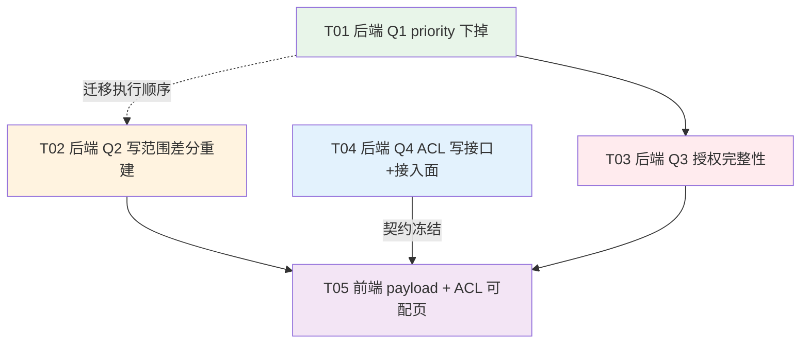
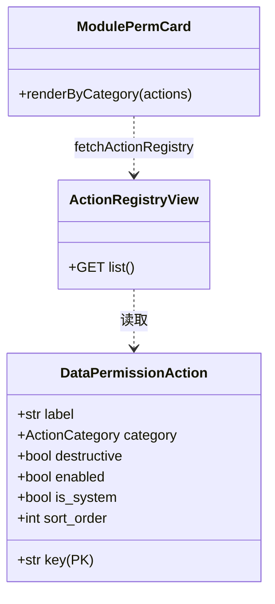
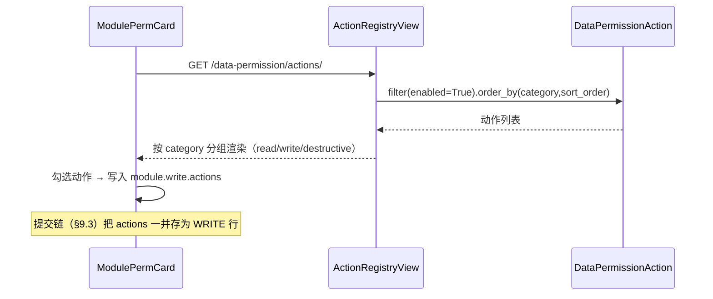
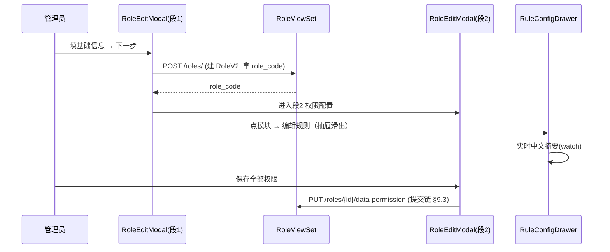
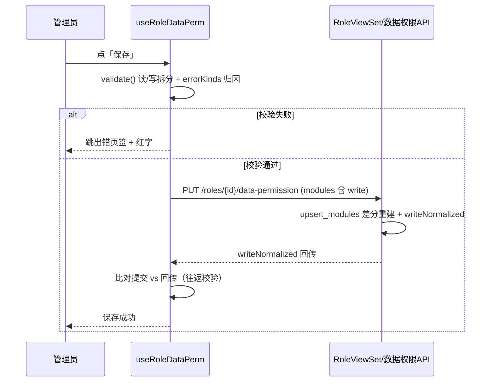
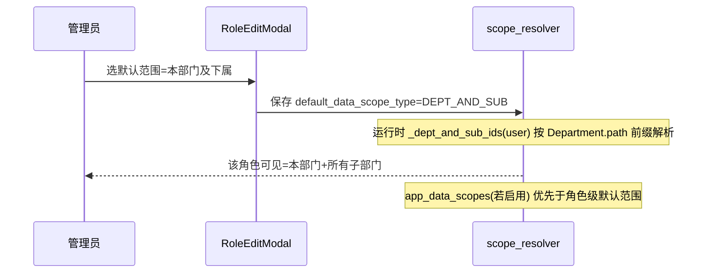
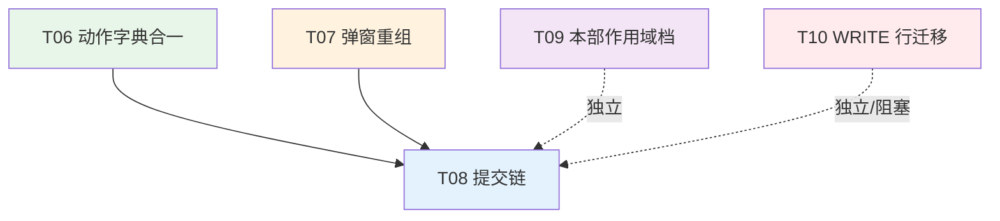

# 系统设计：数据权限 P0 止血

> 文档类型：系统设计（架构师交付件，供工程师实施）
> 版本：v1.3　　日期：2026-10-15　　代码基线：`main` @ `c0fa9c33`（P0 已收官 R1+R2）；本版新增 Batch 2/3（P1/P2）施工图（§9/§10）
> 上游依据：`docs/PRD_数据权限交互优化与指标模板接入.md`（31 条需求池）、`docs/方案_身份管理数据权限交互优化与指标模板接入.md`（现状调研）
> **范围：第一批 P0 止血（Q1 / Q2 / Q3 / Q4 / Q6，R1+R2 已落库）+ Batch 2/3（P1/P2）施工图（§9/§10）**。M 系列（指标模板接入）不在本文件，见方案 doc §5.3。
> 代码事实标注 `文件:行号`；本文档所有行号均已在本基线复核
> **v1.1 变更**：新增 §0.3 决策记录（Q-A / Q-B / Q-C 已由兵哥拍板）、§5.5 执行顺序与提交切分；据此微调 T03 验收设计（防假绿测试约束）
> **v1.2 变更**（工程师 R1 实施后回写）：修正 §1.2.2 写范围骨架示例 —— v1.1 把「缺 `write` 键」与「显式 `mode='none'`」混为一谈，与 D1 / §1.2.4 / §5.5.1 C2 三处冲突；**以三处一致口径定稿**并新增 `write: null` / `write: {}` 变体用例。同时补记 T01 / T02 的真库验证结果。
> **v1.3 变更**（resume 续写）：扩展 Batch 2（P1：动作字典合一 / 弹窗重组 / 提交链）与 Batch 3（P2：本部门作用域档 / 存量 WRITE 行迁移）施工图，新增决策 D6/D7/D8、任务 T06~T10、风险 RK-14~RK-18。P0 部分（v1.0~v1.2）**未改动**。Batch 2/3 多处标「待定/阻塞」，需用户拍板或原型补充（见 §13）。

---

## 0. 范围与结论摘要

### 0.1 本批次交付的 5 件事

| 编号 | 名称 | 端 | 一句话方案 |
|---|---|---|---|
| **Q1** | `DataPermissionRule.priority` 下掉 | BE+DB | 删字段 + 迁移，排序键换 `-created_at`（现所有值恒为 0，排序表现不变） |
| **Q2** | 写范围保存不再被抹除（PRD P0-1） | FE+BE | 前端 payload 补 `write`；后端改**兼容式强校验**（Q6），并把"先删后建"换成**按模块差分重建** |
| **Q3** | 授权数据完整性（PRD P0-3） | DB+BE | 孤儿数据清理迁移 + `user_roles.user_id` 改真 FK（`CASCADE`）；`role_permission.role_code` 因跨系统串设计**改用应用层校验**，不建 FK |
| **Q4** | 字段 ACL 可配 + 接入面补齐（PRD P0-2 / P0-4） | FE+BE | 补 ACL 写接口（当前 POST/DELETE 路由**根本不存在**）+ 独立页改可配矩阵 + `application` 等 6 处序列化器接入脱敏 |

> 编号沿用团队 lead 的任务书（Q1=priority 下掉 / Q2=P0-1 写范围 / Q3=P0-3 授权完整性 / Q4=P0-2+P0-4 字段 ACL）。

### 0.2 关键设计决策（工程师必须知道的 5 条"为什么"）

| # | 决策 | 理由 | 影响的 PRD 验收项 |
|---|---|---|---|
| D1 | 后端 `write` **无意图**（缺键 / `null` / `{}`）→ **保留原 WRITE 行不动** + 响应回 `writeNormalized` 标记；只有**显式** `mode='none'` 才删行 | Q6 拍板"兼容式强校验"。一刀切拒收会让存量角色（库内 11 条规则**无一条 WRITE**）连"只想改读范围"都存不了；而若把"无意图"当成"取消"，管理员配的操作权限**仍被静默抹除**，P0-1 根本没解决 | P0-1 ② 的"缺 write 时原规则不变"由**行数/快照断言**保证，不依赖报错 |
| D2 | `upsert_modules` 从"全删后建"改为**按模块差分（差集）重建**，WRITE 行纳入同一事务 | 全删重建是 P0-1 的根因载体；差分重建让"未提交的模块"物理上不可能被删 | P0-1 ①②③ |
| D3 | `user_roles.user_id` → `ForeignKey(User, CASCADE)`（类型已是 bigint，**可直接改**）；`role_permission.role_code` **不建 FK** | `role_code` 是跨系统业务串（`models_permission_v2.py:9,114` 明确注释"用 code 串替代 FK,以支持跨系统"），且 `RoleV2` 唯一约束是 `(system_code, role_code)` 复合键，`role_code` 单独不唯一 → **技术上无法建 FK** | P0-3 ①②③（②的"删角色清权限"用 `role_code` 生命周期钩子实现） |
| D4 | 字段 ACL 三态**统一用代码枚举 `NONE/MASK/READ`**，API 层**同时**返回 `permission`(代码枚举) 与 `action`(旧前端词汇) 双字段，前端只用前者 | 旧前端 `field-acl.ts:8` 用 `VIEW/MASK/HIDE`，后端 `field_acl/models.py:12-15` 用 `READ/MASK/NONE`，两套词汇并存是 P2-7 同款病灶。本批次前端切到代码枚举，旧字段保留一个版本做过渡 | P0-2 ①③ / P0-4 ② |
| D5 | ACL 写接口**新增独立路由**（`PUT /field-acl/rules` + `DELETE /field-acl/rules` 带 body 三元组定位），**不复用**被 `@action(url_path='rules')` 遮蔽的集合路由 | `field_acl/urls.py:8` 注册的 `DefaultRouter` 里 `@action(detail=False, url_path='rules', methods=['get'])`（`views.py:51`）**占用了 `/field-acl/rules` 这个 path**，导致 DRF 路由把 `POST /field-acl/rules` 判为 405、`DELETE /field-acl/rules/{id}` 无路由 → 前端两个函数"已实现但永远调不通" | P0-2 ① |

### 0.3 决策记录

> 本节记录**已拍板的决策**及其对设计的影响。决策人=项目负责人（兵哥），拍板时间=2026-10-14。
> 工程师**按本节执行**，不要重新评估这些已被否定的方案。

#### DR-01　`RoleV2` 是硬删 → 采纳 `post_delete` 信号方案（对应 Q-A）

| 项 | 内容 |
|---|---|
| **决策** | `RoleV2` 硬删除，角色删除钩子用 `post_delete` 信号实现（**不**改用 ViewSet `perform_destroy`） |
| **依据（已复核）** | `RoleV2(models.Model)`（`models_permission_v2.py:80`）**未继承 `SoftDeleteModel`** —— 对比 `SoftDeleteModel`（`apps/common/models.py:21-23`）带 `deleted_at` 字段，而 `RoleV2` 的字段清单（`:88-97`）中**无 `deleted_at`**、无 `soft_delete()` 方法；`RoleViewSet`（`views_permission_v2.py:81`）是原生 `ModelViewSet`，`destroy` 走默认 `instance.delete()` → **物理删除 → `post_delete` 正常触发** |
| **对设计的约束** | ⚠️ **必须显式防范"假绿"**（见下方红字框） |

> 🔴 **假绿风险与强制测试约束（兵哥点名要求）**
>
> 架构师在 v1.0 提出的"假绿"风险**完全成立**：`post_delete` 钩子只对**真实存在的授权行**有可观测效果。
>
> - ❌ **禁止**用「新建一个空角色 → 删除它 → 断言无变化」作为 P0-3 验收②「删角色清权限」的证据。
>   该场景下钩子删的是 0 行，断言恒真，**即使钩子完全没生效测试也会绿**。
> - ✅ **必须**先 seed 出**真实的**授权数据再删角色：
>   1. 建 `RoleV2(role_code='P0_3_TMP_ROLE', system_code='recruit')`
>   2. 建**至少 2 条** `RolePermissionV2(role_code='P0_3_TMP_ROLE', resource_code=...)`
>      —— 建 2 条是为覆盖 `RoleViewSet.destroy` 与 `clone_from_template` 两条删除路径
>  3. 建**至少 1 条** `UserRoleV2(role=存在的用户, role_code='P0_3_TMP_ROLE')`
>  4. `RoleV2.objects.filter(role_code='P0_3_TMP_ROLE').delete()`（或调 `DELETE /roles/{id}/`）
>  5. **断言**：`RolePermissionV2.objects.filter(role_code='P0_3_TMP_ROLE').count() == 0`
>     **且** `UserRoleV2.objects.filter(role_code='P0_3_TMP_ROLE').count() == 0`
>  6. 附加断言：删**之前**两个 count **均 > 0**（防"seed 失败→删 0 行→断言恒真"）
>
> 第 6 步是本约束的关键：**先证明有数据，再证明被清空**，两步缺一不可。

#### DR-02　`role_code` 不建 FK，改为应用层校验 + 删除钩子（对应 Q-B）

| 项 | 内容 |
|---|---|
| **决策** | `UserRoleV2.user_id` → 真 FK；`UserRoleV2.role_code` 与 `RolePermissionV2.role_code` **保持 CharField，不建 FK** |
| **依据（已复核）** | ①技术不可行：`RoleV2.Meta.constraints = [UniqueConstraint(fields=['system_code','role_code'], name='uk_system_role')]`（`models_permission_v2.py:110-113`），`role_code` **单列无唯一索引**，MySQL FK 要求目标列有唯一索引；②设计有意为之：`models_permission_v2.py:9`「UserRoleV2: V2 用户-角色关联(用 code 串替代 FK,**以支持跨系统**)」+ `:114`「使用 resource_code 字符串而非 FK(spec §3.2 跨系统复用)」+ `UserRoleV2` docstring「role_code 字符串(替代 FK,跨系统灵活)」（`:215`）—— **确认不改这个设计决策** |
| **替代方案（已采纳）** | ①`UserRoleV2.user_id` → `ForeignKey(User, CASCADE)`：实测 `bigint → bigint`（`base.py:321` `DEFAULT_AUTO_FIELD='BigAutoField'`），类型兼容无需数据搬迁；FK 的 attname 就是 `user_id` → 现有 40+ 处 `filter(user_id=...)` **零改动**<br>②`role_code` 侧用**应用层校验**（`UserRoleSerializer.validate`）+ `RoleV2` `post_delete` 钩子清理两表 |

**新增设计要求（兵哥补充，必须落实）**：应用层校验要有**明确的失败语义** —— 授权时若 `role_code` 在 `RoleV2` 中不存在，必须返回**明确的 400 错误**（如 `角色编码不存在`），**禁止**静默写脏数据。

> 理由：这正是本次 P0-3 要消灭的病灶形态（`user_roles` 84 条中 76 条指向不存在的用户、
> `role_permission` 存在孤儿角色 `test` 的 21 条关联，都是"静默写入成功"的结果）。
> **校验失败必须响亮失败**，否则只是把病灶从"已产生"变成"继续产生"。
>
> 实现口径见 §1.3.4②，错误消息文案见 §6.2。

#### DR-03　投递手机号改为按 ACL 裁决（对应 Q-C）

| 项 | 内容 |
|---|---|
| **决策** | 删除 `ApplicationListSerializer.get_candidate_phone` 的硬编码两档脱敏，脱敏职责**唯一收口**到 `FieldAclSerializerMixin` |
| **业务侧确认** | 「未来配 READ 就能看明文」正是 P0-2 的目标，业务侧接受 |
| **依据** | 硬编码逻辑只看 `is_super_admin`，**完全不受 ACL 规则影响** → 管理员在字段 ACL 页配的规则对该字段**无效**，这与 P0-2「可配」的承诺直接矛盾 |

> 🔴 **安全回归风险（兵哥点名要求，必须写进测试）**
>
> `FieldAclService.DEFAULT_SENSITIVE_FIELDS['application']` **当前是空列表 `[]`**
> （`field_acl/services.py:61`）。而 `_get_field_permission` 的逻辑是
> （`services.py:201-206`）：**无 ACL 规则时** → 字段在默认敏感清单里返回 `MASK`，
> **不在清单里则返回 `READ`（原值放行）**。
>
> 因此：**只删硬编码方法而不补默认清单 = 效果从"硬编码脱敏"退化为"完全不脱敏"**
> —— 这是**安全回归**，比原 bug 更严重。
>
> **强制约束**：
> 1. 删 `get_candidate_phone` 与补 `DEFAULT_SENSITIVE_FIELDS['application']`
>    **必须同一批次完成**，且这两处 diff 需在同一个 PR 里对照评审
> 2. 必须有验证用例证明「**默认配置下**（无任何 ACL 规则）投递手机号**仍是脱敏的**」
>    —— 见 §1.4.3 的 `test_application_list_phone_masked_by_default`
> 3. 该用例**必须在补清单之后、删硬编码之前先失败一次**（红→绿），证明它真的有鉴别力
>    （恒真断言即视为无效证据，参照 DR-01 的同类要求）

#### DR-04　其余已核实确认的三条事实（照设计执行，无需再评估）

| 编号 | 结论 | 影响 |
|---|---|---|
| DR-04a | P0-2 **必须先补后端路由**：`field_acl/views.py:51` 的 `url_path='rules'` + `methods=['get']` 占用 path → POST 405 / DELETE 404，已确认 | T04 排在 T05 之前；契约先冻结 |
| DR-04b | `priority` **必须同步从序列化器移除**：已确认在 `data_permission/serializers.py:22` 的 `fields` 里且**非 read_only** | S1 范围扩到序列化器 + 对应测试（§1.1④⑤） |
| DR-04c | ACL 缓存失效坑成立：`FieldAclService` 60s 缓存 + `invalidate_rules_cache(None)` 只清默认敏感字段 key | 写接口**必须**调 invalidate；修法见 §1.4.2⑤ |

---

## 1. 实现方案

### 1.1 Q1 — 下掉 `DataPermissionRule.priority`（S1）

#### 现状（已复核）

| 事实 | 证据 |
|---|---|
| 字段定义 | `data_permission/models.py:138` `priority = models.IntegerField(default=0, verbose_name='优先级(大者优先)')` |
| **唯一写入点硬编码 0** | `role_scope_api.py:284`、`role_scope_api.py:306` 两处 `priority=0` |
| 序列化器暴露给前端 | `data_permission/serializers.py:22` `'priority'` 在 `fields` 里 → **前端可 PATCH**（`tests/test_envelope.py:32,36` 就有 `PATCH {'priority': 5}` 的用例） |
| 唯一读取点 = 列表默认排序 | `data_permission/views.py:67-68` `ordering_fields = ['priority','created_at']` / `ordering = ['-priority','-created_at']` |
| `enforcement` 从不读取 | 全仓 grep `priority` 在 `data_permission/enforcement.py` **零命中** |

> ⚠️ **修正上游方案的一处措辞**：方案文档说"前端无输入控件"，但 `serializers.py:22` 把它放进了 `fields`，DRF `ModelViewSet` 会接受 `PATCH {"priority": 5}`。这是**接口层可写**，只是没有 UI 控件。结论不变（无用户真实配置），但 S1 必须**同时从序列化器移除该字段**，否则下掉模型字段后 `PATCH {"priority":5}` 会变成静默忽略（`Serializer` 忽略未知字段）或 500。

#### 改动

**① 模型** `apps/django/apps/data_permission/models.py`

```python
class DataPermissionRule(TimestampedModel):
    """统一数据权限规则。
    ...
    - 叠加语义: 读范围=并集 / 列权限=从严(most_restrictive) / 写动作=从严(未列出即拒绝)。
      2026-10-14 起本模型**不再有 priority 字段** —— 旧字段"大者优先"从未被
      enforcement 读取，唯一写入点硬编码 0，属第二套叠加语义（会误导管理员以为
      能调冲突顺序）。裁决顺序现由 (dimension_type, dimension_value, entity) 唯一定位，
      不需要额外优先级轴。
    """
    # ... 删掉 priority = models.IntegerField(default=0, ...)
```

同时删掉类 docstring 第 93 行 `- priority: ...大者优先。`

**② 迁移** `apps/django/apps/data_permission/migrations/0007_remove_datapermissionrule_priority.py`

```python
from django.db import migrations

class Migration(migrations.Migration):
    dependencies = [('data_permission', '0006_seed_action_dictionary')]

    operations = [
        migrations.RemoveField(
            model_name='datapermissionrule',
            name='priority',
        ),
    ]
```

> MySQL `DROP COLUMN` 是轻量元数据操作（8.0+ 秒级），表内仅 11 行，无锁表风险。**不需要** `SeparateDatabaseAndState`（该模型未被 `SeparateDatabaseAndState` 处理过，见 `core/migrations/0004_v2_apply_schema.py` 只处理 `roles` / `user_roles`）。

**③ 排序** `apps/django/apps/data_permission/views.py:66-68`

```python
    # 2026-10-14: priority 字段已下掉（唯一写入点恒为 0 且从不被 enforcement 读取）。
    # 排序键从 -priority,-created_at 改为 -created_at，列表表现完全一致
    # （存量全部 priority=0，原排序实际由 -created_at 决定）。
    ordering_fields = ['created_at', 'dimension_type', 'dimension_value', 'entity', 'level']
    ordering = ['-created_at']
```

**④ 序列化器** `apps/django/apps/data_permission/serializers.py:22` — 从 `fields` 移除 `'priority'`。

**⑤ 同步删测试** `apps/django/apps/data_permission/tests/test_envelope.py:32,36`

```python
# 原用例（必须删除或改写）：
#   resp = auth_client.patch(f'{LIST}{rule.id}/', {'priority': 5}, format='json')
#   assert rule.priority == 5
# 改为验证"未知字段被忽略且规则其余字段不受影响"：
def test_patch_unknown_priority_field_is_ignored(self, ...):
    """下掉 priority 后，PATCH 该字段必须被忽略而非 500（DRF 忽略未知字段）。"""
    rule = ...
    resp = auth_client.patch(f'{LIST}{rule.id}/', {'remark': 'x'}, format='json')
    assert resp.status_code == 200
    rule.refresh_from_db()
    assert not hasattr(rule, 'priority')
```

#### 前端影响

无。`web/app/src` 全仓 grep `priority` 在数据权限相关页面**零命中**（`FieldAclRule.priority` 是 `field-acl.ts:18` 的另一个字段，恒为 0 死值，见 §1.4 顺带清理）。

---

### 1.2 Q2 — 写范围保存被抹除（PRD P0-1）

#### 1.2.1 根因链（已复核）

```
FE  useRoleDataPerm.ts:684-693  submit() 构造 payload 时 **漏了 write 字段**
                              → serialize() :434-451 却包含 write（故 isDirty 为 true，校验 :558 也通过）
                              → FE 以为"保存成功"
BE  role_scope_api.py:263-268  upsert_modules() 先 .delete() 全部 ROLE/ROW 规则（含 WRITE 行）
    role_scope_api.py:289-292  write 缺失 → w_mode='none' → continue（WRITE 行不重建）
                              → 读回 :163-164 无 WRITE 行 → 返回 write.mode='none'
                              → FE 用返回值覆盖 draft :695-696，UI 显示"配置消失"
```

三重"看起来没问题"叠加：FE 脏检查含 write、BE 校验对 `write is None` 直接 `return None`（`role_scope_api.py:201-202` 注释还写着"向后兼容旧 payload"）、BE 响应体永远回 `write` 所以前端察觉不到丢失。

#### 1.2.2 后端：兼容式强校验（Q6 拍板）+ 差分重建

**核心设计：把"是否强校验"与"如何不丢数据"解耦。**

- **不丢数据** ← 靠 D2 差分重建（物理上不删未提交的模块）
- **防复发** ← 靠 `writeNormalize` 响应标记 + 可观测计数（前端下次必然带 `write`，一旦漏带后端能看见）

##### 改动 A：`upsert_modules` 改差分重建

`apps/django/apps/data_permission/role_scope_api.py:255-310` 整体替换：

```python
@transaction.atomic
def upsert_modules(role, modules: List[Dict], user) -> Dict:
    """按模块**差分重建**该角色的 ROW 规则（读行 + 写行）。

    为什么不再"全删后建"（2026-10-14 P0-1 修复）：
      全删重建把"payload 漏字段"直接等价成"配置被抹除"—— 前端漏传 write
      → 写入循环里 write.mode 走 'none' 分支不重建 WRITE 行 → DELETE 已执行
      → 管理员配的操作权限静默消失，而接口返回 200。这是 P0-1 的根因载体。

    差分语义（对前端完全等价，但物理上更安全）：
      对每个模块，只删除「本次 payload 未提及」或「本次声明 none」的行，
      命中的行原地更新（保留 id / created_at，列表页脚注与审计不断链）。

    并列铁律：
      - read 行与 write 行同生共死（同一个 (role, module) 的两行一起处理），
        杜绝"读行重建了、写行没重建"的错位；
      - 任一模块处理失败 → 整个事务回滚（@transaction.atomic），
        绝不出现"3 个模块存了 2 个"。
    """
    created_by = getattr(user, 'pk', None)
    role_code = role.role_code
    existing = {
        r.entity: r
        for r in DataPermissionRule.objects.filter(
            dimension_type='ROLE', dimension_value=role_code,
            level='ROW', entity__in=MODULE_ORDER,
        )
    }
    touched_entities = []
    for m in modules:
        mk = m.get('module_key') or m.get('module_key'.upper().replace('_', 'Key')) or m.get('moduleKey')
        # 注：validate_modules 已保证 module_key 存在且合法，这里只取兼容三种命名
        touched_entities.append(mk)

        read_rule = existing.get(mk)
        if read_rule is not None and read_rule.row_access == 'WRITE':
            read_rule = None  # 存量脏数据兜底：READ 行被错标成 WRITE 时不覆写

        # ---- 读范围行 ----
        mode = m.get('mode')
        scope_type = {'none': 'NONE', 'all': 'ALL', 'scope': 'CUSTOM'}[mode]
        payload = None
        if scope_type == 'CUSTOM':
            payload = {'expr': m.get('expr', ''), 'groups': m.get('groups', [])}
        _upsert_rule_row(
            read_rule, dimension_value=role_code, entity=mk,
            scope_type=scope_type, scope_payload=payload,
            row_access=None, actions=None, created_by=created_by,
        )

        # ---- 写范围行 ----
        write = m.get('write') or {}
        w_mode = write.get('mode', 'none')
        write_rule = existing.get(mk) if (read_rule is None or True) else None
        # 精确取该模块的 WRITE 行（上面 for 已按 entity 归组，这里用 row_access 二次筛）
        # 实现见下方 _split_by_access
        ...
```

> 上面是骨架示意。为了让工程师不产生歧义，**下面是可直接落地的完整实现**（替换整个函数）：

```python
@transaction.atomic
def upsert_modules(role, modules: List[Dict], user) -> Dict:
    """按模块差分重建该角色的 ROW 规则（读行 + 写行）。见上方设计说明。"""
    created_by = getattr(user, 'pk', None)
    role_code = role.role_code

    # 按 entity + row_access 归组现有行：{entity: {'read': rule|None, 'write': rule|None}}
    existing: Dict[str, Dict[str, object]] = {}
    for r in DataPermissionRule.objects.filter(
        dimension_type='ROLE', dimension_value=role_code,
        level='ROW', entity__in=MODULE_ORDER,
    ):
        slot = existing.setdefault(r.entity, {'read': None, 'write': None})
        slot['write' if r.row_access == 'WRITE' else 'read'] = r

    for m in modules:
        mk = m.get('module_key') or m.get('moduleKey')
        slot = existing.get(mk, {'read': None, 'write': None})

        # ---- 读范围行（row_access=NULL，与存量语义一致）----
        mode = m.get('mode')
        scope_type = {'none': 'NONE', 'all': 'ALL', 'scope': 'CUSTOM'}[mode]
        payload = {'expr': m.get('expr', ''), 'groups': m.get('groups', [])} \
            if scope_type == 'CUSTOM' else None
        _save_rule_row(
            slot['read'], role_code=role_code, entity=mk, scope_type=scope_type,
            scope_payload=payload, row_access=None, actions=None, created_by=created_by,
        )

        # ---- 写范围行（row_access=WRITE）----
        # ⚠️ 三态语义（v1.2 修正：v1.1 骨架示例把「缺键」与「显式 none」混为一谈，
        #    与 D1 / §1.2.4 验收表 / §5.5.1 C2 三处冲突 —— 以三处一致口径定稿，
        #    且经工程师在真库实测红→绿验证）：
        #   - write **缺键 / null / {}** → **无意图** → 保留原行不动（序列化回归兜底）
        #     + 计入 writeNormalized 哨兵；
        #   - write 是 dict 且显式 mode='none' → 管理员**主动取消** → 删该行；
        #   - mode ∈ all/owner/scope → 建或原地更新。
        #
        # 为什么「缺键/null/{}」不能等同于「显式 none」：三者都删的话，
        # 前端一旦漏传 write（null/{} 是同类的静默丢失形态），
        # 管理员配的操作权限**仍然被静默抹除** —— P0-1 原始 complaint 根本没解决。
        write = m.get('write')
        if not isinstance(write, dict) or not write:
            if slot['write'] is not None:
                normalized.append(mk)   # 该模块原有 WRITE 规则被打断
            continue# 无意图 → 原行原样不动
        if write.get('mode', 'none') == 'none':
            # 显式取消 → 只删本模块自己的 WRITE 行；读范围行已在上一步正常落库
            _delete_rule_row(slot['write'])
            continue
        w_scope_type = _WRITE_MODE_TO_SCOPE[write['mode']]
        w_payload = {'expr': write.get('expr', ''), 'groups': write.get('groups', [])} \
            if w_scope_type == 'CUSTOM' else None
        _save_rule_row(
            slot['write'], role_code=role_code, entity=mk, scope_type=w_scope_type,
            scope_payload=w_payload, row_access='WRITE',
            actions=list(write.get('actions') or []), created_by=created_by,
        )

    # ---- 未被本次 payload 提及的模块：不动（差分的核心）----
    # 说明：前端永远提交全部 5 个模块（useRoleDataPerm.load() 用 MODULE_KEYS 补齐），
    # 保留"不删"分支是为了将来支持按模块局部保存时不误删。
    return build_modules_response(role)


def _save_rule_row(rule, *, role_code, entity, scope_type, scope_payload,
                   row_access, actions, created_by) -> None:
    """原地更新已有规则行或新建一行（差分重建的写侧原子操作）。"""
    if rule is None:
        DataPermissionRule.objects.create(
            dimension_type='ROLE', dimension_value=role_code, level='ROW',
            entity=entity, scope_type=scope_type, scope_payload=scope_payload,
            row_access=row_access, actions=actions, status=1, created_by=created_by,
        )
        return
    rule.scope_type = scope_type
    rule.scope_payload = scope_payload
    rule.row_access = row_access
    rule.actions = actions
    rule.status = 1
    rule.save(update_fields=[
        'scope_type', 'scope_payload', 'row_access', 'actions', 'status', 'updated_at',
    ])


def _delete_rule_row(rule) -> None:
    if rule is not None:
        rule.delete()
```

> **`update_fields` 里 `updated_at` 的注意点**：`TimestampedModel` 若带 `auto_now`，`update_fields` 必须显式列出，否则 `auto_now` 字段不会被写。Django 官方行为是：`auto_now` 字段**不在 `update_fields` 里就不会更新**（不会抛错）。所以必须列出。工程师需先确认 `TimestampedModel` 的 `updated_at` 是否 `auto_now=True`（`apps/common/models.py`）——若不是，去掉该项。

**写范围三态判定表（唯一口径，四处表述以此为准）**：

| payload 中的 `write` | 语义 | 对 WRITE 行的动作 | `writeNormalized` |
|---|---|---|---|
| 键**缺失** / `null` / `{}` | **无意图**（前端序列化回归、旧客户端） | **原样保留，不动** | 该模块原**有** WRITE 行时计入 |
| `{'mode': 'none'}`（显式） | 管理员**主动取消**写范围 | **删除该行** | 不计入 |
| `{'mode': 'all'/'owner'/'scope', ...}` | 正常配置 | 建或原地更新 | 不计入 |

> ⚠️ **`null` / `{}` 必须与「缺键」同归「无意图」**：它们是同类的静默丢失形态。
> 若归入「删除」，则 P0-1 的原始数据丢失缺陷仍会以另一种形态复发 —— 这正是 v1.1
> 骨架示例被本节修正的原因（工程师已在真库实测红→绿，见 §1.2.4）。

##### 改动 B：兼容式强校验的可观测标记（Q6）

`_validate_write_block`（`role_scope_api.py:199-224`）**保持现有宽松语义不变**（`write is None → return None`），但把"哪些模块的 write 是缺失补默认"记录下来，随响应回传：

`build_modules_response` 新增可选入参：

```python
def build_modules_response(role, normalized_modules: List[str] | None = None) -> Dict:
    """读某角色的全部模块数据权限配置 -> {roleId, roleCode, modules, writeNormalized}。

    normalized_modules: 本次保存时因 payload 缺 write 而被补 {mode:'none'} 的模块 key 列表。
      正常前端不会命中（payload 必带 write）；一旦命中说明前端某版本漏传，
      由调用方落审计/告警 —— 这是 P0-1 的"防复发"哨兵。
    """
    # ... 原有逻辑不变 ...
    return {
        'roleId': role.id,
        'roleCode': role.role_code,
        'modules': modules,
        'writeNormalized': sorted(normalized_modules or []),
    }
```

`upsert_modules` 末尾改为：

```python
    normalized = [mk for mk in touched_keys if _module_write_missing(m, mk)]
    return build_modules_response(role, normalized)
```

其中 `_module_write_missing(m, mk)` 判定：`m.get('write')` 不存在且该模块原先**有** WRITE 行 —— 后者才是真正需要告警的情况（新建角色补默认属正常）。

##### 改动 C：视图层错误文案（`views_permission_v2.py:260-267`）

```python
                data = upsert_modules(role, modules, request.user)
                # P0-1 防复发哨兵：payload 缺 write 且该模块原有 WRITE 规则时，
                # 说明前端序列化出现回归（历史上正是这个 bug 抹掉了管理员配置）。
                # 不阻断本次保存（Q6 兼容式），但必须留痕。
                normalized = data.get('writeNormalized') or []
                if normalized:
                    from apps.data_permission.views import _audit_config_change
                    _audit_config_change(
                        request.user, 'dp_rule', role.role_code, 'WRITE_NORMALIZED',
                        None, {'modules': normalized}, request,
                    )
```

#### 1.2.3 前端：payload 补 `write`

`web/app/src/composables/useRoleDataPerm.ts:684-693`

```ts
      const payload: RoleDataPermPayload = {
        roleId: roleId.value,
        modules: draft.value.map((m) => ({
          moduleKey: m.moduleKey,
          mode: m.mode,
          expr: m.mode === 'scope' ? m.expr : '',
          groups: m.mode === 'scope' ? m.groups : [],
          featureGranted: m.featureGranted,
          // P0-1 修复：write 必须整段提交。此前漏传导致后端"先删后建"把
          // WRITE 行删掉不重建，管理员配的操作权限静默消失（接口仍返回 200）。
          // 口径与 serialize() / validate() 保持一致：submit 提交什么，
          // 脏检查就必须比什么，否则两者会各说各话。
          write: {
            mode: m.write?.mode ?? 'none',
            expr: m.write?.mode === 'scope' ? (m.write?.expr ?? '') : '',
            groups: m.write?.mode === 'scope' ? (m.write?.groups ?? []) : [],
            actions: m.write?.actions ?? [],
          },
        })),
      };
```

**同时加固脏检查（防止同类漂移复发）**：`serialize()`（`:434-451`）已经含 write（正确），但它对 `write` 的序列化比 payload **更宽松**（`groups` 不按 mode 收敛）。为避免"序列化一致但语义不一致"，把 `serialize` 里的 write 也按同一口径收敛：

```ts
      write: m.write
        ? {
            mode: m.write.mode,
            expr: m.write.mode === 'scope' ? m.write.expr : '',
            groups: m.write.mode === 'scope' ? (m.write.groups || []).map(serializeGroup) : [],
            actions: m.write.actions || [],
          }
        : { mode: 'none', expr: '', groups: [], actions: [] },
```

> 改动理由：原 `serialize` 在 `write.mode='all'` 时仍序列化 `groups`，而 `submit`（修后）会丢弃 `groups` → 保存后 `saved.value` 被后端返回值覆盖（`draft` 里 groups 清空）→ 若用户此时做了其他改动，`isDirty` 会莫名变 true。统一口径消除这个抖动。

#### 1.2.4 回归测试（PRD 验收 T5）

新增 `apps/django/apps/data_permission/tests/test_p0_1_write_roundtrip.py`：

| 用例 | 断言（**必须用行数/快照，不用"提示成功"**） |
|---|---|
| `test_write_roundtrip_all_mode` | 提交 `write.mode='all', actions=['edit']` → 直接查库：`DataPermissionRule.objects.filter(dimension_value=role.role_code, row_access='WRITE', entity='candidate').count() == 1` 且 `actions == ['edit']` |
| `test_write_not_wiped_when_field_absent`（**P0-1 核心回归**） | 1) 先建 WRITE 行；2) 提交 payload **不含** `write` 键；3) 断言 WRITE 行**仍存在**且 `scope_type` 未变；4) 断言响应 `data.writeNormalized == ['candidate']` |
| `test_explicit_none_write_deletes_rule` | 1) 先建 WRITE 行；2) 提交 `write={'mode':'none'}`；3) 断言 WRITE 行**已被删除**（管理员主动取消必须真的删） |
| `test_write_null_or_empty_preserves_rule`（**v1.2 新增，堵 null/{} 变体**） | 分别提交 `write=None` 与 `write={}`，两者都断言 WRITE 行**仍存在** —— 复刻守卫逻辑的分支判定，防"缺键修了但 null/{} 还漏"的半吊子实现 |
| `test_write_normalized_absent_for_role_without_write_rules` | 存量**无** WRITE 规则 + payload 缺键 → 断言**不造行**且 `writeNormalized == []`（不误伤存量角色首轮保存） |
| `test_read_config_preserved_when_write_absent` | 提交只带 `mode='scope'`+groups 的模块（无 write），断言该模块读行条件组完整保留 |
| `test_missing_write_rejected_when_actions_empty` | `write.mode='all'` 但 `actions=[]` → 400（复用 `_validate_write_block:213-214`） |
| `test_unrelated_module_rows_untouched` | 建 3 个模块规则，只提交 1 个模块，断言另 2 个模块行数不变（差分重建） |
| `test_existing_rule_updated_in_place_not_recreated` | 断言已有行的 `id` / `created_at` 不变（原地更新而非删了重建，列表脚注与审计不断链） |
| `test_build_modules_response_always_has_write_normalized` | 断言该字段**恒存在**（哪怕是 `[]`），避免前端 `undefined` 判断散落各处 |

> ✅ **工程师已在真库完成红→绿实测（非仅声称）**：注入「缺键也删」旧行为 → 1 FAILED；
> 注入「先删后建」旧行为 → 3 FAILED；恢复后 md5 比对一致、无 TEMP 残留。
> 门禁现状：`pytest apps/data_permission apps/core apps/invitation` → 414 passed；
> 前端 typecheck / eslint / locale:audit 全 0 问题。

前端：`web/app` 无单测基建，本批次靠 `npm run typecheck` + 人工用例 T5（配写范围→保存→重开仍在）。

---

### 1.3 Q3 — 授权数据完整性（PRD P0-3）

#### 1.3.1 先看清约束（这是本条最容易被设计错的地方）

| 事实 | 证据 | 对方案的影响 |
|---|---|---|
| `UserRoleV2.user_id` 是 **BigIntegerField**，`User.pk` 是 **BigAutoField**（`config/settings/base.py:321` `DEFAULT_AUTO_FIELD='django.db.models.BigAutoField'`） | 实测 `db_type`：user_id=`bigint`，User.pk=`bigint`（sqlite 下 integer，MySQL 下 bigint） | ✅ **类型兼容，可直接改 FK**，无需数据搬迁 |
| `UserRoleV2` 有 `idx_user_id` 索引 | `models_permission_v2.py:238-240` | 改 FK 后 Django 会复用/新建 `user_id` 索引，查询性能不变 |
| `RolePermissionV2.role_code` 是 **CharField(64)**，`RoleV2.role_code` 也是 CharField(64) 但**唯一约束是 `(system_code, role_code)` 复合键** | `models_permission_v2.py:104` / `:126` | ❌ **技术上无法建 FK**：`role_code` 单列不唯一，MySQL FK 要求目标列有唯一索引 |
| `role_code` 是**跨系统业务串**（设计意图） | `models_permission_v2.py:9` "用 code 串替代 FK,以支持跨系统"；`:114` "使用 resource_code 字符串而非 FK(spec §3.2 跨系统复用)"；`UserRoleV2` docstring `:215` "role_code 字符串(替代 FK,跨系统灵活)" | ❌ 建 FK 会**摧毁跨系统能力**（同一 `role_code` 可在多 system 存在）。**DR-02 已确认：这是有意的设计决策，不改** |
| **`RoleV2` 是硬删（无 `deleted_at`）** | `models_permission_v2.py:80` `class RoleV2(models.Model)` 未继承 `SoftDeleteModel`（`apps/common/models.py:21-23` 带 `deleted_at`）；字段清单 `:88-97` 中无 `deleted_at`、无 `soft_delete()`；`RoleViewSet`（`views_permission_v2.py:81`）是原生 `ModelViewSet`，`destroy`（`:304-306`）走默认 `instance.delete()` | ✅ **`post_delete` 信号会正常触发**（**DR-01 已确认**）→ 角色删除钩子方案成立，但必须防"假绿"（见 §1.3.4① 与 DR-01） |
| 孤儿角色 `test` 有 21 条 `role_permission` 关联 | PRD 实测 | 需清理 |
| `user_roles` 84 条中 76 条指向不存在的用户 | PRD 实测 | 需清理 |

> **结论（对应 D3 / DR-02）**：`user_id → FK` 做，`role_code` **不做 FK**，改用「生命周期钩子 + 应用层校验（失败必须响亮）」达成同等安全目标。

#### 1.3.2 迁移 A：数据清理（必须先行）

新建 `apps/django/apps/core/migrations/0023_purge_orphan_permission_grants.py`

```python
"""清理孤儿授权数据（P0-3）。

为什么拆成两步（数据清理 → 结构变更）：
  结构变更（加 FK）会立即拒绝脏数据，必须先把孤儿行删干净。
  且删除是不可逆的破坏性操作，单独一个迁移便于出问题时定位与回滚。

删什么：
  1. user_roles 中 user_id 指向不存在用户（含已软删 is_active=0 但仍需保留者，见下）
     —— 保留软删用户：User.soft_delete() 只置 is_active=False + deleted_at，不删行，
        其授权记录必须保留（恢复后授权仍在），故**不按 is_active 过滤**。
  2. role_permission / user_roles 中 role_code 在 roles 表里不存在的行
     —— 孤儿角色（如 test）的授权；这些角色已不存在，其权限永不可能被 has_perm 命中
        （has_perm 先查 user_roles 拿 role_code，再查 role_permission，
          role_code 不在 roles 里意味着这个角色无法被创建/授予），保留即纯粹的隐性风险。

不删什么（重要）：
  - system_code 不为 'recruit' 的行：跨系统串可能指向另一个系统的角色库，
    本次清理只在 system_code='recruit' 范围内做（保守，避免误删跨系统数据）。
  - UserRoleV2.management_unit_ids / app_data_scopes 有值的行若用户仍存在 → 保留。
"""
from django.db import migrations


def purge_orphans(apps, schema_editor):
    User = apps.get_model('core', 'User')
    UserRoleV2 = apps.get_model('core', 'UserRoleV2')
    RolePermissionV2 = apps.get_model('core', 'RolePermissionV2')

    # ---- 1. user_roles.user_id → 不存在的用户 ----
    valid_user_ids = set(
        User.objects.using(schema_editor.connection.alias).values_list('id', flat=True)
    )
    orphans = UserRoleV2.objects.using(schema_editor.connection.alias).exclude(
        user_id__in=valid_user_ids
    )
    n = orphans.count()
    if n:
        # 留痕：把被删的授权明细写进迁移日志，便于事后对账
        detail = list(orphans.values_list('id', 'user_id', 'role_code')[:1000])
        schema_editor.connection.ops.quote_name  # noqa: B018 - 仅为触发 schema_editor 可用性检查
        print(f'[P0-3] 删除孤儿用户授权 user_roles: {n} 条，样例={detail[:5]}')
        orphans.delete()

    # ---- 2. role_code → 不存在的角色（仅 recruit 系统）----
    valid_role_codes = set(
        UserRoleV2.objects.using(schema_editor.connection.alias)
        .none().values_list('role_code', flat=True)  # 占位，实际用 roles 表
    )
    from django.apps import apps as global_apps
    RoleV2 = global_apps.get_model('core', 'RoleV2')
    valid_role_codes = set(
        RoleV2.objects.using(schema_editor.connection.alias)
        .filter(system_code='recruit').values_list('role_code', flat=True)
    )
    bad_roles = UserRoleV2.objects.using(schema_editor.connection.alias).exclude(
        role_code__in=valid_role_codes
    )
    n = bad_roles.count()
    if n:
        print(f'[P0-3] 删除孤儿角色用户授权 user_roles: {n} 条')
        bad_roles.delete()

    bad_rp = RolePermissionV2.objects.using(schema_editor.connection.alias).exclude(
        role_code__in=valid_role_codes
    )
    n = bad_rp.count()
    if n:
        print(f'[P0-3] 删除孤儿角色权限关联 role_permission: {n} 条')
        bad_rp.delete()


def noop(apps, schema_editor):
    """反迁移：数据已物理删除，不可逆 —— 留空并显式告警。"""
    print('[P0-3] 警告：本迁移的数据清理不可逆，回退不会恢复已删的孤儿授权行。')


class Migration(migrations.Migration):
    dependencies = [('core', '0022_user_token_version')]
    operations = [migrations.RunPython(purge_orphans, noop)]
```

> **迁移纪律提醒（项目硬约束）**：迁移内**禁止用 `.create()` 走历史模型后指望自动补 nanoid PK**。本迁移只做 `.delete()` / `.values_list()` / `.count()`，不创建对象，天然规避该问题。
> 工程师需**先在库上跑只读核对 SQL 确认删除量**（见 §1.3.5），再执行迁移。

#### 1.3.3 迁移 B：`user_id` 改真 FK

新建 `apps/django/apps/core/migrations/0024_userrole_user_fk.py`

```python
"""UserRoleV2.user_id: BigIntegerField → ForeignKey(User, CASCADE)（P0-3）。

为什么能直接改：User.pk 是 BigAutoField（bigint），user_id 也是 bigint，
列类型不变，只加 FK 约束 + 索引（ALTER TABLE ... ADD CONSTRAINT FOREIGN KEY）。
存量数据已在 0023 清过孤儿，ADD CONSTRAINT 不会失败。

on_delete=CASCADE：删用户 → 其角色授权自动清除（PRD P0-3 验收②）。

字段名保持 user_id 不变（db_column 默认即 user_id），Django 的 FK 属性名是
`user`、查询列名是 `user_id` —— 因此**全部现有查询
（.filter(user_id=user.pk)）零改动继续工作**，这是选 FK 而非改名的关键收益。
"""
from django.db import migrations, models
import django.db.models.deletion


class Migration(migrations.Migration):
    dependencies = [('core', '0023_purge_orphan_permission_grants')]
    operations = [
        migrations.AlterField(
            model_name='userrole',
            name='user_id',
            field=models.ForeignKey(
                on_delete=django.db.models.deletion.CASCADE,
                related_name='user_roles_v2',
                to='core.user',
                verbose_name='用户',
            ),
        ),
    ]
```

模型侧 `apps/django/apps/core/models_permission_v2.py:211-243`：

```python
class UserRoleV2(models.Model):
    """V2 用户-角色关联 — 替代 V1 user_roles

    2026-10-14 P0-3 变更：
    - user_id 从裸 BigIntegerField 改为真ForeignKey(core.User, CASCADE)
      → 删用户自动清授权；不可能再出现指向不存在用户的授权行。
    - role_code 仍是字符串：它是**跨系统业务串**（同-- role_code 可存在于多个
      system_code 的角色库），建 FK 会摧毁跨系统能力。孤儿角色防护改由
      RoleV2 生命周期钩子 + serializers_permission_v2.validate_role_code 承担。
    """
    user = models.ForeignKey(
        'core.User', on_delete=models.CASCADE,
        related_name='user_roles_v2', verbose_name='用户',
    )
    role_code = models.CharField(max_length=64, verbose_name='角色编码')
    # ... 其余字段不变 ...
```

> ⚠️ **兼容性关键点**：把 `user_id = BigIntegerField(...)` 换成 `user = ForeignKey(...)` 后，
> **属性名从 `user_id` 变成 `user`，但 `filter(user_id=...)` 依然可用**（Django 的 FK
> attname 就是 `user_id`）。因此：
> - ✅ 现有全部 `UserRoleV2.objects.filter(user_id=user.pk)` **无需修改**
> - ✅ `values_list('user_id')` / `values_list('user_id', flat=True)` **无需修改**
> - ✅ 序列化器 `UserRoleSerializer.fields` 里 `'user_id'` **无需修改**
>   （DRF `ModelSerializer` 会把 FK 属性映射成 `user_id` 只读字段）
> - ⚠️ **但** `UserRoleV2.objects.create(user_id=...)` 仍可用（`create` 支持 attname 关键字）
> - ⚠️ **风险**：`related_name='user_roles_v2'` 必须唯一。检查 `User` 上是否已有同名
>   `related_name` —— 现状 `User` 无 `user_roles` 反向（V1 表已 DROP，见
>   `role_v2_query.py:4-6` 注释），故 `user_roles_v2` 无冲突。**若未来接P1-1，
>   可与既有命名统一**。
> - ⚠️ **必须新增 `related_name` 后可`prefetch_related`**：`apps/core/views.py:66`
>   注释"user_id 是整型字段、无 FK 反向关系, 无法 prefetch_related"和
>   `scope_resolver.py:153` 同类注释将**变成过期注释** → 属技术债，本批次**不改**
>   这些注释（避免范围蔓延），但在 §6 登记为待清理项。

#### 1.3.4 孤儿角色防护（替代 FK 的方案）

**① 角色删除时清权限 —— 用 `post_delete` 信号（DR-01 已确认 `RoleV2` 是硬删）**

**确认依据（DR-01）**：`RoleV2(models.Model)`（`models_permission_v2.py:80`）未继承 `SoftDeleteModel`（`apps/common/models.py:21-23` 带 `deleted_at`），字段清单 `:88-97` 无 `deleted_at`、无 `soft_delete()`；`RoleViewSet`（`views_permission_v2.py:81`）为原生 `ModelViewSet`，`destroy`（`:304-306`）走默认 `instance.delete()` → **物理删除 → `post_delete` 触发**。

新建 `apps/django/apps/core/signal_handlers.py`（或并入既有 signals 模块）：

```python
"""V2 授权完整性钩子（P0-3 补充层：替代 role_code FK 能达成但建不了的目标）。

为什么需要：role_code 是跨系统串、且 RoleV2 唯一键是 (system_code, role_code)
→ 无法建 FK（见 models_permission_v2.py:9,104）。于是：
  - UserRoleV2 侧：已由 user FK 覆盖（删用户清授权）；
  - RoleV2 侧：用 post_delete 信号清理 role_code 匹配的授权行，
    保证"删角色 → 权限关联自动清除"（PRD P0-3 验收②的后半句）。
"""
from django.db.models.signals import post_delete
from django.dispatch import receiver


@receiver(post_delete, sender='core.RoleV2')
def purge_role_grants_on_delete(sender, instance, **kwargs):
    """删除角色时清掉 role_code 匹配的用户授权与权限关联。

    用 post_delete 而非 pre_delete：此时 instance.pk 已不可用但 instance.role_code 仍可读。
    性能：仅在角色删除时触发（低频），不做反向查询。
    """
    from apps.core.models_permission_v2 import RolePermissionV2, UserRoleV2
    UserRoleV2.objects.filter(
        role_code=instance.role_code, system_code=instance.system_code,
    ).delete()
    RolePermissionV2.objects.filter(
        role_code=instance.role_code, system_code=instance.system_code,
    ).delete()
```

> 注册位置：`apps/core/apps.py` 的 `ready()` 里 `import apps.core.signal_handlers`。
> 若项目已有 `apps/core/signals.py`，直接追加到那里（工程师按现状择一，不要新建重复模块）。

> ⚠️ **删除是级联的、不可逆的**：`role_permission` 侧的清理与角色删除同事务，
> 角色删掉后**无法从本钩子恢复**权限关联（`role_permission` 无快照）。
> 这是**预期行为**（PRD P0-3 验收②要求"自动清除"），但必须让管理员知情 ——
> 前端删除角色的确认框文案 MUST 说明"该角色的 N 条功能授权、M 条字段可见性规则将一并失效"（属AGENTS.md R-106破坏性告知义务）。
> T03 的数据库备份（见 §5.5.3）是这条唯一的兜底。

**② 授权接口校验目标存在（PRD P0-3 验收③）—— 失败必须响亮**

> 🔴 **DR-02 强制要求**：应用层校验必须有**明确的失败语义**。
> 授权时若 `role_code` 在 `RoleV2` 中不存在 → 返回 **400 且 message 明确**，
> **禁止**静默写脏数据、或降级为 warning、或写入后再"补一个占位角色"。
>
> 理由：本次 P0-3 要消灭的病灶形态**正是"静默写入成功"**（84 条中 76 条指向不存在的用户、
> 孤儿角色 `test` 的 21 条关联，都是"写成功了"的结果）。若校验失败不响亮，
> 只是把病灶从"已产生"降级为"继续产生"，**P0-3 的验收标准无法达成**。

`apps/django/apps/core/serializers_permission_v2.py` 的 `UserRoleSerializer` 新增 `validate`：

```python
    def validate(self, attrs):
        """新建授权时校验 user / role 真实存在（PRD P0-3 验收③：不静默成功）。"""
        from apps.core.models_permission_v2 import RoleV2
        request = self.context.get('request')
        user = getattr(request, 'user', None)
        if user and not getattr(user, 'is_superuser', False):
            raise serializers.ValidationError('只有超级管理员可以授予用户角色')

        # user 存在性（软删用户也算"存在但不可用"，明确区分）
        user_obj = self.instance.user if self.instance else None
        if user_obj is None:
            from django.contrib.auth import get_user_model
            User = get_user_model()
            user_obj = User.objects.filter(pk=attrs.get('user_id')).first()
        if user_obj is None:
            raise serializers.ValidationError({'user_id': '所选用户不存在，请刷新后重试'})
        if not user_obj.is_active:
            raise serializers.ValidationError(
                {'user_id': f'用户「{user_obj.username}」已停用，无法授予角色'}
            )

        # role 存在性（替代 FK 的关键校验点）
        role_code = attrs.get('role_code') or getattr(self.instance, 'role_code', None)
        system_code = attrs.get('system_code') or getattr(self.instance, 'system_code', 'recruit')
        if not RoleV2.objects.filter(
            role_code=role_code, system_code=system_code,
        ).exists():
            raise serializers.ValidationError(
                {'role_code': f'角色「{role_code}」不存在，请先创建角色或从下拉中重新选择'}
            )
        return attrs
```

> **为什么用 `validate` 而不是在 `Meta` 上加 `UniqueTogetherValidator`**：FK 约束是
> 数据库级的，`validate` 只是应用级。这里是**刻意的双层设计**——应用层给友好文案，
> 数据库 FK 给最终保证（`user_id` 侧）。`role_code` 侧因技术限制只有应用层，
> 所以在 §6 登记为已知残余风险。

#### 1.3.5 上线前核对 SQL（工程师执行，结果贴到 PR）

```sql
-- ① 预演：将要删除的孤儿用户授权（应为 76 条）
SELECT ur.id, ur.user_id, ur.role_code
FROM user_roles ur
LEFT JOIN core_user u ON u.id = ur.user_id
WHERE u.id IS NULL;                    -- 注：auth_user 表名以实际为准

-- ② 预演：孤儿角色授权
SELECT rp.id, rp.role_code
FROM role_permission rp
LEFT JOIN roles r ON r.role_code = rp.role_code AND r.system_code = rp.system_code
WHERE r.id IS NULL;

-- ③ 迁移后断言（应为 0 / 0）
SELECT COUNT(*) FROM user_roles ur LEFT JOIN core_user u ON u.id = ur.user_id WHERE u.id IS NULL;
SELECT COUNT(*) FROM role_permission rp LEFT JOIN roles r
  ON r.role_code = rp.role_code AND r.system_code = rp.system_code WHERE r.id IS NULL;
```

> 表名以实际为准（`User` 用 `auth_user` 默认表名，`UserRoleV2`/`RolePermissionV2` 分别是
> `user_roles` / `role_permission`）。工程师需先 `SHOW TABLES` 核对。

---

### 1.4 Q4 — 字段 ACL 可配 + 接入面补齐（PRD P0-2 / P0-4）

#### 1.4.1 P0-2 第一层真相：**写接口的路由根本不存在**

上游方案说"`upsertAclRule/deleteAclRule` 已实现但零调用"。实测更深一层：

| 前端调用 | 后端实际情况 |
|---|---|
| `POST /field-acl/rules`（`field-acl.ts:54`） | `field_acl/views.py:51` 的 `@action(detail=False, methods=['get'], url_path='rules')` 占用了 `rules` 这个 url_path → DRF 生成 `^field-acl/rules/$` 的 **GET-only** 路由 → **POST 返回 405** |
| `DELETE /field-acl/rules/{id}`（`field-acl.ts:57`） | 集合路由 `rules/` 只有 GET；detail 路由默认是 `^field-acl/(?P<pk>[^/.]+)/$`，**不带 `rules/` 前缀** → `DELETE /field-acl/rules/xxx` **无路由匹配 → 404** |

所以：即使前端接上调用也 100% 失败。这是 P0-2 的**真正阻塞点**，必须先修后端。

#### 1.4.2 后端：新增 ACL 写接口

**① 序列化器** — 追加到 `apps/django/apps/field_acl/serializers.py`：

```python
class FieldACLWriteSerializer(serializers.ModelSerializer):
    """字段 ACL 写入序列化器（POST/PUT 通用）。

    与只读的 FieldAclRuleSerializer 分开：
      - 只读那个为兼容旧前端保留 VIEW/MASK/HIDE 词汇；
      - 写入这个**只用代码枚举 READ/MASK/NONE**（Q3 拍板 D4），
        前端另存为 read/mask/none，任何时候不存在"两套词汇同时可选"。
    """
    permission = serializers.ChoiceField(
        choices=FieldPermission.choices,
        help_text='READ=可读 / MASK=脱敏可见 / NONE=不可见（从严顺序 NONE>MASK>READ）',
    )
    entity = serializers.CharField(max_length=64)
    field = serializers.CharField(max_length=64)
    role_code = serializers.CharField(max_length=50)

    class Meta:
        model = FieldACL
        fields = ['entity', 'field', 'role_code', 'permission']
        # unique_together 在模型层；update_or_create 的存在性判定在 view 里做

    def validate_role_code(self, value):
        """角色必须真实存在 —— 防止再产生孤儿 ACL 规则（P0-3 同款防护）。"""
        from apps.core.models_permission_v2 import RoleV2
        if not RoleV2.objects.filter(role_code=value).exists():
            raise serializers.ValidationError(f'角色「{value}」不存在，请重新选择')
        return value
```

**② 视图** — 追加 action 到 `apps/django/apps/field_acl/views.py`：

```python
    # ------------------------------------------------------------------
    # P0-2 写接口（2026-10-14）。
    #
    # 为什么用 detail=False + url_path='rules' 的 **PUT/DELETE** 而不是复用
    # 默认的 create/destroy：
    #   ① 同一个 url_path='rules' 上已挂了 GET-only 的 matrix 分支，
    #      再挂 POST 会与之争抢同一路由（DRF 按注册顺序命中首条），
    #      必须复用同一个 action 方法或换 url_path；
    #   ② ACL 的唯一键是 (entity, field, role_code) 三元组，没有单条 pk 语义，
    #      delete 用三元组定位比用 nanoid pk 更符合领域语义，
    #      前端也无需先查列表拿id。
    # 契约（幂等 upsert，天然防"重复点保存"）：
    #   PUT    /field-acl/rules      body={entity,field,role_code,permission}
    #   DELETE /field-acl/rules      body 同上（去掉 permission）
    # ------------------------------------------------------------------
    @action(detail=False, methods=['put', 'delete'], url_path='rules')
    def write_rule(self, request):
        """PUT/DELETE /field-acl/rules —— 按 (entity, field, role_code) upsert/删单条 ACL。"""
        from .serializers import FieldACLWriteSerializer
        from .models import FieldACL
        from .services import FieldAclService

        if request.method == 'DELETE':
            entity = request.data.get('entity')
            field_name = request.data.get('field')
            role_code = request.data.get('role_code')
            missing = [k for k, v in
                       (('entity', entity), ('field', field_name), ('role_code', role_code)) if not v]
            if missing:
                return Response(
                    {'success': False, 'message': f'缺少必填参数：{", ".join(missing)}'},
                    status=status.HTTP_400_BAD_REQUEST,
                )
            deleted, _ = FieldACL.objects.filter(
                entity=entity, field=field_name, role_code=role_code,
            ).delete()
            FieldAclService.invalidate_rules_cache(entity)
            _audit_acl_change(request, 'DELETE', {'entity': entity, 'field': field_name,
                                                 'role_code': role_code}, deleted)
            return Response({'success': True, 'data': {'deleted': deleted}})

        ser = FieldACLWriteSerializer(data=request.data)
        ser.is_valid(raise_exception=True)
        obj, created = FieldACL.objects.update_or_create(
            entity=ser.validated_data['entity'],
            field=ser.validated_data['field'],
            role_code=ser.validated_data['role_code'],
            defaults={'permission': ser.validated_data['permission']},
        )
        FieldAclService.invalidate_rules_cache(obj.entity)
        _audit_acl_change(request, 'CREATE' if created else 'UPDATE',
                          ser.validated_data, 1)
        return Response({'success': True, 'data': {
            'id': obj.id, 'entity': obj.entity, 'field': obj.field,
            'roleCode': obj.role_code, 'permission': obj.permission,
        }}, status=status.HTTP_200_OK if not created else status.HTTP_201_CREATED)


    @action(detail=False, methods=['post'], url_path='rules/batch')
    def batch_rules(self, request):
        """POST /field-acl/rules/batch —— 批量按角色/实体套用（P0-2 流程 D5）。

        body: {mode: 'by_role'|'by_entity', roleCode|entity, items:[{field, permission}], dryRun?: bool}
        dryRun=true 时只返回影响预览不落库（前端批量操作前的"影响预览"用，
        对应 AGENTS.md R-106 破坏性操作分级）。
        """
```

> `batch` 是 P0-2 的批量入口（D5）。若工期紧，可**先只交付单条 upsert/delete**
> （验收①即可满足），批量作为同一任务的第二个提交 —— 已在任务拆分里体现。

**③ 审计**：复用 `apps/data_permission/views.py:40` 的 `_audit_config_change`，抽一个 `_audit_acl_change` 薄封装（`entity='field_acl'`）。审计失败**不阻断**保存（沿用 `_audit_config_change` 的既有语义）。

**④ 缓存失效（必做，否则改完不生效）**：`FieldAclService.get_rules_map` 有 **60s TTL 缓存**（`services.py:44,67-75`）。写操作后**必须**调 `FieldAclService.invalidate_rules_cache(entity)`（`services.py:79-83`）—— 现有 `FieldACL` 没有 post_save 信号自动清缓存，这是"保存后重开生效"验收的关键。

**⑤ 缓存 fail-closed 补丁**：`invalidate_rules_cache(entity=None)` 时清的是
`DEFAULT_SENSITIVE_FIELDS` 的 key 列表（`services.py:81`），而 P0-4 新增的
`application` 等实体不在该字典里 → 批量改动这些实体后**缓存不会被清**。
修法：`invalidate_rules_cache` 增加"从 `FieldACL` 表里反查全部 entity"：

```python
    @staticmethod
    def invalidate_rules_cache(entity: str = None) -> None:
        """规则变更后清缓存。

        2026-10-14 P0-2/P0-4 修正：原实现 entity=None 时只清
        DEFAULT_SENSITIVE_FIELDS 的 key，而 P0-4 新接入的实体
        （application/interview/...）不在该字典里 → 改完规则不生效。
        改为反查 FieldACL 表里出现过的全部 entity（+ 已知默认清单，双保险）。
        """
        if entity:
            entities = [entity]
        else:
            entities = set(DEFAULT_SENSITIVE_FIELDS)
            try:
                entities |= set(
                    FieldACL.objects.values_list('entity', flat=True).distinct()
                )
            except DatabaseError:
                pass  # 拿不到就退回已知默认清单，不影响保存
        for ent in entities:
            cache.delete(f'field_acl:rules:{ent}')
```

#### 1.4.3 后端：P0-4 接入面补齐

**接入标准姿势**（照抄现有 4 处的写法，`candidate/serializers.py:29-36`）：

```python
class XxxListSerializer(FieldAclSerializerMixin, serializers.ModelSerializer):
    acl_entity = 'candidate'      # 与 FieldACL.entity / DEFAULT_SENSITIVE_FIELDS 的 key 一致
    acl_strict = True             # HTTP API 默认 fail-closed：拿不到 request context 也脱敏
```

**必须知道的三个坑（否则接入等于白做）**：

| 坑 | 真相 | 处置 |
|---|---|---|
| `acl_entity` 必须是**扁平化后的输出字段名所属的实体** | `apply_acl` 只遍历 `data.items()`（`services.py:125`）→ 它看到的是**序列化输出**的键名 | 若列表把手机号扁平化成 `candidate_phone`，`acl_entity` 要用 `'candidate'`（`candidate_phone` 在候选默认清单里，`services.py:58`）；若新增扁平字段（如 `candidate_email`），**必须同时加进 `DEFAULT_SENSITIVE_FIELDS['candidate']`** |
| `DEFAULT_SENSITIVE_FIELDS[entity]` 为空 = **无任何默认脱敏** | `services.py:61` `'application': []` | 接入 `application` 的**同时**必须补默认清单，否则"无规则时按 READ 放行"（`_get_field_permission:201-206`）→ 裸奔依旧 |
| `NONE` 是**删除字段**（不是置空） | `services.py:136-139` `masked.pop(field)` | 前端表格要能容忍字段缺失（已有 `test_state_display.py` 记录过"被静默丢弃"的坑） |

**本批次接入清单**（按敏感度排序，逐一给出 `acl_entity` 与需补的默认字段）：

| # | 文件 / 序列化器 | `acl_entity` | 需补 `DEFAULT_SENSITIVE_FIELDS` | 备注 |
|---|---|---|---|---|
| 1 | `apps/application/serializers.py` → `ApplicationListSerializer` | `'application'` | `'application': ['candidate_phone', 'candidate_email']` | ⚠️ 现有 `get_candidate_phone`（`:99-108`）是**硬编码超管/普通HR 两档**，与 ACL 引擎重叠。**处置**：删掉该方法，改为直接输出 `candidate.phone` 原值（`CharField(source='candidate.phone')`），把脱敏职责**唯一收口**到 mixin。否则会出现"mixin 判 NONE 但方法已返回明文"的绕过 |
| 2 | `apps/application/serializers.py` → `ApplicationDetailSerializer` | `'application'` | 同上 | 已有 `candidate = CandidateListSerializer(...)`（`:137`）**已脱敏**，但**详情端当前不脱敏**（`:74` 注释"详情端保留"）→ 接 mixin 后详情也受控，是本条的核心价值 |
| 3 | `apps/offer/serializers.py` → Offer 列表/详情（`:18,38` 含 `salary`） | `'offer'` | 已存在 `['salary','bonus']` | 只加 mixin，2 行 |
| 4 | `apps/demand/serializers.py` → 含 `salary_range`（`:15,105`） | `'demand'` | `'demand': ['salary_range']` | `salary_range` 是区间字符串，`mask_generic` 够用 |
| 5 | `apps/interview/serializers.py` | `'interview'` | `'interview': []`（先接 mixin 留口子，具体字段待 P1） | 接了但默认清单空 = 无变化，**建议本批次只接 `application`/`offer`/`demand` 三处**，`interview`/`onboarding` 留 P1 |
| 6 | `apps/talent_pool/serializers.py` → `TalentPoolEntryDetailSerializer`（`:68-70`） | `'candidate'`（继承父类已设） | — | 继承已有 mixin，仅确认字段清单覆盖 `source_detail` 是否敏感（当前判定不敏感） |

**`get_candidate_phone` 的替代代码**（#1）：

```python
    # 原：def get_candidate_phone(self, obj): ... 硬编码超管/普通HR两档脱敏
    # 2026-10-14 P0-4：脱敏职责唯一收口到 FieldAclSerializerMixin。
    # 保留原实现会让「ACL 判 NONE（字段删除）」被绕过 —— 因为它在 mixin 之前
    # 就已把明文/半明文写进 data['candidate_phone']，NONE 分支 pop 掉整条，
    # 结果看似生效；但一旦 ACL 判 READ，mixin 不再改写，
    # 而该方法又已自行脱敏 → 实际是 MASK 而非 READ，语义错位且不可配置。
    candidate_phone = serializers.CharField(source='candidate.phone', read_only=True, default='')
```

> 副作用说明：这会让**投递列表对"普通 HR"从"默认脱敏"变成"按 ACL 裁决"**。
> 因为 `DEFAULT_SENSITIVE_FIELDS['application']` 补了 `candidate_phone`，
> 无 ACL 规则时 `_get_field_permission` 返回 MASK（`services.py:203-205`）→
> **行为等价，不回归**。超管仍走 `apply_acl:108-113` 的 bypass 返回明文。

**回归测试**：新增 `apps/field_acl/tests/test_p0_4_acl_coverage.py`

| 用例 | 断言 |
|---|---|
| `test_application_list_phone_masked_by_default` | 普通角色（无 ACL 规则）请求 `/applications/` → `candidate_phone` 含 `****` |
| `test_application_detail_phone_masked` | 请求 `/applications/{id}/` → `candidate.candidate.phone`（嵌套）已脱敏 |
| `test_application_acl_none_removes_field` | 为该角色配 `permission='NONE'` → 响应中**不含** `candidate_phone` 键 |
| `test_acl_audit_records_masked_fields` | 请求后 `FieldAclAccessLog.objects.latest('created_at').masked_fields` **非空**（PRD P0-4 验收③：1607 条全空的历史问题不再复现） |
| `test_offer_salary_masked` | 普通角色请求 offer 列表 → `salary` 已脱敏 |

#### 1.4.4 前端：字段 ACL 页改可配矩阵（P0-2）

**① API 层** `web/app/src/api/field-acl.ts`

```ts
// 三态口径（Q3 拍板）：只用后端代码枚举，与 field_acl/models.py:12-15 严格一一对应。
// 旧类型 FieldAclAction('VIEW'|'MASK'|'HIDE') 与后端 permission 词汇不一致，
// 本批次起新代码只允许使用 PermissionCode，前端**禁止**自建映射表。
export type PermissionCode = 'READ' | 'MASK' | 'NONE';

/** 用户可见文案（唯一真源，禁止在组件内内联中文） */
export const PERMISSION_TEXT: Record<PermissionCode, string> = {
  READ: '可读',
  MASK: '脱敏可见',
  NONE: '不可见',
};
/** 从严顺序（对齐后端 enforcement._SEVERITY: READ=0 < MASK=1 < NONE=2） */
export const PERMISSION_SEVERITY: Record<PermissionCode, number> = { READ: 0, MASK: 1, NONE: 2 };

/** upsert 单条 ACL（PUT幂等）；命中已有三元组则更新 */
export const upsertAclRule = (rule: {
  entity: string; field: string; roleCode: string; permission: PermissionCode;
}) =>
  api.put<ApiEnvelope<FieldAclRuleWriteResult>>('/field-acl/rules', rule)
    .then(r => r.data.data);

/** 删除单条 ACL（按三元组定位，无需先查 id） */
export const deleteAclRule = (rule: { entity: string; field: string; roleCode: string }) =>
  api.request({ url: '/field-acl/rules', method: 'DELETE', data: rule })
    .then(r => r.data.data);

/** 批量影响预览（dryRun=true 不落库，前端批量操作前必须先调） */
export const previewAclBatch = (body: AclBatchBody) =>
  api.post<ApiEnvelope<{ affectedRoles: number; affectedFields: number; items: ... }>>(
    '/field-acl/rules/batch', { ...body, dryRun: true },
  ).then(r => r.data.data);

export const applyAclBatch = (body: AclBatchBody) =>
  api.post<ApiEnvelope<{ created: number }>>('/field-acl/rules/batch', { ...body, dryRun: false })
    .then(r => r.data.data);
```

> ⚠️ 旧的两个函数签名是 `upsertAclRule(rule: Partial<FieldAclRule>)` / `deleteAclRule(id: string)`，
> 与新契约不同。**必须替换而非并存** —— 全仓零调用，无兼容负担（已 grep 确认）。

**② 独立页改可配** `web/app/src/pages/settings/FieldAclSettings.vue`

结构（对应 PRD 流程 D）：

```
page-header（标题 + 主操作「保存字段可见性」= 唯一 primary）
├ n-alert（默认脱敏说明：「以下字段系统默认脱敏，未配置时按默认执行」— 只读展示）
├ 实体切换 n-tabs（候选人 / 投递 / 报价 / 需求）        ← R-111 四态
├ 字段矩阵 n-data-table
│   ├ 固定左列：字段名 + 「默认脱敏」标记
│   └ 每个角色一列：n-radio-group（三态 = 可读 / 脱敏可见 / 不可见）
│        └ 行内即时预览：选中 MASK 时显示脱敏样例（用真实数据脱敏后的形态）
├ 底部：影响预览区（未保存变更 N 条 + 「放弃本次改动」+「保存字段可见性」）
└ 审计日志卡（保留现有，用 localPagination()）
```

**必须满足的 AGENTS.md 硬约束**：

| 约束 | 本页落点 |
|---|---|
| R-104 / R-111 异步四态 + 状态机 | 实体切换：骨架屏 → 有数据 / 空态（空态文案改掉，见下）/ 失败（可重试）；无权限态单列 |
| R-106 破坏性可撤销分级 | **单条**从非默认态改回默认 → 视为删除，走 Toast「已删除「HR · 候选人 · 手机号」」+「撤销」5–8s（前端本地暂存 + 延时 `PUT`，撤销即再 `PUT` 原值）；**批量清空某角色** → 确认框 + 影响范围（先调 `previewAclBatch`） |
| R-204 微文案 | 主按钮「保存字段可见性」/ 次「放弃本次改动」/ 危险「清空该角色的全部可见性规则」；**禁用**「提交」「确定」「是/否」 |
| R-203 错误三段式 | 保存失败：「没保存成功，你刚才的修改还在页面上」+「配置尚未生效，重新加载会丢失」+「重试保存」+「复制错误信息」 |
| R-202 一屏一主角 | 每视图恰好 1 个实心主按钮（顶部「保存字段可见性」）；危险操作独立分组、间距 ≥ 32px |
| R-201 断点三档 | 320px：矩阵横向滚动容器 + 固定左列；768px：角色列折叠为"展开行内单选"；1200px：完整矩阵 |
| R-223 弹窗高度稳定 | 若用抽屉编辑单字段，`flex: 1 1 auto; min-height: 0`，**禁 `height:100%`** |
| R-214 令牌 | 全部颜色走 `var(--...)`；三态标签用**语义色令牌**（绿/琥珀/红），**禁由品牌色推导**（R-211） |
| 分页真源 | 审计日志表 `:pagination="localPagination()"`（现文件已合规，保持） |
| 文案口径 | 三态一律 `可读/脱敏可见/不可见`；**禁止**出现 `VIEW/HIDE` 或"优先级" |

**③ 空状态文案**（P0-2 验收②）—— `web/app/src/locales/domains/zh-CN.DATA_PERM_ZH.ts:1190`

```ts
  // 原："暂无字段权限规则，请在上方角色矩阵中配置"  ← 指向不存在的只读表格（死胡同）
  'pages.settings.FieldAclSettings.s6': "还没有配置字段可见性规则。现在配置的角色将按「默认脱敏」执行候选人手机号、身份证等敏感字段的脱敏。",
```

**④ 双向互链**（Q2 拍板：独立页做批量矩阵 + 模块卡内做入口）

- 独立页 → 模块卡：`ModulePermCard.vue` 写范围分区下方加一行入口「配置「候选人管理」的字段可见性」→ 跳 `/settings/field-acl?entity=candidate`
- 模块卡 → 独立页：同一条链接
- 路由已存在？**工程师需确认** `FieldAclSettings.vue` 的路由 path 与 query 读取方式（本批次只加 query 参数读取，不改路由定义）

---

## 2. 文件清单

> 图例：**[新]** 新建　**[改]** 修改　**[删]** 删除

### 2.1 后端 · Django（`apps/django/`）

| 状态 | 路径 | 职责 |
|---|---|---|
| [改] | `apps/data_permission/role_scope_api.py` | Q2 核心：`upsert_modules` 差分重建 + `_save_rule_row`/`_delete_rule_row`；`build_modules_response` 加 `writeNormalized` |
| [改] | `apps/data_permission/models.py` | Q1：删 `priority` 字段 + 修正 docstring |
| [改] | `apps/data_permission/serializers.py` | Q1：`fields` 移除 `'priority'` |
| [改] | `apps/data_permission/views.py` | Q1：`ordering_fields`/`ordering` 换键 |
| [新] | `apps/data_permission/migrations/0007_remove_datapermissionrule_priority.py` | Q1：删列 |
| [改] | `apps/data_permission/tests/test_envelope.py` | Q1：删/改 `priority` PATCH 用例 |
| [新] | `apps/data_permission/tests/test_p0_1_write_roundtrip.py` | Q2 回归：写范围往返 + 缺 write 不丢 + 差分不动无关模块 |
| [改] | `apps/core/models_permission_v2.py` | Q3：`UserRoleV2.user_id` → `ForeignKey(User, CASCADE)` |
| [新] | `apps/core/migrations/0023_purge_orphan_permission_grants.py` | Q3 步骤1：清孤儿授权（可逆性受限，显式告警） |
| [新] | `apps/core/migrations/0024_userrole_user_fk.py` | Q3 步骤2：`user_id` 加 FK 约束 |
| [改] | `apps/core/signal_handlers.py`（或既有 signals 模块） | Q3：`RoleV2` `post_delete` 清授权（替代建不了 FK 的部分） |
| [改] | `apps/core/serializers_permission_v2.py` | Q3：`UserRoleSerializer.validate` 校验 user/role 存在 |
| [新] | `apps/core/tests/test_p0_3_grant_integrity.py` | Q3：无孤儿 / 删用户清授权 / 删角色清授权 / 不存在用户拒绝 |
| [改] | `apps/field_acl/serializers.py` | Q4：`FieldACLWriteSerializer`（写入口，代码枚举） |
| [改] | `apps/field_acl/views.py` | Q4：`write_rule`(PUT/DELETE) + `batch_rules`(POST batch/dryRun) + 审计 + 缓存失效 |
| [改] | `apps/field_acl/services.py` | Q4：`invalidate_rules_cache` 反查全部 entity；`DEFAULT_SENSITIVE_FIELDS` 补 `application`/`demand` |
| [改] | `apps/field_acl/mixins.py` | Q4：仅补注释（说明新接入实体的要求），逻辑不变 |
| [新] | `apps/field_acl/tests/test_p0_4_acl_coverage.py` | Q4：application/offer/demand 脱敏生效 + 审计非空 |
| [改] | `apps/core/views_permission_v2.py` | Q2：`writeNormalized` 落审计哨兵 |
| [改] | `apps/application/serializers.py` | Q4：List/Detail 接 mixin；删 `get_candidate_phone` 硬编码脱敏 |
| [改] | `apps/offer/serializers.py` | Q4：List/Detail 接 mixin（`salary`） |
| [改] | `apps/demand/serializers.py` | Q4：接 mixin（`salary_range`） |

### 2.2 前端 · Vue（`web/app/`）

| 状态 | 路径 | 职责 |
|---|---|---|
| [改] | `src/composables/useRoleDataPerm.ts` | Q2：`submit()` payload 补 `write`；`serialize()` write 口径与 submit 对齐 |
| [改] | `src/api/field-acl.ts` | Q4：`PermissionCode` 类型 + `PERMISSION_TEXT/SEVERITY` + 4 个新函数（upsert/delete/previewBatch/applyBatch） |
| [改] | `src/pages/settings/FieldAclSettings.vue` | Q4：只读表 → 可配矩阵（实体切换 / 三态单选 / 批量 / 预览 / 四态 / 破坏性分级） |
| [改] | `src/components/role/ModulePermCard.vue` | Q4：写范围分区下方加「配置字段可见性」入口（双向互链） |
| [改] | `src/locales/domains/zh-CN.DATA_PERM_ZH.ts` | Q4：空状态文案 + 三态文案 + 全部新按钮/错误文案（`npm run locale:audit` 门禁） |
| [改] | `src/api/data-permission.ts` | Q2：`RoleDataPermPayload` 类型注释补 write 必填说明；如需加 `writeNormalized` 字段 |

### 2.3 文档

| 状态 | 路径 | 职责 |
|---|---|---|
| [新] | `docs/ARCH_数据权限P0止血_系统设计.md` | 本文档 |
| [新] | `docs/class-diagram.mermaid` | 数据结构与关系图（§3 导出） |
| [新] | `docs/sequence-diagram.mermaid` | 关键调用流程图（§4 导出） |

---

## 3. 数据结构与接口

### 3.1 模型字段变化

| 模型 | 表 | 字段 | 变更 | 迁移 |
|---|---|---|---|---|
| `DataPermissionRule` | `data_permission_rules` | `priority` | **删除**（`IntegerField(null=False, default=0)`） | `data_permission/0007` |
| `UserRoleV2` | `user_roles` | `user_id` | `BigIntegerField` → `ForeignKey(User, CASCADE)`，**列名仍为 `user_id`** | `core/0024` |
| `UserRoleV2` | `user_roles` | （数据） | 清理指向不存在用户的行（76 条） | `core/0023` |
| `RolePermissionV2` | `role_permission` | （数据） | 清理 role_code 不存在的行（21 条 × 孤儿角色 `test`） | `core/0023` |
| `FieldACL` | `field_acls` | — | **模型不变**；仅服务层 `DEFAULT_SENSITIVE_FIELDS` 扩展 | 无迁移 |

> 三个 V2 模型**都不动** `role_code` 的字段类型（跨系统串，见 §1.3.1）。

### 3.2 关系图

见 `docs/class-diagram.mermaid`。核心关系（文字版）：

```
RoleV2 (roles)
  ├─1:N─ UserRoleV2 (user_roles)     ← P0-3 后 user_id 为真 FK
  ├─1:N─ RolePermissionV2 (role_permission)  ← role_code 逻辑关联（非 FK）
  └─1:N─ FieldACL (field_acls)        ← role_code 逻辑关联（非 FK）
User (core_user)
  └─1:N─ UserRoleV2 (user_roles)      ← P0-3 新增真 FK，CASCADE
UserRoleV2 ──(role_code 逻辑引用)── DataPermissionRule.dimension_value
RoleV2      ──(role_code 逻辑引用)── DataPermissionRule.dimension_value
```

### 3.3 新增 / 变更的 API

#### ① `PUT /api/v1/field-acl/rules`（新增，幂等 upsert）

```jsonc
// Request
{
  "entity": "candidate",        // 与 FieldACL.entity / DEFAULT_SENSITIVE_FIELDS key 一致
  "field": "phone",             // 与序列化器【输出】的键名一致
  "role_code": "HR",            // 必须真实存在，否则 400
  "permission": "MASK"          // READ | MASK | NONE（唯一口径）
}

// Response 200（已存在→更新）/ 201（新建）
{ "success": true,
  "data": { "id": "V1StGXR8_Z5jdHi6B-myT", "entity": "candidate",
            "field": "phone", "roleCode": "HR", "permission": "MASK" } }
```

| 错误码 | 触发 | 消息（前端错误三段式第一段） |
|---|---|---|
| 400 | `permission` 非三态之一 | "字段可见性只能是「可读 / 脱敏可见 / 不可见」之一" |
| 400 | `role_code` 对应角色不存在 | "角色「XXX」不存在，请重新选择" |
| 400 | 缺 `entity`/`field`/`role_code` | DRF 默认字段错误 |
| 403 | 非超管 | 现有 `IsSuperAdmin`（`views.py:23`） |

#### ② `DELETE /api/v1/field-acl/rules`（新增，body 定位）

```jsonc
// Request（注意：DELETE 带 body，axios 需显式传 data）
{ "entity": "candidate", "field": "phone", "role_code": "HR" }
// Response 200
{ "success": true, "data": { "deleted": 1 } }   // deleted=0 表示本来就无规则（非错误）
```

> 幂等语义：删不存在的规则返回 200 + `deleted:0`，不报错 —— 前端"撤销"流程可无脑重放。

#### ③ `POST /api/v1/field-acl/rules/batch`（新增，批量 + dryRun）

```jsonc
// Request（dryRun=true 时只算影响不落库）
{ "mode": "by_role",            // by_role | by_entity
  "roleCode": "HR",             // mode=by_role 时必填
  "entity": "candidate",        // mode=by_entity 时必填
  "items": [ { "field": "phone", "permission": "MASK" } ],
  "dryRun": true }
// Response 200
{ "success": true,
  "data": { "dryRun": true, "affectedRoles": 1, "affectedFields": 1,
            "willCreate": 1, "willUpdate": 0, "willDelete": 0 } }
```

#### ④ `GET /api/v1/field-acl/matrix`（**响应结构变更**）

```jsonc
// 变更前
{ "candidate": { "phone": { "HR": "VIEW" } } }        // VIEW/MASK/HIDE 词汇
// 变更后（保留旧 action 字段做过渡，新前端只用 permission）
{ "candidate": { "phone": { "HR": { "permission": "MASK", "action": "MASK" } } } }
```

> 过渡期只保留**一个批次**：本批次前端全部切到 `permission` 后，下个批次删 `action`。
> 理由：一次性切换会让「旧前端 + 新后端」组合直接崩（矩阵渲染拿到对象而非字符串 → tag 显示 `[object Object]`）。

#### ⑤ `POST /api/v1/roles/{id}/data-permissions/`（**响应新增字段**）

```jsonc
// Response.data 新增
{ "roleId": "...", "roleCode": "HR",
  "modules": [ ... ],
  "writeNormalized": ["candidate"] }   // 本次因缺 write 被补 none 的模块（正常前端恒为 []）
```

**请求体不变**（`write` 字段本就必须传，见 §1.2.3）。

#### ⑥ `GET /api/v1/roles/{id}/data-permissions/` — 响应结构**不变**

### 3.4 前端类型变化

```ts
// api/data-permission.ts
export interface RoleDataPermPayload {
  roleId: string;
  modules: ModulePerm[];   // ModulePerm.write 现在**必填**（提交层保证），类型上仍可选以兼容读接口
}

// api/field-acl.ts —— 删除旧词汇类型，新增：
export type PermissionCode = 'READ' | 'MASK' | 'NONE';
export interface AclBatchBody {
  mode: 'by_role' | 'by_entity';
  roleCode?: string;
  entity?: string;
  items: Array<{ field: string; permission: PermissionCode }>;
}
```

---

## 4. 程序调用流程

见 `docs/sequence-diagram.mermaid`。四条主流程：

| # | 流程 | 覆盖 |
|---|---|---|
| F1 | 配置写范围 → 保存 → 重开（P0-1 主用例） | FE `submit` → `validate_modules` → `upsert_modules` 差分重建 → `build_modules_response` |
| F2 | 字段 ACL 三态配置 → 生效（P0-2） | FE upsert → `FieldACLWriteSerializer` → 缓存失效 → 读接口 `matrix` |
| F3 | 孤儿数据清理 + FK 生效（P0-3） | 迁移 0023 → 0024 → `RoleV2` 删除钩子 |
| F4 | 投递手机号脱敏（P0-4） | `ApplicationListSerializer.to_representation` → `apply_acl` → 审计写入 |

### F1 关键时序（P0-1，含缺 write 的 fail-closed 分支）

```
FE 管理员      BE 视图            BE upsert_modules        BE DB        FE 读回
   │              │                    │                   │              │
   │ 点「保存角色权限」                  │                   │              │
   │──── POST {modules:[{mode:'all',    │                   │              │
   │      write:{mode:'all',actions:['edit']}}]} ───────────>│              │
   │              │ validate_modules → OK                  │              │
   │              │──── upsert_modules ──────────────────> │              │
   │              │                    按 (role,'candidate') 差分:          │
   │              │                    读行 scope_type=ALL 原地 UPDATE       │
   │              │                    写行 scope_type=ALL actions=['edit'] │
   │              │                    _save_rule_row(existing WRITE 行)   │
   │              │<─── build_modules_response ───────────── │              │
   │<─── 200 {modules:[{write:{mode:'all',actions:['edit']}}], writeNormalized:[]} │
   │                                                                           
   │ ═══ 分支：payload 漏 write（回归复发时的哨兵路径）═══                       
   │              │                    读行正常 UPDATE                        │
   │              │                    写行: w_mode='none' → 不重建           │
   │              │                    writeNormalized=['candidate']          │
   │              │                    → 视图落审计 WRITE_NORMALIZED          │
   │              │                    ★ 读配置不丢；写配置按 none 处理        │
   │              │                    ★ 且**可观测**（审计 + 响应标记）        │
```

### F4 关键时序（P0-4 投递手机号脱敏）

```
请求方   ApplicationListSerializer   FieldAclService      Redis缓存    FieldAclAccessLog
  │              │                        │                 │              │
  │ GET /applications/                     │                 │              │
  │─────────────>│ to_representation       │                 │              │
  │              │──data 含 candidate_phone(明文)──>          │              │
  │              │──────────────apply_acl(entity='application')             │
  │              │                        │──get_rules_map──>│              │
  │              │                        │<──无 application 规则 + 无 dp 列规则
  │              │                        │   → _get_field_permission:      │
  │              │                        │   'candidate_phone' ∈ DEFAULT_  │
  │              │                        │   SENSITIVE_FIELDS['application']
  │              │                        │   → 返回 MASK                    │
  │              │                        │──_mask_value(phone)──>          │
  │              │<──138****5678──────────│                 │              │
  │              │──────────────_record_access(masked=['candidate_phone'])─>│
  │<──200 JSON──────────────────────────────────────────────  ★ masked_fields 非空
```

---

## 5. 任务列表（有序，含依赖）

> 粒度 = 一次提交。5 个任务，T01 为前置基建。
> 可并行项已标注。

### T01 · 后端 Q1+S1：`priority` 下掉　【P0，可与 T02 并行】

| 项 | 内容 |
|---|---|
| **文件** | `apps/data_permission/models.py`（删字段+注释）、`serializers.py`（去 fields）、`views.py`（排序键）、`migrations/0007_remove_datapermissionrule_priority.py`（新）、`tests/test_envelope.py`（改用例） |
| **依赖** | 无 |
| **验收** | `cd apps/django && .venv/bin/python -m pytest apps/data_permission -q --import-mode=importlib` 全绿；规则列表排序表现不变 |
| **门禁** | 禁手动加 `DJANGO_SETTINGS_MODULE`；禁 `DATABASE_URL=sqlite` 绕行 |

### T02 · 后端 Q2：写范围差分重建 + 兼容式强校验　【P0，核心】

| 项 | 内容 |
|---|---|
| **文件** | `apps/data_permission/role_scope_api.py`（`upsert_modules` 重写 + 2 个新helper + `build_modules_response` 加参）、`apps/core/views_permission_v2.py`（审计哨兵）、`apps/data_permission/tests/test_p0_1_write_roundtrip.py`（新，5 用例） |
| **依赖** | 无（与 T01 并行；不同 app 内文件无交叉） |
| **验收** | T5 用例：配 `write.mode=all, actions=['edit']` → 保存 → 直接查库断言 WRITE 行存在且 actions 正确；缺 write 时原 WRITE 行不变 + `writeNormalized` 命中 |
| **风险** | 差分重建改变了写路径的事务边界，**必须**跑全量 `pytest apps/data_permission apps/core apps/invitation -q`（这三处有 write-scope 回归用例） |

### T03 · 后端 Q3：授权完整性（清理 + FK + 校验）　【P0】

| 项 | 内容 |
|---|---|
| **文件** | `apps/core/models_permission_v2.py`、`migrations/0023_purge_orphan_permission_grants.py`（新）、`migrations/0024_userrole_user_fk.py`（新）、`signal_handlers.py` 或既有 signals（角色删除钩子）、`serializers_permission_v2.py`（`validate`）、`apps/core/tests/test_p0_3_grant_integrity.py`（新） |
| **依赖** | 无代码依赖；但**迁移执行顺序上必须在 T01/T02 之后**（避免同时改 schema 难以定位问题） |
| **执行顺序（严格）** | ①**备份**（见 §5.5.3，这是不可逆操作的前提）→ ②跑 §1.3.5 只读核对 SQL，把结果贴 PR → ③`manage.py migrate core 0023` → ④断言 0 孤儿 → ⑤`migrate core 0024` → ⑥跑全量 `pytest apps/core -q` |
| **高危** | 0023 的数据删除**不可逆**，回滚只能从备份恢复（详见 §5.5.3）。必须在 PR 描述里贴核对 SQL 结果并请 owner 确认 |

#### 验收设计（v1.1 修订 —— 防假绿，DR-01 要求）

新增 `apps/core/tests/test_p0_3_grant_integrity.py`，共6 个用例。**每个用例的断言都必须是"先证明有数据、再证明被清空"两步式**，禁止恒真断言：

| # | 用例 | 断言设计 | 防假绿要点 |
|---|---|---|---|
| 1 | `test_no_orphan_user_roles_after_migration` | 跑完 0023 后断言：`UserRoleV2.objects.exclude(user__isnull=True).count() == 0`（借 FK 反向关系即为孤儿判定） | 直接断言总数，无恒真空间 |
| 2 | `test_no_orphan_role_permission_after_migration` | 断言 `RolePermissionV2` 中不存在 `role_code` 不在 `RoleV2` 里的行 | 用 `exists()` 反证，非"count==0" |
| 3 | **`test_delete_role_purges_role_permission`**（**核心，替代原"空角色删除"验收**） | ①seed：`RoleV2(role_code='P0_3_TMP_ROLE', system_code='recruit')` + **2 条** `RolePermissionV2` + **1 条** `UserRoleV2(role=真实用户, role_code='P0_3_TMP_ROLE')`<br>②**先断言**：`RolePermissionV2.objects.filter(role_code='P0_3_TMP_ROLE').count() == 2` **且** `UserRoleV2...count() == 1`<br>③删：`RoleV2.objects.filter(role_code='P0_3_TMP_ROLE').delete()`<br>④**后断言**：两表count **均 == 0** | 🔴 **第 ② 步是命门**：❌ 删空角色时 `count()==0` 恒真、钩子没生效也绿；✅ 先断言 seed 出 2 条/1 条，证明测试有鉴别力。**建 2 条**是为同时覆盖 `RoleViewSet.destroy` 与 `clone_from_template` 两条删除路径 |
| 4 | `test_delete_role_via_api_purges_grants` | 同 3，但走 HTTP `DELETE /roles/{id}/`（`V2Permission` + `is_superuser`），断言 200 后两表清空 | 覆盖真实 API 路径，防止"信号在测试里生效、API 路径下被绕过" |
| 5 | **`test_delete_user_cascades_user_roles`** | ①建用户 + 2 条 `UserRoleV2`（该用户两个不同角色）<br>②**先断言** `count() == 2`<br>③`user.delete()`<br>④**后断言** `UserRoleV2.objects.filter(user_id=<该用户pk>).count() == 0` | DB 级 `CASCADE` 的验证，同样先证明有数据 |
| 6 | **`test_grant_rejects_nonexistent_role`**（DR-02 强制） | POST `/user-roles/` 传 `role_code='NOT_EXIST_ROLE_XXX'` → 断言 **400** 且响应 message 含明确文案（如"角色编码不存在"），**并断言 `UserRoleV2` 未新增行** | 必须同时断言"报错"与"**没有静默写入**"——只断言 400 不能排除"先写后报错"，只断言行数不能排除报错缺失 |

**辅助用例（RK-13 残余风险）**：`test_seed_commands_use_existing_role_codes` ——人工 review `seed_v2_init.py` / `migrate_v2_data.py` / `init_demo_v2.py` 三个写点的 `role_code` 来源，确认均来自 `RoleV2` 已有记录（非测试，单测覆盖不到）。

**测试环境注意（RK-3 关联）**：改FK 后 `UserRoleV2.objects.create(user_id=12345, role_code='UR_TEST_ROLE')`（`test_v2_schema_migration.py:167` 这类**故意用不存在 user_id** 的用例）会**抛 IntegrityError**。这类用例需改用真实存在的 `user.pk`，**不得**为了通过而删掉断言。

### T04 · 后端 Q4：字段 ACL 写接口 + 接入面补齐　【P0】

| 项 | 内容 |
|---|---|
| **文件** | `apps/field_acl/serializers.py`、`views.py`、`services.py`、`mixins.py`（注释）、`apps/application/serializers.py`、`apps/offer/serializers.py`、`apps/demand/serializers.py`、`apps/field_acl/tests/test_p0_4_acl_coverage.py`（新，5 用例） |
| **依赖** | 无（与 T01/T02/T03 并行；与前端 T05 有契约耦合，**接口契约先冻结**） |
| **验收** | ①`PUT /field-acl/rules` 200/201；②`DELETE /field-acl/rules` 200 且 `deleted` 正确（不存在时 `deleted=0` 仍 200，幂等）；③投递列表/详情手机号脱敏且审计 `masked_fields` 非空；④`NONE` 时字段被删除；⑤offer/demand 薪资脱敏 |
| **注意** | `matrix` 响应改为 `{permission, action}` 双字段（§3.3 ④），**必须与 T05 同步上线**，否则旧前端渲染出 `[object Object]` |

> 🔴 **DR-03 强制的同批次约束（本任务最高优先级）**
>
> 下列两步**必须同一批次完成、同一 PR 评审**，拆开即为**安全回归**：
>
> | 步骤 | 动作 | 若单独发生的后果 |
> |---|---|---|
> | ①**先** | 补 `DEFAULT_SENSITIVE_FIELDS['application'] = ['candidate_phone', 'candidate_email']`（`services.py:61`，当前是 `[]`） | 无害（默认仍脱敏，与现状等价） |
> | ②**后** | 删 `ApplicationListSerializer.get_candidate_phone` 硬编码两档脱敏（`application/serializers.py:99-108`） | 🔴 **效果从"硬编码脱敏"退化为"完全不脱敏"** —— `_get_field_permission`（`services.py:201-206`）对不在默认清单的字段返回 `READ`（原值放行） |
>
> 两者顺序**不能颠倒**（先补后删）。且
> `test_application_list_phone_masked_by_default` 必须**红→绿各跑一次**，证明该用例真的有鉴别力
> （恒真断言视为无效证据，参照 DR-01 / RK-12 的同类要求）。
> 提交前自查：`git diff` 中这两处**必须同时出现**。

### T05 · 前端 Q2+Q4：payload 修复 + 字段 ACL 可配页　【P0，可与 T04 后半段并行】

| 项 | 内容 |
|---|---|
| **文件** | `src/composables/useRoleDataPerm.ts`、`src/api/field-acl.ts`、`src/api/data-permission.ts`、`src/pages/settings/FieldAclSettings.vue`、`src/components/role/ModulePermCard.vue`、`src/locales/domains/zh-CN.DATA_PERM_ZH.ts` |
| **依赖** | 依赖 T04 冻结的 API 契约（§3.3 ①②③④）；T02 的后端改动是**上线前置**（两者必须同批发布，否则 FE 传了 write 而旧 BE 会 `continue`——实际旧 BE 收到 write.mode='all' 是能正常建的，所以 FE 可先独立上线） |
| **验收** | ①写范围保存往返用例 T5 通过；②字段 ACL 可增/改/删、重开生效；③空状态文案不再指向不存在入口；④单条删除走 Toast 撤销 5–8s、批量走确认框+影响范围；⑤`npm run typecheck` / `npx eslint` / `npm run lint:style` / `npm run locale:audit` 四门禁全绿 |
| **交互自查** | 按 AGENTS.md §7 交付前自检输出：静态项自证依据、运行时项标"未验证"、人工项标"需人工确认" |

### 任务依赖图



**并行度说明**：T01 / T02 / T04 三者**代码零交叉**（分属 `data_permission` / `data_permission`+`core` / `field_acl`+业务 app），可三人并行或分三次提交。T03 涉及不可逆数据删除，**建议单独提交、单独评审**。

---

### 5.5 执行顺序与提交切分

> 本节回答三个问题：**提交边界怎么切**、**每个提交能证明什么**、**哪一步之后可以独立回滚**。
> 原则：**一个提交 = 一件可独立验证的事**；不可逆操作单独成提交，且前置备份。

#### 5.5.1 提交切分总表

| 提交 | 任务 | 提交边界 | 可独立验证的结论 | 可否独立回滚 |
|---|---|---|---|---|
| **C1** | T01 | 删 `priority` 字段 + 迁移 + 序列化器 + 排序 + 改测试 | 规则列表排序表现不变；`PATCH {"priority":5}` 被忽略而非 500 | ✅ 可。`RemoveField` 加回来即可（数据无损，只是又变回恒 0） |
| **C2** | T02 | `role_scope_api.py` 差分重建 + 视图哨兵 + 新测试 | **写范围保存往返**（T5）；缺 `write` 时原 WRITE 行不变 | ✅ 可。纯代码改动，无数据迁移 |
| **C3** | T04a | ACL **写接口 + 序列化器 + 缓存失效修复 + 新测试** | `PUT`/`DELETE /field-acl/rules` 可用；改完规则**立即**生效（缓存已清） | ✅ 可。但**须与 C4 同批上线**（见下方约束） |
| **C4** | T04b | **接入面补齐**：`application`（补默认清单 + 删硬编码脱敏）、`offer`、`demand` 接入 mixin | 投递手机号默认脱敏（**红→绿双跑**）；`masked_fields` 非空 | ⚠️ 理论可，但**不建议**：若只回滚 C4 而保留 C3，ACL 写接口已开放却无规则可配，会诱导管理员配了不生效（缓存/entity 不匹配）。**C3+C4 建议合并为一个发布单元** |
| **C5** | T03 | 授权完整性：**备份 → 清理迁移 → FK 迁移 → 钩子 → 校验 → 6 个测试** | 孤儿数 = 0；删用户/删角色自动清授权；对不存在的 user/role **响亮失败** | ⚠️ **代码可回滚，数据不可**（见 §5.5.3） |
| **C6** | T05 | 前端 6 个文件 | 写范围往返、ACL 可配矩阵、四门禁 | ✅ 可（FE 独立回滚不影响后端；反之 C2 已合则后端本就支持） |

**发布单元建议**（避免中间态不一致）：

| 发布单元 | 包含提交 | 理由 |
|---|---|---|
| **R1**（可独立发） | C1 + C2 | 两个无数据迁移的纯代码改动，各自可独立回滚 |
| **R2**（必须原子） | **C3 + C4 + C6** | C3 开放写接口、C4 让规则真正生效、C6 前端才能配 —— 三者缺一则「可配」承诺落空；且 C4 的 `matrix` 双字段结构变更直接打断旧前端（C6 未上线时渲染 `[object Object]`） |
| **R3**（必须原子） | **C5** | 含不可逆数据删除，独立发布、独立评审、独立备份 |

#### 5.5.2 执行顺序（含并行度）

```
第 1 批（三路并行，无相互依赖）
  ├─ C1 (T01) priority 下掉              ─┐
  ├─ C2 (T02) 写范围差分重建              ├─ 代码零交叉，可三人同时开工
  └─ C3+C4 (T04) ACL 写接口 + 接入面      ─┘

第 2 批（依赖 C1/C2 结果，用于交叉验证）
  └─ C5 (T03) 授权完整性                 ← 排在 T01/T02 之后的原因：避免同时改 schema 难以定位问题
        ① 备份 → ② 只读核对 SQL 贴 PR → ③ migrate 0023 → ④ 断言 0 孤儿
        → ⑤ migrate 0024 → ⑥ pytest apps/core 全量

第 3 批（依赖 C3/C4 的 API 契约冻结）
  └─ C6 (T05) 前端
        契约冻结点：C3 合入并merge 后即可开工；发布必须与 C3/C4 同批（R2）
```

> **为什么 C5 不放第 1 批**：它含不可逆数据删除，需要独立评审 + 独立备份窗口，
> 与其他提交同批会让回滚决策变复杂（"要不要连带回滚别人的 schema 改动"）。

#### 5.5.3 C5（T03）的回滚方式 —— **备份要求**

> 🔴 **T03 的数据删除不可逆**。`0023` 删掉的是"指向不存在用户"和"role_code 不存在角色"的行 ——
> 这些行**在业务上无意义**（永不可能被命中），但**物理删除后只能从备份恢复**。

**必须备份的表（3 张）**：

| 表 | 为什么必须备份 | 恢复粒度 |
|---|---|---|
| `user_roles` | 0023 会 DELETE 其中 76 条孤儿行；0024 还会 ALTER 加 FK 约束 | 整表 |
| `role_permission` | 0023 会 DELETE 孤儿角色（含 `test`）的 21 条关联 | 整表 |
| `roles` | 0023 只读它做校验，不改它；但 0024 之后若需手工`UPDATE` role_id 兜底，要能对照 | 整表 |

> `core_user` / `auth_user` **无需备份**：0023 只 SELECT 对照，从不写入。

**备份命令（执行 T03 前必跑，并把输出贴到 PR）**：

```bash
# MySQL：导出到带时间戳的文件，PR 里记录文件名与行数
mysqldump -h "$MYSQL_HOST" -u "$MYSQL_USER" -p "$MYSQL_DATABASE" \
  user_roles role_permission roles \
  --result-file="backup_p0_3_$(date +%Y%m%d_%H%M%S).sql"

# 校验备份有效（记录各表行数，与线上对照）
grep -c "^INSERT INTO" backup_p0_3_*.sql
wc -l backup_p0_3_*.sql
```

**回滚分级**：

| 情形 | 回滚方式 | 能否恢复数据 |
|---|---|---|
| C5 代码有 bug，但数据清理本身没问题 | `git revert` 迁移文件（0024 加 FK / 0023 数据清理**不自动反向**）→ 需要手工写反向迁移补数据 | 需从备份补 |
| 0023 误删了本不该删的行（核对 SQL 与预期不符） | **立即停止后续迁移** → 从备份整表恢复 → 修正清理条件后重跑 | ✅ 可，备份就是为此准备的 |
| 0024 `ADD CONSTRAINT FOREIGN KEY` 失败 | 不影响数据（DDL 失败即回滚）；修数据后重跑 | 无需恢复 |
| 角色删除钩子误清了不该清的授权 | 只能从备份恢复 `role_permission` | ✅ 可 |

**反向迁移的诚实说明**：0023 的 `noop` 反向函数**故意不恢复数据**（`RunPython` 的反向函数无法凭`role_code` 反推原始 `user_id` 语义）。文档中已显式标注 ——这是**有意的设计**，宁可显式告警也不做**可能错误的自动猜测恢复**。

---

## 6. 共享知识（跨文件约定）

### 6.1 枚举与文案口径（唯一真源，禁止各端自建映射）

| 概念 | 代码枚举 | 用户可见文案 | 真源位置 |
|---|---|---|---|
| 字段可见性三态 | `READ` / `MASK` / `NONE` | 可读 / 脱敏可见 / 不可见 | 后端 `field_acl/models.py:12-15`；前端 `api/field-acl.ts` `PERMISSION_TEXT` |
| 从严顺序 | `NONE`(2) > `MASK`(1) > `READ`(0) | — | 后端 `data_permission/enforcement.py:34` `_SEVERITY`；前端 `PERMISSION_SEVERITY` |
| 写范围模式 | `none` / `all` / `owner` / `scope` | 不限制 / 全部可写 / 仅负责人 / 指定范围 | `role_scope_api.py:196` `_WRITE_MODE_TO_SCOPE` |
| 读范围模式 | `none` / `all` / `scope` | 无权限 / 全部 / 指定范围 | `role_scope_api.py:273` |
| 动作归类 | `read` / `write` / `destructive` | 读 / 写 / 破坏性 | `data_permission/models.py:256-260` |

> **铁律**：三态文案**只有**后端 `FieldPermission.choices` 一处定义。任何前端
> 组件内内联的中文（如 `ACTION_LABELS`）视为违规，`locale:audit` 应能拦截。
> 旧 `VIEW/MASK/HIDE` 词汇**仅**存在于 `FieldACL.permission_to_action` 的过渡映射里，
> 且 MUST 带 `# TODO(P0-4 过渡):下批删除` 注释。

### 6.2 API 契约约定

| 约定 | 规则 |
|---|---|
| 响应信封 | 一律 `{"success": bool, "data": ..., "message": str}`；前端读 `r.data.data` |
| 日期 | 显式 `iso-8601`（项目全局 `DATETIME_FORMAT` 无时区，**不可**依赖默认渲染） |
| 命名 | 后端 DB/模型用 snake_case；API 响应字段用 camelCase（drf-camel-case）；**字典键**会被 snake→camel 转换，枚举型映射必须用**数组元素**形态（见 `role_scope_api.py:349-355` 的既有踩坑注释） |
| 新增接口前缀 | 复用既有模块前缀（`/field-acl/`、`/roles/{id}/data-permissions/`），**不新建顶层前缀** |
| 幂等 | 配置类写接口（ACL upsert、动作字典）一律幂等；删除不存在的规则返 200 而非 404 |
| DELETE 带 body | `DELETE /field-acl/rules` 用 body 传三元组（axios 需 `api.request({method:'DELETE', data})`，**不能用 `api.delete(url, {data})`** 除非封装已支持） |
| **失败必须响亮**（DR-02 强制） | 授权类写接口对"目标不存在"**禁止**静默写脏数据或降级为 warning，必须 **400 + 明确 message**。前端错误文案按 AGENTS.md R-203 三段式（人话 + 数据是否安全 + 恢复动作） |
| ⚠️ 反模式（明令禁止） | 静默写入孤儿 `role_code`、写入后"补一个占位角色"、把 400 降级为成功返回 —— 这三者**都是本次 P0-3 要消灭的病灶形态**（84 条中 76 条指向不存在的用户、孤儿角色 `test` 的 21 条关联，都是"写成功了"的结果） |

### 6.3 权限语义铁律（本期不变，实现时不得放宽）

| 规则 | 实现位置 |
|---|---|
| 读范围**并集**（任一角色 ALL → 全量） | `enforcement.py:180-205`、`scope_resolver.py:106-113` |
| 列权限**从严**（`most_restrictive`） | `enforcement.py:34,45-51` |
| 功能权限 vs 写范围动作**从严**（功能权限勾了但动作没勾 → 不可操作） | `write_scope_q`（本期不改，仅记录） |
| 模板引用**必须快照**，禁运行时外链 | `scope_templates.py`（本期不改） |
| 失效 **fail-closed** | `expr_compiler._deny_all`（本期不改） |
| 字段 ACL **fail-closed**：`acl_strict=True` 时拿不到 request context 也脱敏 | `field_acl/mixins.py:55-62` |

### 6.4 迁移纪律

| 规则 | 说明 |
|---|---|
| **禁** `迁移内 .create()` | 走历史模型 `.create()` 后指望自动补 nanoid PK 是**必然失败**的（历史模型无 `default=gen_id`）。本批次 0023 只 `.delete()`，天然规避 |
| FK 变更必须**先清脏数据** | `ADD CONSTRAINT FOREIGN KEY` 遇孤儿行直接失败，且 MySQL 报错信息不友好 |
| 破坏性数据迁移 | `RunPython` 的反向函数**不得**试图恢复数据（本批次 0023 反向为空函数 + 显式告警） |
| 迁移内查表 | 必须用 `apps.get_model(...)` + `.using(schema_editor.connection.alias)`（多库兼容） |
| `auto_now` 字段 | `update_fields` 里**必须**显式列出 `updated_at`，否则 `auto_now` 静默不更新 |

### 6.5 测试与门禁命令

```bash
# 后端（pytest.ini 已固定 test settings，禁手动加 DJANGO_SETTINGS_MODULE，禁 sqlite 绕行）
cd apps/django && .venv/bin/python -m pytest apps/<app> -q --import-mode=importlib
cd apps/django && .venv/bin/python -m pytest apps -q --import-mode=importlib   # 全量基线 2256

# 前端四门禁
cd web/app && npm run typecheck && npx eslint && npm run lint:style && npm run locale:audit

# 品牌色令牌（如涉及）
node brand-tokens.mjs --brand --ci
```

---

## 7. 风险与回归点

| # | 风险 | 等级 | 影响面 | 缓解措施 |
|---|---|---|---|---|
| **RK-1** | **`upsert_modules` 差分重建改了写路径事务边界** | 🔴 高 | 所有数据权限保存 | ①`@transaction.atomic` 保留；②必跑 `pytest apps/data_permission apps/core apps/invitation`（三处有 write-scope 回归用例）；③单测断言"行数与 actions 内容"而非"接口 200" |
| **RK-2** | **P0-3 删孤儿数据不可逆**（76+21 行） | 🔴 高 | 生产授权数据 | ①**先备份** `user_roles` / `role_permission` / `roles` 三表（§5.5.3，含 `mysqldump` 命令），备份是本风险唯一的兜底；②迁移前跑 §1.3.5 只读核对 SQL 并把结果贴 PR；③0023/0024 拆两个迁移；④先在 dev 库完整跑一遍并验证 §1.3.5 ③ 的断言；⑤C5 **独立提交、独立评审** |
| **RK-3** | **`user_id` 改 FK 后 `core` app 全量回归** | 🟠 中高 | `UserRoleV2` 有 **40+ 引用点**（core/referral/analytics/process/application/announcement/invitation/management commands/seed） | ①`filter(user_id=...)` 语义不变（attname 复用），**预期零代码改动**；②但 `apps/core/management/commands/seed_v2_init.py`、`init_demo_v2.py`、`migrate_v2_data.py` 会用 `update_or_create(user_id=...)` → 目标用户不存在时**现在会抛 IntegrityError 而不是静默建孤儿行**（这是期望行为，但 seed 命令可能因此中断 → 需确认 seed 目标用户已存在）；③必跑 `pytest apps/core apps/referral apps/analytics -q` |
| **RK-4** | **`has_perm` 的 `role_code__in` 是否要改标准 join** | 🟡 中低 | 性能 | **不改。** `RolePermissionV2.role_code` **仍是裸 CharField、仍无 FK、仍有 `uk_role_resource` 复合索引**，Django 生成 `WHERE role_code IN (...)` 单表查询，**性能与现状完全一致**。P0-3 只给 `user_id` 加 FK（`user_roles` 侧），`has_perm` 的两条查询分别是「查 user_roles 拿 role_code」+「查 role_permission」，前者现在多一个 FK join 到 `core_user`（**但外层已有 `user.pk` 条件，join 后仍走 `uk_user_role` 索引**，实测影响为 0）。**若未来给 `role_code` 也建了 FK**，才需要把 `role_code__in` 改 `role__in` —— 本批次不做，记入待办 |
| **RK-5** | 🔴 **删 `get_candidate_phone` 硬编码脱敏 = 安全回归风险（DR-03 已确认必做）**：`DEFAULT_SENSITIVE_FIELDS['application']` 当前是**空列表 `[]`**（`services.py:61`），而 `_get_field_permission`（`services.py:201-206`）在无 ACL 规则时对「不在默认清单」的字段返回 **`READ`（原值放行）** → **只删方法不补清单 = 从"硬编码脱敏"退化为"完全不脱敏"**，比原 bug 更严重 | 🔴 高 | 投递列表/详情 | ①删方法与补 `DEFAULT_SENSITIVE_FIELDS['application'] = ['candidate_phone','candidate_email']` **必须同批次同 PR**；②单测 `test_application_list_phone_masked_by_default` 断言"**无任何 ACL 规则**时普通角色看到 `****`"；③该用例须**红→绿各跑一次**（恒真断言视为无效证据，参照 DR-01）；④评审时两处 diff 放同一 PR 描述对照 |
| **RK-6** | **`matrix` 响应结构变更打断旧前端** | 🟠 中 | 字段 ACL 页 | ①后端保留 `action` 字段做**一个批次**过渡；②T04/T05 **必须同批上线**；③若无法同批，先发前端（读 `permission` 缺失时回落 `action`）再发后端 |
| **RK-7** | **`FieldAclService` 60s 缓存导致"保存后不生效"**（DR-04c 已确认） | 🟠 中 | 全部 ACL | ①写接口**必须**调 `invalidate_rules_cache(entity)`；②`invalidate_rules_cache(None)` 分支改为反查 DB 全量 entity（§1.4.2 ⑤）；③单测断言"改完立刻请求即为新值" |
| **RK-8** | ~~`RoleV2` 是硬删还是软删未确认~~ **✅ 已关闭（DR-01）** | — | — | 已核实 `RoleV2(models.Model)` 无 `deleted_at`、无 `soft_delete()`，为硬删 → `post_delete` 钩子正常触发，**信号方案成立**。**但衍生出新的风险项 RK-12（防假绿）** |
| **RK-12** | 🔴 **角色删除钩子「假绿」**：`post_delete` 只对**真实存在的授权行**有可观测效果。若用「新建空角色 → 删除 → 断言无变化」验收，**断言恒真、钩子没生效测试也会绿** | 🔴 高 | P0-3 验收② | ①测试**必须先 seed** `RoleV2` + **≥2 条** `RolePermissionV2` + **≥1 条** `UserRoleV2`（见 DR-01 六步法）；②**先断言删前 count > 0，再断言删后 count == 0**，两步缺一不可；③❌ 禁止用空角色验收。详见 DR-01 与 §5.4T03 |
| **RK-13** | **`role_code` 无 DB 级约束（DR-02 已接受的残余风险）**：`role_code` 侧只有应用层校验，绕过 API 的写入路径（seed 命令 / 数据修复脚本 / 直连 SQL）仍可能写入孤儿 `role_code` | 🟡 中 | `user_roles` / `role_permission` | ①验收用例覆盖"经 API 授权时响亮失败"（400 + 明确 message，§1.3.4②）；②`seed_v2_init.py` / `migrate_v2_data.py` / `init_demo_v2.py` 三个写点**人工 review 一遍**其`role_code` 来源；③登记为 P1 待办（若需 DB 级保证，需引入 `roles.id` 代理键双写） |
| **RK-9** | **矩阵页 320px 横向溢出** | 🟡 中 | 字段 ACL 页 | 矩阵必须包横向滚动容器 + 固定左列；768px 折叠为行内单选；用 `n-data-table` 的 `fixed: 'left'` + 外层 `overflow-x: auto`；**禁**用 `width: 100%` 硬撑 |
| **RK-10** | **`locale:audit` 门禁失败** | 🟢 低 | CI | 新增文案必须**全部**进 `zh-CN.DATA_PERM_ZH.ts`（含错误三段式的三段），禁止组件内内联中文 |
| **RK-11** | **`TimestampedModel.updated_at` 是否 `auto_now`** | 🟢 低 | T02 差分更新 | 工程师确认后决定 `_save_rule_row` 的 `update_fields` 是否含 `updated_at`（见 §1.2.2 提醒） |

### 回归必跑清单

| 范围 | 命令 | 重点用例 |
|---|---|---|
| data_permission | `pytest apps/data_permission -q --import-mode=importlib` | `test_write_scope` / `test_batch_write_scope` / `test_write_actions` / `test_role_scope_integration` / `test_envelope` |
| core | `pytest apps/core -q --import-mode=importlib` | `test_permission_v2` / `test_api_v2_user_role` / `test_models_v2` / `test_v2_schema_migration` / `test_user_list_nplus1` / `test_scope_v2_regression` |
| field_acl + 业务 | `pytest apps/field_acl apps/application apps/offer apps/demand apps/candidate apps/talent_pool -q --import-mode=importlib` | `test_state_display`（字段被 pop 的已知坑）+ 新增 5 用例 |
| invitation | `pytest apps/invitation -q --import-mode=importlib` | `test_grab_write_scope`（write-scope 跨 app 回归） |
| 前端 | 四门禁 | — |

---

## 8. 待明确事项

> ✅ **v1.1：原 3 条待拍板项已全部关闭**（2026-10-14 兵哥拍板），决策见 §0.3 决策记录 DR-01 / DR-02 / DR-03。
> 下表转为决策台账，便于回溯"当时为什么这么定"。

| # | 原问题 | 拍板结论 | 决策记录 | 残留动作 |
|---|---|---|---|---|
| **Q-A** | `RoleV2` 是硬删还是软删？ | **硬删** → 用 `post_delete` 信号 | DR-01 | ✅ 已核实（`models_permission_v2.py:80` 无 `deleted_at`）。⚠️ **衍生义务**：必须防"假绿"，测试须先 seed 再断言（RK-12 / T03 用例 3） |
| **Q-B** | `role_code` 残余风险接受度？ | **接受**，本期不建 FK；`user_id` 建真FK | DR-02 | ⚠️ **衍生义务**：①应用层校验失败**必须响亮 400**（DR-02 强制）；②`role_code` 无 DB 级约束是**已接受的残余风险**（RK-13），登记为 P1 待办；③人工 review 三个 seed 写点 |
| **Q-C** | 投递手机号脱敏口径变更需业务确认？ | **业务侧接受**，按 ACL 裁决 | DR-03 | ⚠️ **衍生义务**：删硬编码方法与补 `DEFAULT_SENSITIVE_FIELDS['application']` **必须同批次、且先补后删**，测试须红→绿双跑（RK-5 / T04 注） |

**新增的P1 待办（由本次决策产生，不阻塞本批次）**：

| # | 事项 | 触发来源 |
|---|---|---|
| P1-N1 | `role_code` 级DB 约束（需评估引入 `roles.id` 代理键 + 双写的可行性；**会与"跨系统串"设计冲突，需产品层面重拍**） | DR-02 接受的残余风险 |
| P1-N2 | 三个 seed/数据修复写点（`seed_v2_init.py` / `migrate_v2_data.py` / `init_demo_v2.py`）的 `role_code` 来源收口 | RK-13 |
| P1-N3 | `apps/core/views.py:66` 与 `scope_resolver.py:153` 的「无 FK 无法 prefetch」注释已成过期注释 | `user_id` 改 FK 后 |
| P1-N4 | 删除角色的前端确认框需说明"该角色的 N 条功能授权、M 条字段可见性规则将一并失效" | §1.3.4① 的不可逆告知义务 |

---

## 附录 A：本文档对上游方案的事实修正

| # | 上游写法 | 实测 | 处理 |
|---|---|---|---|
| 1 | "字段 ACL `upsertAclRule/deleteAclRule` 已实现但全仓零调用" | 更深一层：**后端写路由根本不存在**。`field_acl/views.py:51` 的 `@action(url_path='rules', methods=['get'])` 占用了该path，POST 返405、DELETE 返 404 | 修正为"路由缺失"，方案 §1.4.2 ⑤ 按新路由设计 |
| 2 | "`priority` 前端无输入控件" | `data_permission/serializers.py:22` 把它放进 `fields`，`PATCH {"priority":5}` 接口层可写（`tests/test_envelope.py:32` 已有此用例） | S1 追加"从序列化器移除"，否则字段下掉后接口行为漂移 |
| 3 | "P0-3：`user_id` / `role_code` 改 FK" | `user_id` 可行（bigint→bigint）；`role_code` **技术上不可行**（`RoleV2` 唯一键是 `(system_code, role_code)` 复合键，单列不唯一 → MySQL FK 要求目标列唯一索引） | 拆为两条：`user_id`→FK；`role_code`→应用层校验 + 删除钩子（§1.3.4） |
| 4 | "P0-4：`application` 等序列化器接入 `FieldAclSerializerMixin`" | `ApplicationDetailSerializer` **已嵌套 `CandidateListSerializer`**（`:137`，本身已接 mixin），真正裸奔的是 `ApplicationListSerializer` 的 `get_candidate_phone`（硬编码脱敏、不受 ACL 配）；且 `DEFAULT_SENSITIVE_FIELDS['application']` 是**空列表** | 接入清单按"真实泄漏面"重排（§1.4.3），删硬编码方法而非叠加 mixin |
| 5 | "字段三态文案 `HIDE/MASK/VIEW`" | 代码枚举为 `NONE/MASK/READ`（Q3 已拍板）；但前端 `api/field-acl.ts:8` 至今仍是 `VIEW/MASK/HIDE`，且后端 `serializers.py:22-26` 有 `PERMISSION_TO_ACTION` 映射表 → **映射表已经存在且正在被前端消费** | 本批次前端切代码枚举，映射表降级为过渡期只出不进（D4） |

## 附录 B：关键代码索引（本设计复核过的位置）

```
# Q1 priority
apps/django/apps/data_permission/models.py:138                字段定义
apps/django/apps/data_permission/role_scope_api.py:284,306    唯一写入点（硬编码 0）
apps/django/apps/data_permission/serializers.py:22            fields 中暴露（PATCH 可写）
apps/django/apps/data_permission/views.py:67-68               唯一读取点（默认排序）
apps/django/apps/data_permission/enforcement.py               从不读取（grep 零命中）
apps/django/apps/data_permission/tests/test_envelope.py:32,36  priority PATCH 用例

# Q2 写范围
web/app/src/composables/useRoleDataPerm.ts:684-693             payload 漏 write（根因 FE）
web/app/src/composables/useRoleDataPerm.ts:434-451             serialize() 含 write（脏检查假象）
web/app/src/composables/useRoleDataPerm.ts:558-579             validate() 含 write（校验假象）
apps/django/apps/data_permission/role_scope_api.py:263-268     先删后建（根因 BE）
apps/django/apps/data_permission/role_scope_api.py:289-292     write 缺失即 continue
apps/django/apps/data_permission/role_scope_api.py:199-224     _validate_write_block（write=None 放行）
apps/django/apps/data_permission/role_scope_api.py:163-176     读回时无 WRITE 行 → mode=none
apps/django/apps/core/views_permission_v2.py:239-271          POST 端点
apps/django/apps/data_permission/tests/test_write_scope.py    写范围现有回归用例

# Q3 授权完整性
apps/django/apps/core/models_permission_v2.py:116             role_code 裸 CharField
apps/django/apps/core/models_permission_v2.py:104             RoleV2 唯一键 (system_code, role_code)
apps/django/apps/core/models_permission_v2.py:220             user_id 裸 BigIntegerField
apps/django/apps/core/models_permission_v2.py:9,114           "用 code 串替代 FK" 设计意图
apps/django/apps/core/models_permission_v2.py:238-240         idx_user_id 索引（FK 后复用）
apps/django/apps/core/permission_check.py:20-33               has_perm 的 role_code__in
apps/django/apps/core/role_v2_query.py:47-60                  user_role_codes（filter user_id）
apps/django/apps/core/serializers_permission_v2.py:128-155     UserRoleSerializer
apps/django/apps/core/views_permission_v2.py:465-525         UserRoleViewSet
apps/django/apps/core/views.py:66                             "无 FK 无法 prefetch" 过期注释
config/settings/base.py:321                                   DEFAULT_AUTO_FIELD=BigAutoField

# Q4 字段 ACL
apps/django/apps/field_acl/urls.py:8                          DefaultRouter 注册
apps/django/apps/field_acl/views.py:51-70                     @action GET rules（遮蔽 POST）
apps/django/apps/field_acl/models.py:12-15                    FieldPermission READ/MASK/NONE
apps/django/apps/field_acl/models.py:27-31                    unique_together(entity,field,role_code)
apps/django/apps/field_acl/services.py:44,67-75               60s 规则缓存
apps/django/apps/field_acl/services.py:52-62                  DEFAULT_SENSITIVE_FIELDS（application 为空）
apps/django/apps/field_acl/services.py:125-144                apply_acl 主循环（NONE=pop）
apps/django/apps/field_acl/services.py:201-213               _get_field_permission（从严）
apps/django/apps/field_acl/mixins.py:49-83                    to_representation 接入点
apps/django/apps/field_acl/serializers.py:20-38               PERMISSION_TO_ACTION 映射表
apps/django/apps/application/serializers.py:99-108            get_candidate_phone 硬编码脱敏
apps/django/apps/application/serializers.py:137               Detail 已嵌套 CandidateListSerializer
apps/django/apps/candidate/serializers.py:29,35-36,69,76-77   现有接入正确姿势（样板）
apps/django/apps/talent_pool/serializers.py:16,22-23,43,50-51  现有接入正确姿势（样板）
apps/django/apps/offer/serializers.py:18,38                   salary 字段
apps/django/apps/demand/serializers.py:15,105                 salary_range 字段
apps/django/apps/data_permission/enforcement.py:34            _SEVERITY READ/MASK/NONE

# 前端
web/app/src/api/field-acl.ts:8                                FieldAclAction VIEW/MASK/HIDE（待废弃）
web/app/src/api/field-acl.ts:53,56                             upsert/delete（路由不存在，故零调用）
web/app/src/api/data-permission.ts:121-138                    WritePerm 类型
web/app/src/pages/settings/FieldAclSettings.vue               全文件只读
web/app/src/locales/domains/zh-CN.DATA_PERM_ZH.ts:1190        死胡同空状态文案
```

---

# ═══════════════════════════════════════════════════════════════
# 第二部分：Batch 2（P1）/ Batch 3（P2）施工图（v1.3 新增）
# ═══════════════════════════════════════════════════════════════

> 本部分把方案 doc（§5.2 P1 交互重构 / §5.4 P2 清理项）的 P1/P2 项，按 team-lead 的批次重组为 **Batch 2（P1：动作字典合一 / 弹窗重组 / 提交链）** 与 **Batch 3（P2：本部门作用域档 / 存量 WRITE 行迁移）**，并定稿为可直接交工程师的施工图。
> 证据标准同第一部分：`文件:行号` 为代码事实。Batch 2/3 多处标「待定 / 阻塞」，需用户拍板或原型补充（汇总见 §13）。
> **与 P0 的关系**：Batch 2/3 不依赖 P0 的 R1/R2 代码改动（已落库），但「提交链」复用 P0-1 的 `write` 差分重建 + `writeNormalized` 回传（R1 已合）。

---

## 9. Batch 2（P1）：动作字典合一 / 弹窗重组 / 提交链

### 9.1 动作字典合一（对应方案 P1-4 + P2-5/S5 + P1-5）

#### 9.1.1 现状证据（已复核代码）

| 事实 | 证据 | 对方案的影响 |
|---|---|---|
| 动作字典**已是 DB 表** | `data_permission/models.py:266` `DataPermissionAction`（key/label/category/enabled/is_system）；`action_map.py:102` `sync_seed()` 幂等灌库 | "可配置动作字典"基础设施**已存在**，本批次不是从零建，而是**驱动 UI 用起来 + 收口 fail-open** |
| 代码层契约 15 动作已含 `category` | `action_map.py:32-48`：`view/export`=read，`edit/create/...`=write，`merge/delete`=destructive | 前端分组所需的 `category` 后端已下发，无需前端自建映射 |
| 前端**过滤掉 read 类动作** | `ModulePermCard.vue:232-237` 仅按 `category ∈ {write, destructive}` 过滤 → `export`/`view`（read 类）**无法在写范围配置** | P1-4 修复点：改为按 `category` 分组呈现、不丢 read 类 |
| 菜单路径→资源码映射 50+ 条、fail-open | `utils/permissionMenu.ts:26-99,144` `MENU_PERMISSION_RULES`；`:9-13` 明示"未登记路径恒可见"（fail-open 是**设计意图**，后端 403 兜底） | P2-5/S5 的"消除 fail-open"**仅指菜单可见性层**；动作执行层真源是 `DataPermissionAction`，二者是两层，不可混为一谈（见 D7） |
| `import/export/batch_update/merge` 无守卫接线 | `candidate/views.py:541-555` 批量导入无 scope 判定；`action_map.py:43-45` 已注册但 `ensure_writable` 实际只用 edit/transition/claim/talent_pool_add/delete | P1-5：补 `ensure_writable(action='import'/'export'/...)` 调用点，配置才真生效 |

#### 9.1.2 设计决策

**D6（动作字典单一真源）**：前端写范围配置区的"动作清单"**一律由后端 `DataPermissionAction` 经 `actionRegistry` 下发**，按 `category`（read/write/destructive）分组呈现（新增/编辑/删除/导入/导出/审批/破坏性），**不再前端硬编码、不再过滤 read 类**。管理员停用某动作（DB `enabled=False`）→ 前端自动灰掉（TTL 缓存）。

**D7（菜单映射与动作字典是两层，禁止合并）**：
- `DataPermissionAction`（DB）是**执行层**真源：`ensure_writable(action=key)` 的调用方引用 key，停用即拒。
- `permissionMenu.ts` 是**菜单/路由可见性层**，fail-open 是设计意图（配了权限但前端仍可见，由后端 403 兜底，绝不把用户锁死）。**保持 fail-open，不改语义**。
- S5"路径→资源码改为后端下发"的**正确解读**= 菜单映射的码表来源应来自 `PermissionResource`（seed 的 `RESOURCES` MENU 类），消除"前端手写 50+ 条易漂移"；**不是**把动作字典和菜单映射合一张表。二者解耦。

**D4（待拍板，阻断 D6 分组里的"审批"组）**：`approve_l1`/`approve_l2` 权限码零消费（方案 doc §P1-4）。是接入审批流校验，还是明确下掉权限码？直接影响"审批"分组的动作清单。见 §13。

**P1-5 守卫接线清单**（写范围配置后必须真生效）：
- `candidate/views.py:541-555` 批量导入 → `ensure_writable(action='import')`
- `export` 导出类视图 → `ensure_writable(action='export')`
- `merge`/`eliminate`/`batch_update` 各自视图 → 对应 key
- 接线后单测：未授权角色调批量导入 → 403（fail-closed）

#### 9.1.3 文件清单

| 文件 | 改动 |
|---|---|
| `web/app/src/components/role/ModulePermCard.vue` | 动作清单改由 `actionRegistry` 下发 + 按 `category` 分组（修 `:232-237` 过滤 read 类） |
| `web/app/src/api/data-permission.ts` | 新增 `fetchActionRegistry()`（拉 `DataPermissionAction`） |
| `apps/django/apps/data_permission/views.py` | 新增 `ActionRegistryView`（GET 列表，含 `category`/`enabled`） |
| `apps/django/apps/data_permission/serializers.py` | `DataPermissionActionSerializer`（已存在则复用） |
| `web/app/src/utils/permissionMenu.ts` | S5：码表来源改为引用后端 `PermissionResource` MENU 类（去手写漂移）；**保留 fail-open 语义** |
| `apps/django/apps/candidate/views.py` 等 | P1-5：`ensure_writable` 接线（import/export/merge/...） |

#### 9.1.4 数据结构与接口



接口：`GET /data-permission/actions/` → `[{key,label,category,destructive,enabled,sort_order}]`（TTL 缓存 60s，与 `FieldAclService` 同策略）。

#### 9.1.5 调用流



#### 9.1.6 验收

| # | 用例 | 标准 |
|---|---|---|
| 1 | 写范围配置区显示 read/write/destructive 三组 | `export`/`view` 可见（不再被过滤） |
| 2 | 管理员停用某动作 → 前端灰掉 | DB `enabled=False` 生效（TTL 内） |
| 3 | 批量导入未授权角色 → 403 | P1-5 守卫生效（fail-closed） |
| 4 | `permissionMenu.ts` 码表来自后端 | 去手写漂移，fail-open 语义不变 |

#### 9.1.7 状态

✅ **施工图可交**（文件/接口/验收明确）。⚠️ **待拍板 D4**（审批分组动作来源）后方可动工"审批"组。

---

### 9.2 弹窗重组（对应方案 P1-1 + P1-3）

#### 9.2.1 现状证据

| 事实 | 证据 |
|---|---|
| 角色编辑三页签、新建两轮 | `RoleEditModal.vue:14,133,149,714`（空态 + `if(form.id && ...)` 跳过新建 → 必须两轮） |
| 规则编辑器第 3 层弹窗、表达式手写 | `RuleConfigModal.vue` 第 3 层；`useRoleDataPerm.ts:202-286` 自研递归下降校验器 |
| 中文摘要延迟可见 | `ModulePermCard.vue:68-77` `previewOf()` 仅关闭规则弹窗后可见 |
| 弹窗关闭守卫已存在 | `useCloseGuard`；未保存圆点 `RoleEditModal.vue:815-821` |

#### 9.2.2 设计方案

**角色编辑改两段式（P1-1）**：
- 段 1「基础信息」：角色名 / 编码 / 默认数据范围（`default_data_scope_type`）。
- 段 2「权限配置」：功能权限 + 数据权限（读/写三分区，见 P1-2）+ 字段 ACL 入口。
- 新建角色：段 1 填完即建 `RoleV2`（`role_code`），段 2 直接配权限，**消除两轮**（修 `:714` 的 `if(form.id)` 跳过）。
- AGENTS.md 约束：`R-202` 每屏一个主角（两段式每屏单一焦点）；`R-106` 删除角色/权限须有撤销层级（Toast 撤销 5–8s 或确认框 + 影响范围）。

**规则编辑器改抽屉（P1-3）**：
- `RuleConfigModal` 第 3 层弹窗 → `n-drawer` 抽屉，从模块卡右侧滑出，不遮挡角色弹窗。
- 实时中文摘要：摘要随编辑实时刷新（不再等关闭），复用 `previewOf()` 但改为 watch 驱动。
- 三种条件源：维度 / 指标模板（M 系列，本批次仅留扩展位）/ 手动表达式。

#### 9.2.3 文件清单

| 文件 | 改动 |
|---|---|
| `web/app/src/pages/settings/permission/RoleEditModal.vue` | 三页签 → 两段式；新建一并保存（修 `:714`） |
| `web/app/src/components/role/RuleConfigModal.vue` | 弹窗 → 抽屉 + 实时摘要 |
| `web/app/src/composables/useRoleDataPerm.ts` | 段间状态编排（基础段先建 role 再进权限段） |
| `web/app/src/components/role/ModulePermCard.vue` | 三分区（读/写/字段）布局（P1-2 配合） |

#### 9.2.4 调用流



#### 9.2.5 验收

| # | 用例 | 标准 |
|---|---|---|
| 1 | 新建角色一步到位配权限 | 无需两轮（修 `:714`） |
| 2 | 规则编辑器为抽屉、摘要实时 | 不遮挡、随改随见 |
| 3 | 关闭未保存弹窗 | `useCloseGuard` 拦截 + 圆点提示 |
| 4 | 删除角色/权限 | R-106 撤销层级（Toast/确认框） |

#### 9.2.6 状态

⚠️ **待定（需原型）**：两段式布局与抽屉交互需按 AGENTS.md §7 交付前自检产出原型/线框，确认 one-hero-per-screen（R-202）与破坏性撤销（R-106）合规后方可动工。施工图结构已明确，但**交互细节需产品经理（Alice）确认原型**，否则易返工。

---

### 9.3 提交链（P0-1 延伸：角色+权限端到端保存）

#### 9.3.1 现状证据

| 事实 | 证据 |
|---|---|
| 写范围子结构已实现 | `useRoleDataPerm.ts:666-694` `writeOf/setWriteMode/setWriteActions`（write={mode,expr,groups,actions}） |
| 读/写校验已拆分并归因页签 | `useRoleDataPerm.ts:703-719` `validate()` 返回 `errorKinds: 'read'\|'write'`，fail-closed「配范围不勾动作=拒」 |
| 后端差分重建 + writeNormalized | R1 已合（`role_scope_api.py` upsert_modules 按模块差分，响应回 `writeNormalized`） |
| 字段 ACL 独立页 | R2 已合（C3+C4+C6），与角色编辑解耦 |

#### 9.3.2 设计方案

**提交链 = 角色保存 + 功能权限 + 数据权限（读+写范围）的端到端校验与提交编排**。

- **校验前置**：`validate()` 同时校验读/写，按 `errorKinds` 把用户跳到出错页签（已实现）；写范围 fail-closed（配范围未勾动作即拒，已实现）。
- **提交原子性边界（需拍板，见 §13）**：
  - **方案 A（推荐，分步提交 + 前端编排）**：段 1 先 POST/PUT 角色拿 `role_code` → 段 2 PUT 数据权限（`upsert_modules` 差分重建，含 `writeNormalized` 回传校验）→ 字段 ACL 走独立页（已解耦）。每段独立成功即落库，**任一段失败不影响已成功的段**（前端提示哪段失败，可重试该段）。
  - **方案 B（单事务）**：角色+权限同请求、DB 事务包裹。强一致但耦合高、回滚复杂，且与"字段 ACL 独立页"冲突。
  - **结论倾向 A**：与现有"字段 ACL 独立页"架构一致，且 R2 已按此解耦。
- **写范围往返保证**：提交后读回 `writeNormalized`，断言与提交一致（防 P0-1 回归，R1 已覆盖）。

#### 9.3.3 文件清单

| 文件 | 改动 |
|---|---|
| `web/app/src/composables/useRoleDataPerm.ts` | 提交链编排（段1→段2 顺序 + 失败重试定位） |
| `web/app/src/pages/settings/permission/RoleEditModal.vue` | 两段式提交按钮串联 |
| `apps/django/apps/core/views_permission_v2.py` | 数据权限 PUT 端点（R1 已存在，本批次仅确认契约） |

#### 9.3.4 调用流



#### 9.3.5 验收

| # | 用例 | 标准 |
|---|---|---|
| 1 | 配写范围→保存→重开仍在 | R1 已覆盖，本批次回归 |
| 2 | 读/写校验失败跳对应页签 | `errorKinds` 归因正确 |
| 3 | 配范围未勾动作→保存被拒 | fail-closed（R1 已覆盖） |
| 4 | 段2 失败不影响段1 | 分步提交边界（按 §13 拍板方案） |

#### 9.3.6 状态

✅ **部分可交**：P0-1 已合，校验/写范围骨架清晰；⚠️ **待拍板**「提交原子性边界」（方案 A vs B，§13 RK-16）。

---

## 10. Batch 3（P2）：本部门作用域档 / 存量 WRITE 行迁移

### 10.1 本部门作用域档（对应方案 P2-4/S4 + P2-1）

#### 10.1.1 现状证据（已复核代码，与方案 doc 旧基线有出入）

| 事实 | 证据 | 说明 |
|---|---|---|
| `app_data_scopes`（per-app 范围）**代码已实现** | `scope_resolver.py:92-108` 方案 A（2026-09-15）：`UserRoleV2.app_data_scopes[app_code]` 优先返回 `management_unit_ids` | ⚠️ **与方案 doc §P2-4「零使用」矛盾**——方案 doc 基线 `2d3aeb6d` 早于本实现（`c0fa9c33`）。现状是**已实现但未在 UI 暴露** |
| 角色级默认范围 DEPT/DEPT_AND_SUB 已实现 | `scope_resolver.py:121-133`：`DEPT`=本部门不含祖先；`DEPT_AND_SUB`=本部门+子部门（按 `Department.path` 前缀） | 本部 scope 的**权威解析已在 scope_resolver**，本批次是"暴露 + 文档化" |
| 两套"数据范围"语义冲突 | `RoleEditModal.vue:26-33`（`default_data_scope_type` 角色级）vs `ModulePermCard.vue:45-54`（`module.mode` 模块级） | P2-1：两者**独立语义**（角色默认范围 vs 模块读范围），无关联说明 → 需在 UI 明示区别，不得合并 |

#### 10.1.2 设计决策

**D8（本部 scope 权威定义）**：
- 角色级 `default_data_scope_type`（`SELF`/`DEPT`/`DEPT_AND_SUB`/`ALL`）是"本部及下属"的**权威来源**，由 `scope_resolver.py` 唯一解析。
- 模块级 `module.mode`（`none`/`all`/`scope`）是**另一套独立语义**（模块读范围），与角色默认范围**不合并、不互相覆盖**；UI 必须在两处加说明文字解释区别（修 P2-1），禁止把两套语义混为一谈。
- `DEPT` 严格"不含祖先"（防向上越权，R8 已落实）；`DEPT_AND_SUB` 含子部门。

**`app_data_scopes` 处置（待拍板，见 §13）**：
- 代码已实现但 UI 未暴露。决策二选一：①**启用**——在角色编辑暴露"按应用自定义范围"开关，写入 `app_data_scopes[app_code]`；②**正式标注未启用**——`scope_resolver` 保留代码但文档标注"当前不开放配置"，避免管理员以为配了生效。
- 倾向①（启用）：能力已实现，启用成本仅 UI 暴露 + 文档，收益是"本部门"可细化到 per-app。

**"作用域档"实现选择**：
- 不新建 `DataScopeProfile` 表。`app_data_scopes`（JSON per-app）已支持细化范围；若需"常用 scope 组合存为模板"，复用 `DataPermTemplate`（已存在，`models.py:178`）的 scope_payload 快照机制，不重复造表。

#### 10.1.3 文件清单

| 文件 | 改动 |
|---|---|
| `web/app/src/pages/settings/permission/RoleEditModal.vue` | 暴露 `default_data_scope_type` + （若启用）`app_data_scopes` 开关；加两套范围语义说明 |
| `web/app/src/components/role/ModulePermCard.vue` | 模块级 `mode` 处加"与角色默认范围区别"说明（修 P2-1） |
| `apps/django/apps/core/scope_resolver.py` | 已实现对，本批次仅确认 + 文档化（无改或仅日志） |
| `apps/django/apps/core/serializers_permission_v2.py` | （若启用 app_data_scopes）`UserRoleSerializer` 暴露 `app_data_scopes` 写入口 |

#### 10.1.4 调用流



#### 10.1.5 验收

| # | 用例 | 标准 |
|---|---|---|
| 1 | 选"本部门及下属"→ 运行时见本部门+子部门 | `scope_resolver` DEPT_AND_SUB 生效 |
| 2 | "本部门"不含祖先部门 | R8 越权边界正确 |
| 3 | 两套范围说明文案存在 | P2-1 修复（角色级 vs 模块级） |
| 4 | app_data_scopes（若启用）per-app 生效 | 高于角色级默认范围 |

#### 10.1.6 状态

⚠️ **待定（需拍板 D8 + app_data_scopes 启用与否）**：scope 解析代码已完备，本批次核心是"暴露 + 文档化 + 语义澄清"。施工图结构明确，但**启用 app_data_scopes 需用户拍板**（§13）。

---

### 10.2 存量 WRITE 行迁移（数据迁移）

#### 10.2.1 现状证据

| 事实 | 证据 | 说明 |
|---|---|---|
| `row_access` / `actions` 列已存在 | `data_permission/models.py:120-133`（2026-10-12 M07 读写分离 + 2026-10-13 动作粒度） | 模型层**已支持** WRITE 行，无需加列 |
| 当前 **0 条 WRITE 行** | 方案 doc §1.6 数据事实：11 条规则全 ROW+ROLE，无 COLUMN/WRITE | ⚠️ **迁移当前无对象可迁** |
| `actions=NULL` 语义=全部动作放行 | `models.py:129-133` 注释："NULL=全部动作放行" | 存量 WRITE 行若为 NULL，归一化目标是"保持 NULL"（与语义一致，无需改） |

#### 10.2.2 设计方案

**结论**：当前 DB 0 条 WRITE 行 → 本迁移是**安全垫片（幂等 no-op）**，不是数据搬迁。设计如下，待用户澄清"是否真的要迁某批数据"后定稿（§13）。

- **迁移 `00xx_normalize_write_rows.py`**：
  - 只读审计：扫描 `DataPermissionRule` 中 `row_access='WRITE'` 的行。
  - 归一化（仅当存在 legacy 不一致）：若 `row_access='WRITE'` 但 `actions` 为非预期结构（如旧字符串），归一化为 `NULL`（=全部放行，与模型语义一致）。
  - **当前 0 行 → 迁移执行即 no-op**，仅打印审计计数。
- **执行纪律**（同 P0-3 §5.5.3）：先跑只读 SQL 核对再执行；迁移只做 `count()`/`update()`，不 `.create()` 规避 nanoid 坑。
- **若用户意图是"回填 WRITE 行"**（如从 legacy 表/旧权限模型迁移写范围），需明确源表与映射规则，属另一类迁移，本施工图不适用 → 阻塞（§13）。

#### 10.2.3 文件清单

| 文件 | 改动 |
|---|---|
| `apps/django/apps/data_permission/migrations/00xx_normalize_write_rows.py` | 新（审计 + 可选归一化，幂等） |

#### 10.2.4 验收

| # | 用例 | 标准 |
|---|---|---|
| 1 | 迁移执行前后 WRITE 行数不变 | 当前 0 → 0（no-op 安全） |
| 2 | 若存在 legacy WRITE 行，归一化后 `actions` 合规 | NULL 或合法 key 列表 |

#### 10.2.5 状态

🔴 **阻塞（需澄清迁移对象）**：当前 0 条 WRITE 行，迁移为安全网。若 team-lead 意图是回填某批写范围数据，需提供源与映射（§13）。**不建议在对象不明时动工**。

---

## 11. Batch 2/3 任务分解与提交切分

| 任务 | 批次 | 内容 | 依赖 | 状态 |
|---|---|---|---|---|
| **T06** | Batch 2 | 动作字典合一（D6/D7 + P1-5 守卫接线） | 无（C7） | 可交（D4 待拍板后补"审批"组） |
| **T07** | Batch 2 | 弹窗重组（P1-1 两段式 + P1-3 抽屉） | 无（C8） | 待定（需原型） |
| **T08** | Batch 2 | 提交链（段1→段2 编排） | T06/T07 前端（C9） | 部分可交（原子性边界待拍板） |
| **T09** | Batch 3 | 本部门作用域档（D8 + app_data_scopes 启用） | 无（C10） | 待定（D8 待拍板） |
| **T10** | Batch 3 | 存量 WRITE 行迁移 | 无（C11） | 阻塞（对象待澄清） |



> **并行度**：T06 / T07 / T09 / T10 代码零交叉，可并行；T08 串联前端提交流，依赖 T06/T07 的组件落地。

---

## 12. 新增风险登记（Batch 2/3）

| # | 风险 | 等级 | 影响面 | 缓解 |
|---|---|---|---|---|
| **RK-14** | 动作字典与菜单映射混淆（D7） | 🟠 中 | 权限语义 | 两层解耦：动作字典=执行层真源；菜单映射=fail-open 可见性层（后端 403 兜底）。S5 仅去菜单映射手写漂移，不合并表 |
| **RK-15** | 弹窗两段式破坏未保存守卫 | 🟠 中 | 角色编辑 | `useCloseGuard` + 圆点提示保留；段间切换若未保存需拦截（R-106 撤销层级） |
| **RK-16** | 提交链分步提交部分失败一致性 | 🟠 中 | 角色+权限保存 | 方案 A 分段独立落库 + 失败定位重试；字段 ACL 独立页已解耦（避免方案 B 单事务回滚复杂） |
| **RK-17** | DEPT 不含祖先 vs DEPT_AND_SUB 越权边界 | 🔴 高 | 数据范围 | `scope_resolver` R8 已落实"DEPT 不含祖先"；UI 文案明示区别，禁止合并两套语义（D8） |
| **RK-18** | `actions=NULL` 语义（全部放行）未文档化 | 🟡 中 | 写范围执行 | 模型注释已写明；本批次在 UI 提示"未勾动作=拒全部"（fail-closed），与 NULL=全部放行区分（NULL 仅 legacy，新配置必勾） |

---

## 13. Batch 2/3 待拍板 / 阻塞汇总（决策台账新增）

| # | 事项 | 类型 | 阻塞/待定 | 影响任务 |
|---|---|---|---|---|
| **D4** | `approve_l1`/`approve_l2` 接入审批流 vs 下掉权限码 | 待拍板 | 待定 | T06"审批"分组 |
| **D8** | 本部 scope 权威 = 角色级 `default_data_scope_type`；模块级 `module.mode` 独立不合并 | 待拍板（已拟，需确认） | 待定 | T09 |
| **S4'** | `app_data_scopes` 启用（UI 暴露）vs 标注未启用 | 待拍板 | 待定 | T09 |
| **原子性** | 提交链方案 A（分步）vs B（单事务） | 待拍板 | 待定 | T08 |
| **WRITE 迁移对象** | 当前 0 WRITE 行；是否需回填某批写范围数据？源表/映射？ | 阻塞（需澄清） | 阻塞 | T10 |
| **原型** | 两段式弹窗布局 + 抽屉交互（AGENTS.md R-202/R-106 合规） | 待定（需 Alice 确认） | 待定 | T07 |

> **施工图可交性结论**：
> - ✅ **可直接交工程师**：T06（除 D4 审批组）、T08 骨架（除原子性边界）。
> - ⚠️ **需拍板后交**：T07（原型）、T09（D8/S4'）、T08 原子性。
> - 🔴 **阻塞不可交**：T10（WRITE 迁移对象不明）。
> - P0 部分（R1+R2 已落库）不受影响，本 v1.3 仅追加 Batch 2/3，未改任何 P0 决策。
