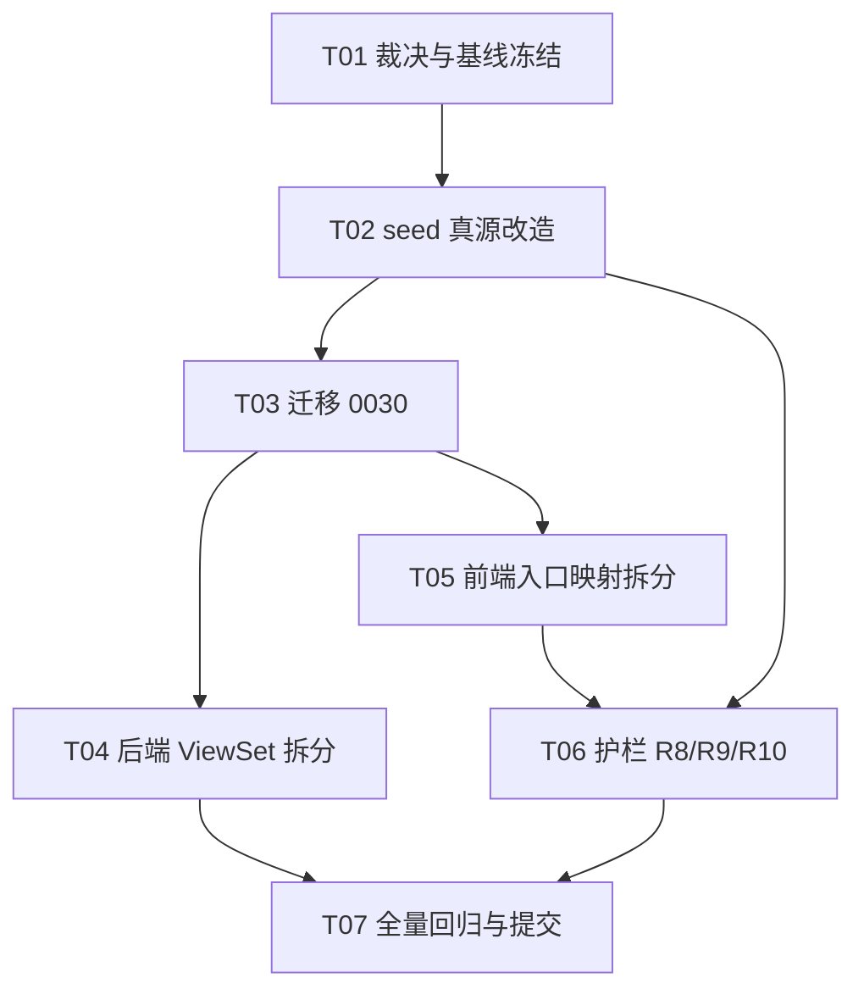
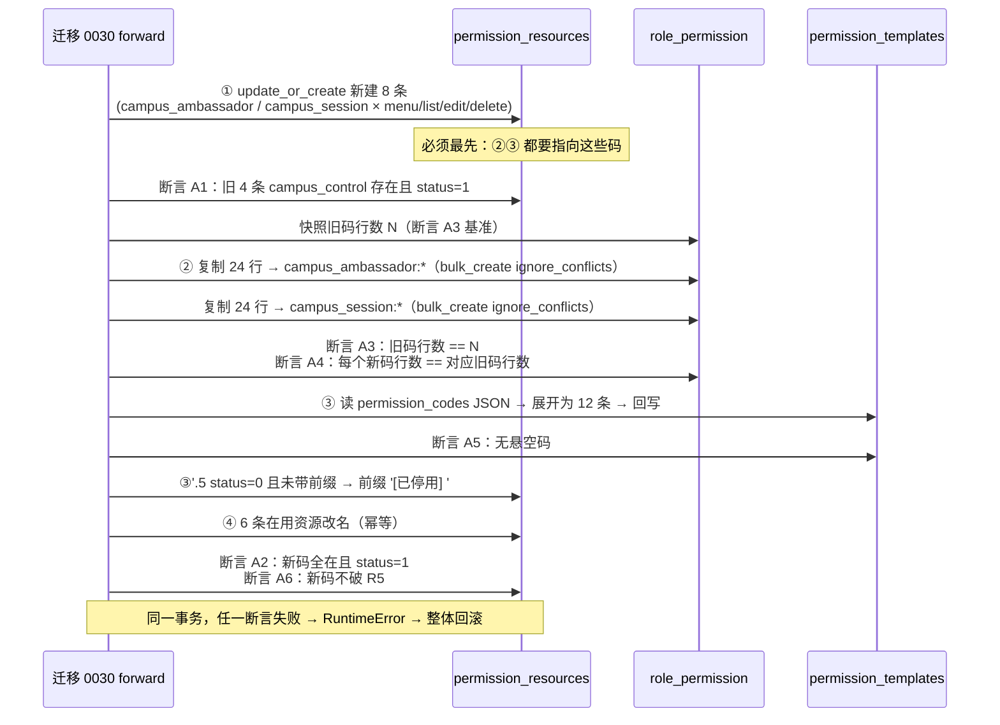
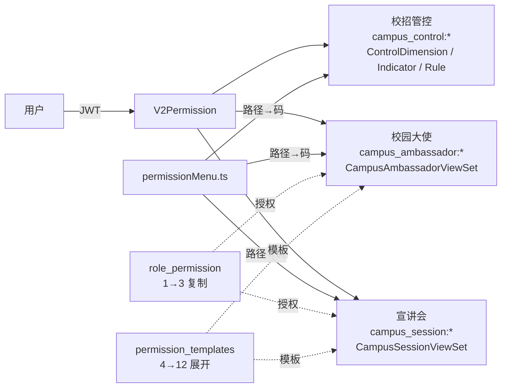

# ARCH：校招资源码拆分 + 资源名对齐（2026-10-18）

> 作者：高见远（架构师）｜状态：待 team-lead / 兵哥裁决
> 范围：**只做设计与任务分解，本轮不改任何代码文件、不做任何 git 写操作**。
> 判据真源：`docs/DESIGN_资源编码规范.md`（下称「规范」）+ 护栏
> `apps/django/apps/core/tests/test_resource_code_convention.py`（下称「护栏」）。

---

## 0. 一页结论（TL;DR）

| 议题 | 结论 |
|---|---|
| 三功能拆分 | 采纳。`campus_control` 一族 4 码拆成 **1 主码（校招管控，保留原码）+ 2 新码（校园大使 / 宣讲会）** |
| 新码段式 | **沿用 `recruit:settings:*`**，段 2 = `settings`（与 `campus_control` 模型的 `module` 同族，护栏 R2 天然满足）。**不起 `recruit:campus:*`** —— 该段已被轮岗/班级/档案占用，且 R2 要求段 2 == module，两个 app 的 module 不同，起新段会立刻破 R2 |
| 「校招管控」入口 | **保留**，它不是僵尸：`/settings/campus-control` 路由 + `CampusControl.vue`（90KB，活的）+ 后端 3 个 ViewSet 全在用，且设置页菜单 `SettingsLayout.vue:205` 有入口。team-lead 底数里「前端菜单当前没有它」指的是**主导航 Layout.vue 的校园招聘分组**没有，两个菜单是两套 |
| 6 行历史授权 | **复制给 3 个新码族**（1→3 展开），原码保留不动。语义＝「此前能管控校招的人，拆完后仍能管控全部三块」，**零静默失权、零新增越权** |
| 3 个模板 | TMPL_ADMIN/DIRECTOR/SPECIALIST 的 `CONFIG_CODES` 段把 4 条 campus_control 码**扩展为 12 条**（3 族 × menu/list/edit/delete） |
| 名称对齐 | **12 条改名**（code_tables 6 + rule_engine 1 + campus_control 1 + campus:resource 3 + metrics 1）+ **5 条 mou 停用** + **28 条既有停用码加 `[已停用]` 前缀**（合计 33 条停用），详见 §4 |
| 迁移 | `apps/django/apps/core/migrations/0030_split_campus_resource_codes.py`，`RunPython` 单事务、内置 6 条自检断言 |
| 护栏 | 新增 **R8（一码不得覆盖多个前端入口）** + **R9（停用码名必须带 `[已停用]` 前缀）** + **R10（停用码不得出现在 seed RESOURCES）** |
| 🔴 P0-1 | **mou 与 mgmt_unit 的真实关系与 team-lead 推测相反**：界面「管理单元」页背后是 **`recruit:mgmt_unit:*`**（`ManagementUnitViewSet` 在 core，`/api/v1/management-units/`），而 **`apps/mou/` 是前端零消费的 MOU 协议 stub**（4 个 ViewSet 挂在 `permissions-v2/`，前端 0 引用）。详见 §4.3 |
| 🔴 P0-2 | 本轮核查**新发现**：14 条已停用码（全部来自 0026）仍在 `seed_v2_init.RESOURCES` 里，`update_or_create` 写死 `status=1` ⇒ **重跑 seed 会把停用码复活**；详见 §7。另自查排除 1 处假阳性（`recruit:role:list` 并未被停用，§7-P0-②） |

---

## 1. 校招三功能拆分决策

### 1.1 事实基线（我已逐处复核，与 team-lead 底数一致）

**资源定义（seed 真源，`seed_v2_init.py`）**

| 资源码 | 名称 | 类型 | module | seed 行号 |
|---|---|---|---|---|
| `recruit:settings:campus_control:menu:view` | 校招管控菜单 | MENU | settings | 226 |
| `recruit:settings:campus_control:list` | 校招管控列表 | BUTTON | settings | 335 |
| `recruit:settings:campus_control:edit` | 编辑校招管控 | BUTTON | settings | 227 |
| `recruit:settings:campus_control:delete` | 删除校招管控 | BUTTON | settings | 228 |

**后端消费点（4 处 ViewSet，全部真合并）**

| 文件 | 位置 | 当前声明 |
|---|---|---|
| `apps/campus_control/views.py` | 150 / 206 / 312（ControlDimension / ControlIndicator / ControlRule） | `permission_required='recruit:settings:campus_control:list'` + map 全部指向 `campus_control:edit` / `:delete` |
| `apps/campus/views.py` | 37-48（`CampusModelViewSetMixin`，被 CampusAmbassadorViewSet / CampusSessionViewSet 继承） | 同上（注释明写「复用 campus_control 资源码」） |

**前端入口**

- `web/app/src/utils/permissionMenu.ts:81-83` —— 三条路由 → 同一码 `recruit:settings:campus_control:menu:view`
- `web/app/src/router/index.ts:150,152,153` —— 三条路由均在，`CampusControl.vue` / `CampusAmbassador.vue` / `CampusSession.vue` 三个组件均存在
- `web/app/src/pages/settings/SettingsLayout.vue:205` —— 设置页菜单有 `/settings/campus-control`（标签 `SettingsLayout.s40` = 「校招管控」/ EN "Campus Recruitment Control"）
- `web/app/src/pages/Layout.vue:410-423` —— 主导航「校园招聘」分组只有 6 项，**不含** campus-control

**⚠️ 底数修正**：`Layout.vue` 的校园招聘分组 ≠ 设置页菜单。`/settings/campus-control` 是**设置页里的独立入口**（有一级菜单项 + locale s40），并非「只有 permissionMenu 规则没有入口」。**结论：校招管控入口是活的，不下线。**

### 1.2 命名方案对比

| 方案 | 样例 | 护栏 R2（第 2 段 == module） | 与既有段冲突 | 评价 |
|---|---|---|---|---|
| **A. 沿用 settings 段**（推荐） | `recruit:settings:campus_ambassador:menu:view` | ✅ 段 2 = `settings` | 无 | 与 campus_control 同族，视觉一致；R5（同前缀至多一条 MENU）天然满足 |
| B. 起 campus 段 | `recruit:campus:ambassador:menu:view` | ❌ 段 2 = `campus` ≠ model module `settings` | 与轮岗/班级/档案同段 | **破 R2**。若强行改 model 的 module 为 `campus`，则 `campus_control` 模型的 4 条码要一起改段 → 触发第二轮三处同步改名，纯放大风险 |
| C. 三功能全塞 `recruit:campus:*` | 同上 | ❌ 同 B | — | 兵哥已否决 |

**推荐 A**，理由三条：

1. **R2 是硬护栏**（护栏 `test_r2_second_segment_equals_module_field`，DB 侧 `test_r2_no_new_module_mismatch` 也断言）。`CampusAmbassador` / `CampusSession` / `ControlRule` 三个模型都没有名为 `campus` 的 module 字段，module 是 `PermissionResource` 的字段而非 model 的字段——它由**资源归属的设置域**决定，这三个功能都在 `/settings/*` 之下，module 天然是 `settings`。
2. **同族即同域**。权限配置页按 `module` 分组展示，`settings` 分组下的资源本来就密集（code_tables / metrics / rule_engine / dictionary …）。拆出的校园大使/宣讲会同属 settings，一屏可见，符合管理员心智。
3. **B 方案要连带改 4 条已有码的段**，等于在同一轮里叠加「拆码 + 改段」两个 P0 级三处同步，风险不可叠加。

### 1.3 推荐的最终资源码表（3 族 × 4 动作 = 12 条，其中 8 条为新增）

**族 1：校招管控（保留原码，零改名零迁移成本）**

| 资源码 | 新名称 | 类型 |
|---|---|---|
| `recruit:settings:campus_control:menu:view` | 校招管控 | MENU |
| `recruit:settings:campus_control:list` | 校招管控列表 | BUTTON |
| `recruit:settings:campus_control:edit` | 编辑校招管控 | BUTTON |
| `recruit:settings:campus_control:delete` | 删除校招管控 | BUTTON |

**族 2：校园大使（新增 4 条）**

| 资源码 | 新名称 | 类型 |
|---|---|---|
| `recruit:settings:campus_ambassador:menu:view` | 校园大使 | MENU |
| `recruit:settings:campus_ambassador:list` | 校园大使列表 | BUTTON |
| `recruit:settings:campus_ambassador:edit` | 编辑校园大使 | BUTTON |
| `recruit:settings:campus_ambassador:delete` | 删除校园大使 | BUTTON |

**族 3：宣讲会（新增 4 条）**

| 资源码 | 新名称 | 类型 |
|---|---|---|
| `recruit:settings:campus_session:menu:view` | 宣讲会 | MENU |
| `recruit:settings:campus_session:list` | 宣讲会列表 | BUTTON |
| `recruit:settings:campus_session:edit` | 编辑宣讲会 | BUTTON |
| `recruit:settings:campus_session:delete` | 删除宣讲会 | BUTTON |

**动作词表合规性（护栏 R3）**：`list` / `edit` / `delete` / `view` 均已在 `ACTION_WHITELIST` 内，**无需改动规范 §3.2**。刻意**不引入 `create`**：现有 `campus_control` 用 `edit` 承载 create/update（`permission_required_map` 里 `'create'` 映射到 `:edit`），这是既有约定；拆码时保持一致可以避免顺手改成 `create` 而导致老角色没有 `create:create` 码从而失权（护栏 `_derive` 在派生码不存在时会**回退原码 + 告警**，但那是降级路径，不该主动依赖）。

**「校招管控」与 `/settings/campus-control` 路由是否需独立码**：**需要，且就是族 1 本身**。拆分后 `permissionMenu.ts` 的映射变为：

```ts
{ prefix: '/settings/campus-control',    code: 'recruit:settings:campus_control:menu:view' },     // 不变
{ prefix: '/settings/campus-ambassador', code: 'recruit:settings:campus_ambassador:menu:view' },  // 改
{ prefix: '/settings/campus-session',    code: 'recruit:settings:campus_session:menu:view' },     // 改
```

---

## 2. 6 行历史授权的迁移语义

### 2.1 事实

team-lead 实测「每条挂 6 行 role_permission 授权」= 4 码 × 6 行 = **24 行**（本轮方案按 24 行处理；若实测为 6 行总量，则同一算法按实际行数展开，不影响结论）。

### 2.2 决策：**1 → 3 复制展开**（不删任何一行）

```
旧：role_permission 里 24 行 = 6 roles × {cc:menu:view, cc:list, cc:edit, cc:delete}
新：保留这 24 行不动（→ 校招管控）
  + 复制 24 行到 campus_ambassador:*
  + 复制 24 行到 campus_session:*
  = 72 行
```

**理由（三条，缺一不可）**

1. **零静默失权**。当前任何能进 `/settings/campus-ambassador` 的角色，走的都是 `campus_control:*` 授权。拆分后若只把 6 行给「主入口」，所有现有 HR / HRBP 角色会**立刻打不开校园大使与宣讲会页**（前端 `filterMenuByPermission` 裁掉菜单 + 后端 403 双重拦截），且 `campus_control` 一族有 `menu:view` 的角色同时是三块的隐形管理员 —— 复制展开是唯一能把「今天能用的功能」原样保住的做法。
2. **零新增越权**。反过来的风险是「把 6 行只给新码、老码不保留」或「新码给一个更宽的码（如都挂 `settings:permissions:*`）」。本方案只做同族 1:1 复制，动作集完全一致（menu/list/edit/delete 四码齐平），不引入任何新能力。
3. **可回滚**。数据迁移保留全部旧行 → `backward()` 只需删除新码行 + 复原名称，旧授权天然完好。若选择「改名而非复制」（把 `campus_control:*` 直接 rename 成两个码之一），则 4 个动作无法映射到 2 个目标，`backward()` 无解。

### 2.3 `uk_role_resource` 唯一约束下的复制实现

`RolePermissionV2` 有 `UniqueConstraint(role_code, resource_code)`。复制时必须用 `ignore_conflicts=True` 的 `bulk_create`（幂等：重复执行不报错）。同时 **7 条新资源码必须先在同一事务内 `update_or_create` 建出来**，否则 `bulk_create` 出的授权指向不存在的资源码 → R6 护栏（`test_r6_template_codes_all_exist` 只查模板，但库内 `role_permission` 悬空码是更隐蔽的静默失权源）。

### 2.4 迁移后 `role_permission` 引用分布

```
campus_control     24 行（原有，未动）
campus_ambassador  24 行（新增，复制）
campus_session     24 行（新增，复制）
```

---

## 3. 三个模板的引用改写

`permission_templates.permission_codes` 是 **JSON 数组字面量**，迁移与级联都不覆盖它 → 漏改 = 身份静默丢权（护栏 R6 的存在理由）。

`seed_v2_init.py:421-422` 目前在 `CONFIG_CODES` 里写死了 4 条 campus_control 码，而 `CONFIG_CODES` 被 **TMPL_DIRECTOR 与 TMPL_SPECIALIST 引用**，`TMPL_ADMIN` 的 `codes: []`（走全量另算）。

| 模板 | 现状引用 campus_control | 改写后 | 说明 |
|---|---|---|---|
| `TMPL_ADMIN`（超级管理员） | 0（`codes: []`） | 0（保持 `[]`） | admin 另有全量授权路径，改这里会引入不必要的语义变更 |
| `TMPL_DIRECTOR`（招聘总经理） | 4（经 `CONFIG_CODES`） | **12** | `CONFIG_CODES` 里 4 条 campus_control 码展开为 4 族 × 4 动作 |
| `TMPL_SPECIALIST`（招聘专员） | 4（经 `CONFIG_CODES`） | **12** | 同上（同一个 `CONFIG_CODES` 列表，改一处两模板同时生效） |

**改写后的 `CONFIG_CODES` 片段（seed 内）**

```python
# 校招（campus）三功能：校招管控 / 校园大使 / 宣讲会
# 2026-10-18 拆分。此前 4 条 campus_control 码被三个功能共用，
# 拆成三个独立码族后，模板必须三族齐平，否则按模板新建的身份会缺入口。
'recruit:settings:campus_control:menu:view', 'recruit:settings:campus_control:list',
'recruit:settings:campus_control:edit', 'recruit:settings:campus_control:delete',
'recruit:settings:campus_ambassador:menu:view', 'recruit:settings:campus_ambassador:list',
'recruit:settings:campus_ambassador:edit', 'recruit:settings:campus_ambassador:delete',
'recruit:settings:campus_session:menu:view', 'recruit:settings:campus_session:list',
'recruit:settings:campus_session:edit', 'recruit:settings:campus_session:delete',
```

**🔴 关键实施顺序**：`CONFIG_CODES` 只影响「**今后**跑 seed / 按模板新建角色」。**存量模板行**（`permission_templates` 表里的 3 行 JSON）必须由**迁移**改写（`RunPython` 里读 JSON → 替换 → 回写），否则：迁移后模板里仍只有旧 4 码（不悬空、不报错、但按模板新建的角色拿不到校园大使/宣讲会 → **静默半失权**，R6 也检不出来，因为旧 4 码确实还在资源表里）。这一条是本轮**最容易被漏掉**的点。

---

## 4. 名称对齐的精确改名表

`resource_name` 字段 `max_length=64`，本轮所有新名均在 12 字以内，无截断风险。

### 4.1 改名表（在用资源）

**A 组：`code_tables` 族（6 条）—— 界面标签是「静态数据」**

| # | 资源码 | 库内现名 | → 新名称 |
|---|---|---|---|
| 1 | `recruit:settings:code_tables:menu:view` | 码表库菜单 | **静态数据菜单** |
| 2 | `recruit:settings:code_tables:list` | 码表列表 | **静态数据列表** |
| 3 | `recruit:settings:code_tables:create` | 新增码表 | **新增静态数据** |
| 4 | `recruit:settings:code_tables:edit` | 编辑码表 | **编辑静态数据** |
| 5 | `recruit:settings:code_tables:delete` | 删除码表 | **删除静态数据** |
| 6 | `recruit:settings:code_tables:export` | 导出码表 | **导出静态数据** |

依据：`SettingsLayout.vue:260` 标签 = `s52` = 「静态数据」。**全族改，不只改 menu** —— 管理员在角色编辑页权限树里看到的是每一条 `resource_name`（§4.5 已证实前端直出该字段），只改 menu 那条会造成「菜单叫静态数据、下面 5 条按钮还叫码表」的自相矛盾。

**措辞冲突已校验**：同模块下另有 `settings:dynamic_fields`（「动态字段菜单」等）与 `settings:dictionary`（「数据字典菜单」），均不含「静态数据」字样；`SettingsLayout` 里「静态数据 / 动态数据」是同一父分组下的两个并列入口，语义对齐。改名后全库启用资源**零重名**（脚本已验证）。

**B 组：`rule_engine`（1 条）**

| # | 资源码 | 库内现名 | → 新名称 |
|---|---|---|---|
| 7 | `recruit:settings:rule_engine:menu:view` | 统一规则引擎菜单 | **规则引擎菜单** |

**我采纳 team-lead 的措辞，修正我第一版的建议**。第一版我建议「规则引擎/简历解析引擎」以显式声明双入口，但实测 `stripMenuSuffix()`（`utils/permissionModules.ts:65`）会把菜单名末尾的「菜单」剥掉后**当作子模块 label 直接渲染** —— 写成「规则引擎/简历解析引擎菜单」在 UI 上会显示成割裂文案。而 `/settings/rule-engine` 才是该码的**主入口**（`/settings/resume-parser-engine` 是同族子视图），故用主入口名 + 「菜单」后缀最准确；双入口这件事由 §6 的 **R8 白名单**留痕，不必写进资源名。

**C 组：`campus` 族（1 + 3 条）**

| # | 资源码 | 库内现名 | → 新名称 | 依据 |
|---|---|---|---|---|
| 8 | `recruit:settings:campus_control:menu:view` | 校招管控菜单 | **校招管控** | `SettingsLayout.s40` = 「校招管控」，去冗余「菜单」 |
| 9 | `recruit:campus:resource:create` | 新建直播间 | **新建轮岗资源** | `Layout.vue:419` 标签 = 「轮岗资源」；同族前两条已叫「轮岗资源」，后三条叫「直播间」自相矛盾 |
| 10 | `recruit:campus:resource:edit` | 编辑直播间 | **编辑轮岗资源** | 同上 |
| 11 | `recruit:campus:resource:delete` | 删除直播间 | **删除轮岗资源** | 同上 |

第 9-11 项是**我在核查中额外发现的族内不一致**，**待裁决**。若纳入：**只改资源名，不动路由 path `/campus/live-room` 与组件名 `CampusLiveRoom`**（改 path 会破历史深链）。

**D 组：`metrics`（1 条）**

| # | 资源码 | 库内现名 | → 新名称 | 依据 |
|---|---|---|---|---|
| 12 | `recruit:settings:metrics:list` | 指标列表 | **指标管理** | `SettingsLayout.s60` = 「指标管理」；且该码是 `/settings/metrics` 的**路由守卫码**（`permissionMenu.ts:108`），名称必须与入口一致 |

**E 组：`mou` 族（5 条）与 `mgmt_unit` 族（4 条）→ 见 §4.3 专项决策**

结论先行：**这两族本轮 0 改名**。`mgmt_unit` 4 条库名已是正确口径（「管理单元菜单/列表/新增/编辑」）；`mou` 5 条保留 MOU 措辞但**整族停用**加 `[已停用]` 前缀。⚠️ 我第一版曾建议把 `recruit:mou:menu:view` 改成「管理单元」，**该建议是错的**，理由见 §4.3。

**改名条数汇总**：**12 条实际改名** = A 组 6（code_tables）+ B 组 1（rule_engine）+ C 组 4（campus_control 1 + campus:resource 3）+ D 组 1（metrics）。**`mou` 族因整族停用，本轮不改名**（对已停用资源改名是空操作，只会给 `[已停用] XXX` 的前缀后再缀一次噪声）；另有 `campus:resource:{menu:view,list}` 与 `mgmt_unit:*` 4 条经复核**无需改**（原名已正确）。

**校验结果**：应用全部改名后，全库启用资源名**零重名**（脚本已验证），且经 `stripMenuSuffix` 处理的子模块 label **零冲突**。

> 🔴 **硬约束（新增）**：所有 `resource_type='MENU'` 的资源名**必须以「菜单」二字结尾**。因为 `stripMenuSuffix()` 会剥掉该后缀并把剩余部分当子模块 label 渲染，漏掉会导致 UI 出现「静态数据菜单」被显示成「静态数据菜单」（剥不掉）的怪象。本轮全部 MENU 类新名已满足。

### 4.2 停用码前缀（28 条）

确切文案：**`[已停用]` + 半角空格 + 原名**，例如 `用户管理菜单` → `[已停用] 用户管理菜单`。

| 来源 | 条数 | 码清单 |
|---|---|---|
| `0026_disable_offline_resources.DISABLED_CODES` | 14 | `settings:registrations:{menu:view,approve}`、`settings:users:{menu:view,list,create,edit,delete,export}`、`settings:users:{internal,external}:{menu:view,list}`、`offer:{approve_l1,approve_l2}` |
| `0029_disable_zombie_resources.ALL_CODES` | 14 | `settings:data_permission:{menu:view,create,edit,delete,export}`、`settings:user_management:{menu:view,create,edit,delete,export}`、`settings:permissions:{create,edit,delete,export}` |
| **本轮新增**（§4.3 决策） | **5** | **`recruit:mou:{menu:view,list,create,edit,approve}` —— 整族停用** |

**合计 33 条**（14 + 14 + 5）。

**前缀只加在 `status=0` 的行上**，且必须**幂等**（已带前缀的不再叠加）——否则迁移重放会得到 `[已停用] [已停用] 用户管理菜单`。

**为什么必须区分**：team-lead 指出的「14 条已停用码与在用码同名造成歧义」，实测**比这更严重**：
- `settings:users:menu:view`（停用，名称「用户管理菜单」）vs `settings:users:all:menu:view`（**在用**，名称「全部用户菜单」）—— 管理员在资源列表看到两个「用户」族；
- `settings:users:{create,edit,delete,export}`（停用，「新增/编辑/删除/导出用户」）vs `settings:users:all:*`（在用）—— 动作名完全一样，看名字无法判断能不能勾。

**🔴 但这 33 条停用码里只有 19 条在 seed RESOURCES 中**（`settings:users:*` 12 条 + `offer:approve_l1/l2` 2 条 = 14 条全来自 0026；`mou` 5 条来自本轮新增；0029 的 14 条**全部不在** seed —— 它们是纯 DB 孤儿/纯僵尸）。前缀改名必须**以库内 `status=0` 为准动态取集合**，不能以 seed 为准，否则：
- seed 里那 19 条：**改完 seed 再跑 seed → 名称被覆写回旧名 + status 被写死回 1（复活）**；
- seed 里没有的 14 条：改不到，列表里仍是裸名。

**唯一正确的实施方式**（推荐，与 §7 的 P0-② 一并解决）：

1. **从 `seed_v2_init.RESOURCES` 里删除这 19 条已停用码**（14 条既有 + 本轮停用的 5 条 mou；它们的功能已下线，seed 是新库初始化真源，不该再吐下线资源）；
2. 迁移里按 **`status=0` 动态集合**统一加前缀（覆盖全部 33 条，含 seed 里没有的 14 条）；
3. 护栏 **R10** 锁死：「停用清单中的码不得出现在 seed RESOURCES」。

这样新库（只跑 seed + migrate）里根本不会创建这些停用码；老库里由迁移打上前缀，两条路径都收敛。

### 4.3 🔴 专项决策：`mou` 与 `mgmt_unit` 的真实关系（与初始推测镜像相反）

**初始推测是「`mou` 是真实模块、`mgmt_unit` 是悬空码」—— 我实测后结论完全相反。**

| 判据 | `recruit:mou:*` | `recruit:mgmt_unit:*` |
|---|---|---|
| 对应 Django app | `apps/mou/` **存在** | `apps/mgmt_unit/` **不存在** |
| 业务模型 | `MouAgreement` / `MouContainer`（**MOU 协议**：company_name / signed_at / mou_type / terms） | `ManagementUnit`（**数据权限的组织范围载体**：树形层级 / org_scope / person_data_range） |
| 路由 | `/api/v1/permissions-v2/mou|containers|mutual-exclusion-groups|automation-rules` | `/api/v1/management-units/`（`urls_permission_v2.py:12`） |
| ViewSet | 4 个（`apps/mou/views.py` 29/51/66/81 行） | 1 个 `ManagementUnitViewSet`（`core/views_permission_v2.py:357-360`，`permission_required='recruit:mgmt_unit:list'`） |
| **前端消费** | **0 个引用** —— 全前端 `grep 'permissions-v2'` 命中 **0**；`api/mou.ts` 不存在；`MouManagement.vue:305` 实际 `from '@/api/management-unit'` | **活的** —— `MouManagement.vue:305` 消费 `management-unit.ts`；页面标题 `MouManagement.s3` = 「管理单元 (Management Unit)」 |
| grants | menu/list/create/edit 各 7 行、approve 2 行 | 各 7 行 |
| 模板引用 | 3 个模板全部引用 | DIRECTOR / SPECIALIST 引用（seed:513） |

**结论（两条，与初始推测镜像对称）**

1. **`recruit:mgmt_unit:*` 是「管理单元」功能的真实在用码**，不是悬空码。`views_permission_v2.py:360` 不是残留，它就是管理单元 API 的唯一鉴权声明。停用这 4 条 ⇒ `ManagementUnitViewSet` 对所有非超管 403 ⇒ **管理员打不开自己正在用的「管理单元」页**。这是硬否决项。
2. **`apps/mou/` 是前端零消费的 MOU 协议 stub**。其 models.py 首行自述「2026-07-01 stub for permissions-v2/*（G36 任务待补真业务）」；4 个 ViewSet + 4 张表 + 5 个迁移在真实 UI 上没有任何入口。唯一疑似消费点是 `apps/referral/alias_endpoints.py:424` 的 `/permissions/mous`（注释说「FE UserManagement.vue 分配MOU 弹窗用」），但 **`UserManagement.vue` 已被删除**（现存 `UserDirectory.vue`），前端 `grep 'permissions/mous'` 命中 0 ⇒ 该端点是死代码。

**⚠️ 由此得出一个反直觉但必须说清的结论**：**界面上的「管理单元」页由 `mgmt_unit` 码守，不由 `mou` 码守。** 我第一版方案里「把 `recruit:mou:menu:view` 改成『管理单元』」是**错的** —— 那会给一个 MOU 协议功能挂上管理单元的名字，与 `mgmt_unit` 族正面冲突，且让管理员误以为「勾了 MOU 就是勾了管理单元」。

**推荐处置：`mou` 族整体停用（选项 a 的变体）**

| 动作 | 对象 | 理由 |
|---|---|---|
| **停用 + `[已停用]` 前缀** | `recruit:mou:{menu:view,list,create,edit,approve}` 全 5 条 | 前端零消费；`/permissions/mous` 端点的唯一前端消费方已删除；保留 7/7/7/7/2 行授权以备审计 |
| **保留启用态 + 原名** | `recruit:mgmt_unit:*` 4 条 | 管理单元 API 的在役鉴权真源，改名反而制造歧义 |
| **本轮不做** | 物理删除 `apps/mou/` 及其 5 个迁移 | 超出「资源码对齐」范围；停用后已不影响业务，留待独立裁决（建议下一轮走 app 下线流程） |
| **本轮不做** | 删 `apps/referral/alias_endpoints.py` 的 `/permissions/mous` 死端点 | 同上；但**必须在迁移 docstring 留痕**「此端点随 mou 停用而不可达」 |

**为何选「停用」而非「物理删除」**：与 0026/0029 的既定处置一致（停用 ≠ 物理删除，保留历史授权可追溯性）；且 `apps/mou/` 5 张表仍有数据，物理删除会牵出一串数据迁移，超出本轮范围。

**为何选「停用 mou」而非「停用 mgmt_unit」**：见上文结论 1，停用 mgmt_unit 直接让管理单元页 403。

**⚠️ 但有一处必做的修正（与 mou 去留解耦）**：`permissionMenu.ts:60` 现在把前端路径 `/settings/mou` 指向 `recruit:mou:menu:view`，但该页实际需要 `mgmt_unit` 码才能拿到数据 —— **这是一处已存在的「菜单守卫指错码」缺陷**。当前只有同时拥有 mou 与 mgmt_unit 两族码的角色才能正常用管理单元页（未配置功能权限的用户靠 fail-open 不受影响）。**必须本轮修正**：`permissionMenu.ts:60` 改为 `recruit:mgmt_unit:menu:view`。

**改名表相应调整**：`mou` 族**不再改名**（`menu:view` 已叫「MOU菜单」，与 MOU 协议业务实质一致），只加 `[已停用]` 前缀；`mgmt_unit` 4 条**保持原名**。§4.1 的 E 组因此从「改名」修正为「**0 改名 + 5 条停用**」。

**若兵哥决定保留 MOU 功能**（未来在 UI 重新暴露 MOU 协议管理页）：`mou` 族保持启用 + 保留 MOU 措辞即可，**唯一必做的改动仍是 `permissionMenu.ts:60` 改指 `mgmt_unit:menu:view`** —— 无论 MOU 未来是否启用，管理单元页的守卫码都应该是 `mgmt_unit`。故此修正与 MOU 去留**解耦，可独立执行**。

### 4.4 code_tables 全族改名的边界（回答「是否整体改为静态数据措辞」）

**结论：是，整体改，但只限本族 6 条，不动 `dictionary` 与 `dynamic_fields`。**

- 本族 6 条在 seed 里全部含「码表」措辞，与界面标签「静态数据」脱节，属真债务；
- `dictionary`（数据字典）与 `dynamic_fields`（动态字段）是**另外两个独立页面**，界面标签分别是 `s42`「数据字典」与 `s53`「动态数据」，库名与界面**本就一致**，不需要改；
- 「静态数据」措辞在本模块下**不与任何其它资源名冲突**（脚本已校验）。

### 4.5 前端是否渲染 `resource_name`（回答 i18n 同步要求）

**结论：会渲染，共 3 处，全部直出后端 `resource_name`、无 i18n 兜底 ⇒ 本轮改名无需任何前端 i18n 同步，但有 3 个副作用需注意。**

| 渲染点 | 代码位置 | 渲染方式 |
|---|---|---|
| 权限树（角色编辑弹窗 / 权限码明细抽屉） | `composables/useResourceNames.ts:20` `nameOf(code)` → `r.resourceName` | 直出 |
| 资源管理列表「资源名称」列 | `pages/settings/permission/ResourcesTab.vue:279` `key: 'resourceName'` | 直出，`ellipsis: { tooltip: true }` |
| 子模块分组标题 | `utils/permissionModules.ts:85` `stripMenuSuffix(r.resourceName)` | 直出 + 剥尾部「菜单」 |
| 资源搜索 | `ResourcesTab.vue:209` `r.resourceName.toLowerCase().includes(kw)` | 关键字过滤 |

字段链路：`permission_resources.resource_name` → `PermissionResourceSerializer`（`serializers_permission_v2.py:19` 含该字段）→ djangorestframework-camel-case 转 `resourceName` → 前端 `api/permission-resource.ts:31` 的 `PermissionResource.resourceName`。

**因此**：
- ✅ **无需改任何 locale 文件**，无需 `npm run locale:audit` 配套动作；改名是纯后端数据变更；
- ⚠️ **副作用 1**：`ResourcesTab.vue:209` 按名称模糊搜索 —— 改名后管理员搜「码表」将**搜不到**这 6 条（需搜「静态数据」）。属预期行为，但应写入发布说明；
- ⚠️ **副作用 2**：`stripMenuSuffix` 剥「菜单」后做子模块 label ⇒ 所有 MENU 类新名**必须以「菜单」结尾**（见 §4.1 末尾硬约束）；
- ⚠️ **副作用 3**：`utils/permissionModules.ts:26-31` 的 `RESOURCE_MODULE_LABELS` 是**模块级**硬编码中文名（`mou: 'MOU'`、`mgmt_unit: '管理单元'`），与 `resource_name` 是两套东西，**不受本轮改名影响，无需同步**。该表注释已记载「早期版本曾把两者都写成『管理单元』，会导致筛选后看不出区别，故按 seed 校正」—— 本轮处置与该历史决策方向一致。

**新增测试要求**：给 `permissionModules` 补一条断言「由 `resource_name` 派生的子模块 label 不含『菜单』后缀」的用例（现有 `pages/settings/permission/__tests__/RoleEditModal.test.ts` 可挂载）。

---

## 5. 迁移文件设计

### 5.1 基本信息

| 项 | 值 |
|---|---|
| 编号 | `0030_split_campus_resource_codes.py` |
| 路径 | `apps/django/apps/core/migrations/0030_split_campus_resource_codes.py` |
| 依赖 | `('core', '0029_disable_zombie_resources')` |
| 结构 | 单个 `migrations.RunPython(forward, backward)`（**纯数据迁移，无 schema 变更** ⇒ `makemigrations --check` 必须仍返回 clean） |
| 事务 | `atomic = True`（默认），三处存储点 + 资源创建 + 模板改写**同一事务**，任一断言失败整体回滚 |

### 5.2 forward 逻辑要点（顺序不可调换）

```
① 建资源（新 8 条 campus_ambassador / campus_session 的 menu/list/edit/delete）
   update_or_create(system_code='recruit', resource_type, module='settings', status=1)
   ← 必须最先：② 的授权与③的模板都要指向这些码
② 授权复制
   src = {campus_control:menu:view, :list, :edit, :delete}
   for target_family in (campus_ambassador, campus_session):
       对 src 中每个 old_code：
           new_code = old_code.replace('campus_control', target_family)
           bulk_create(
               [RolePermissionV2(role_code=r.role_code, resource_code=new_code,
                                 system_code='recruit')
                for r in RolePermissionV2.objects.filter(resource_code=old_code)],
               ignore_conflicts=True)   # 幂等 + 绕过 uk_role_resource
③ 模板改写
   for tpl in PermissionTemplate.objects.all():
       codes = tpl.permission_codes or []
       if any(c in src for c in codes):
           新增 8 条（4 动作 × 2 新族），保序去重后回写 JSON
③'.5 停用 mou 族（本轮新增，§4.3）
   Resource.objects.filter(resource_code__in=MOU_5_CODES, status=1).update(status=0)
   ⚠️ 必须在 ③'.6 之前 —— 打前缀依赖 status=0
③''.6 停用码打前缀（幂等，按 status=0 动态取集合，不按清单硬编码）
   Resource.objects.filter(status=0).exclude(resource_name__startswith='[已停用]')
                    .update(resource_name=Concat('[已停用] ', F('resource_name')))
④ 在用资源改名（12 条，逐条 update，幂等：已是目标名则 no-op）
   ⚠️ 改名清单里**不得包含 status=0 的行** —— 对已停用资源改名是空操作，
      只会让「[已停用] 旧名」与「旧名」两种终态并存，破坏幂等性
```

### 5.3 backward 逻辑要点

```
① 模板：移除 8 条新码（campus_ambassador / campus_session 全族）—— 不动原有码
② 授权：RolePermissionV2.objects.filter(resource_code__in=NEW_8_CODES).delete()
③ 资源：新 8 条 update_or_create 建出来的行 → .delete()（它们是本轮新建，删掉即回到迁移前）
        ⚠️ 若 forward 之后有管理员手动改过名称，backward 会一并丢弃；这是可接受的
           （backward 是应急回滚，不是常规路径），必须在 docstring 里写明
④ 改名：把 6 条在用名改回旧名；把 status=0 的 `[已停用] ` 前缀剥掉（用
   Replace('[已停用] ', '', F('resource_name'))，天然幂等）
⑤ 校招管控族名称：'校招管控菜单' → 复原为 '校招管控菜单'（本轮把它改成 '校招管控'，
   backward 必须复原，否则回滚后名称与 seed 不一致 → 下次跑 seed 又被覆写）
```

### 5.4 必须内置的自检断言（参考 0028/0029 做法）

**硬断言（覆盖不全即 `RuntimeError` 中止 → 整事务回滚）**

| # | 断言 | 目的 |
|---|---|---|
| A1 | 源码 4 条 `campus_control:*` 在库内存在且 `status=1` | 拆分基线存在，否则说明基线已变，必须人来判断 |
| A2 | forward 结束后，8 条新码在 `permission_resources` 中全部存在且 `status=1` | 防「授权/模板指向不存在的码」 |
| A3 | forward 结束后，`role_permission` 中 `campus_control:*` 的行数 **与 forward 之前完全相等** | 硬证据「没删任何历史授权」 |
| A4 | 每个新码的 `role_permission` 行数 == 对应旧码的行数 | 「1→3 复制」完整性：不得有的角色多、有的角色少 |
| A5 | `permission_templates` 中 **不含任何悬空码**（改写后逐条 `in` 资源表全集） | 防模板指向不存在的码（R6 同源，迁移期即时校验） |
| A6 | 8 条新码**不是任何 MENU 前缀下的第二条**（护栏 R5 在迁移内的自检） | 防「一前缀两条 MENU」把权限配置页的树打乱 |

**软告警（只 print 不抛，参照 0029 的「新库/测试库是空库属正常」）**

| # | 断言 | 目的 |
|---|---|---|
| W1 | 若 `campus_control:*` 的 `role_permission` 行数 == 0 → print「空库/未授权，属正常」 | 新库建库即失败是 0026 踩过的坑，必须避免 |
| W2 | 改名前后各打印一次「在用码数 / 停用码数 / 已带前缀数」计数 | 迁移后人工肉眼核对 |

**幂等性硬要求**：forward 重放两次必须得到同一终态。A2/A3/A4/A6 都天然满足幂等（`update_or_create` + `ignore_conflicts`），A3 需要用「forward 开始时的行数快照」与「结束时的行数」比较 —— 重放时旧码行数不变，仍通过。

### 5.5 seed 侧同步（同事务外但必须同 PR）

`seed_v2_init.py` 三处：
1. `RESOURCES`：新增 8 条（新码）+ 改 6 条名称 + **删 14 条已停用码**（§4.2）
2. `CONFIG_CODES`：4 条 campus_control 码展开为 12 条（§3）
3. `TEMPLATES`：无需改（`CONFIG_CODES` 已覆盖 DIRECTOR / SPECIALIST）

⚠️ **重跑 seed 会覆盖名称**：这意味着**迁移必须先于任何一次 seed 重跑**，否则改好的名称会被写回旧值。任务顺序上必须把「跑 seed」放在「跑迁移」之后（或干脆本轮不跑 seed，只跑迁移 + 改 seed 文件）。

---

## 6. 护栏升级（`test_resource_code_convention.py`）

新增 3 条规则，全部为**静态可校验**（不依赖运行时环境）：

### R8 一码不得覆盖多个前端入口（防「一码管三入口」复发）

```
规则：permissionMenu.ts 的 MENU_PERMISSION_RULES 中，同一个 code 不得出现在
      **两个语义独立的顶层路由前缀** 上。
例外白名单（KNOWN_SHARED_CODES，当前 3 条，均为「同一功能的别名/子视图」）：
      recruit:candidate:menu:view         ← /candidates 与 /screenings（同为候选人列表视图）
      recruit:settings:data_dashboard:menu:view ← /report 与 /settings/data-dashboard（同一看板两位置）
      recruit:settings:rule_engine:menu:view     ← /settings/rule-engine 与 /settings/resume-parser-engine（裁决见 §7-R4）
```

- 本轮拆分后，`campus_control:menu:view` 的 3 个入口收敛为 1 个，从白名单移出。
- 白名单**只许变短不许变长**（沿用护栏既有约定），并要求新增项写注释说明为何是一码多入口。
- ⚠️ 护栏必须**交叉读取前端文件**。既有护栏只读 seed，R8 需要读 `web/app/src/utils/permissionMenu.ts`。可行做法：用正则抽出 `{ prefix: '...', code: '...' }` 元组（我在核查中已验证该正则可用：`re.findall(r"\{\s*prefix:\s*'([^']+)',\s*code:\s*'([^']+)'", s)`，当前抽出 57 条规则 / 52 个唯一码）。**路径必须从 `settings.BASE_DIR` 上溯定位到仓库根**（既有 `test_convention_doc_exists` 已有这个模式：`Path(settings.BASE_DIR).parent.parent / 'docs'`）。

### R9 停用码名必须带 `[已停用]` 前缀

```
规则：PermissionResource.objects.filter(status=0) 的每条 resource_name 必须以 '[已停用] ' 开头。
      （正向断言，不设白名单 —— 存量 28 条本轮一次性全覆盖）
```

### R10 停用码不得出现在 seed RESOURCES（防「重跑 seed 复活」）

```
规则：把 0026 / 0029 的 DISABLED_CODES 清单抽成共享常量（建议提到
      apps/core/permission_dead_codes.py 之类模块，或在护栏里直接解析两个迁移文件的常量），
      断言 seed RESOURCES 中不含任何其中条目。
      本轮把 seed 里残留的 12 条删除后此规则恒成立。
```

### 建议的 R11（可选，防御性）

```
规则：模板 permission_codes 中引用的码，其 resource_name 不应带 '[已停用] ' 前缀
      （模板引用停用码 = 该身份拿到一个不可用的入口）。
```
> 可选原因：0029 停用的码目前确实不在任何模板里（我已核查 `CONFIG_CODES` 与三个 `TEMPLATES` 均无引用），加这条是为了**防止下一轮有人把停用码抄进模板**。若实施成本高可推迟到下一轮。

### 规范文档同步

`docs/DESIGN_资源编码规范.md` 需补：§4 增加 R8/R9/R10 三条规则；§6 债务清零表增加本轮两行（校招一码三入口拆分、停用码名前缀化 + seed 复活修复）；§5「新增资源的标准流程」增加一步「若涉及新增入口，同步更新 `permissionMenu.ts` 并跑 R8」。

---

## 7. 🔴 额外 P0（我核查中新发现，team-lead 底数外）

### P0-① 14 条已停用码仍在 seed RESOURCES 中 → 重跑 seed 会把它们复活

**实测**：`seed_v2_init.py` 的 `handle()` 对每条 RESOURCES 元组执行 `update_or_create(defaults={..., 'status': 1})` —— **status 写死为 1**。而 0026/0029 停用的 28 条码里，**14 条仍以启用态留在 seed RESOURCES**（全部来自 0026）：

```
recruit:settings:registrations:{menu:view, approve}
recruit:settings:users:{menu:view, list, create, edit, delete, export}
recruit:settings:users:{internal,external}:{menu:view, list}
recruit:offer:{approve_l1, approve_l2}
```

（0029 停用的 14 条不在 seed，属纯 DB 孤儿，不受此影响。）

**影响**：任何人执行 `python manage.py seed_v2_init`（文档 §5 步骤 3 明确要求执行）→ 14 条已下线功能**重新出现在权限配置页的勾选候选里**，管理员可以勾选一个根本不存在的功能。0026 的停用工作被静默回滚。

**这直接决定了 §4.2 的实施方式**：改名/加前缀**必须在删掉 seed 残留之后做**，否则下次 seed 又覆写回去。

### P0-② 已排除：`recruit:role:list` 并未被停用（我自查时发现的一处假阳性，已修正）

0029 的 `ALL_CODES = ORPHAN_CODES + ZOMBIE_BUTTON_CODES` 只含 10 + 4 = **14 条**，**不含 `recruit:role:list`**（该字符串仅出现在 0029 的**注释**里，作为「`recruit:role:*` 是在役真源、不可停用」的举例）。

我第一遍核查用全文正则抽停用清单，把注释里的 `recruit:role:list` 也抽进去了，一度误判为「0029 停用清单含 role:list 且与注释矛盾」。**结论：`recruit:role:list` 状态健康，无需裁决，本轮不碰。** 此条仅作留痕，避免后续实施者重犯同一误读。

---

## 8. 有序任务列表（按依赖排序）

> 全部为**设计→实现**的任务分解；每步标注文件（相对仓库根）与验证方式。
> git 纪律：共享工作区，提交必须精确 pathspec；**本设计不含任何 git 写操作**。

### T01 · 裁决与基线冻结（P0，前置）
- **产出**：`docs/DESIGN_资源编码规范.md` 增补 §4 R8/R9/R10 + §6 债务表两行；裁决记录（`轮岗资源` 是否纳入改名、`rule_engine` 是否拆码）
- **文件**：`docs/DESIGN_资源编码规范.md`、`docs/ARCH_校招资源码拆分与资源名对齐.md`（本文件，定稿留档）
- **依赖**：无
- **验证**：人工评审；`grep -c "R8\|R9\|R10" docs/DESIGN_资源编码规范.md` ≥ 3
- **优先级**：P0

### T02 · seed 真源改造（RESOURCES + CONFIG_CODES）
- **文件**：`apps/django/apps/core/management/commands/seed_v2_init.py`
- **改动**：
  1. RESOURCES 新增 8 条 `campus_ambassador` / `campus_session` 码
  2. RESOURCES 改 6 条名称（§4.1，其中 `campus:resource:*` 3 条待 T01 裁决）
  3. **删除 14 条已停用码**（P0-①）
  4. CONFIG_CODES 把 4 条 campus_control 码展开为 12 条
- **依赖**：T01
- **验证**：
  ```bash
  cd apps/django && . .venv/bin/activate
  pytest apps/core/tests/test_resource_code_convention.py -q      # 全绿（R1~R7）
  pytest apps/campus/tests/test_v2_permission.py -q
  python manage.py makemigrations --check --dry-run               # 必须 clean（纯数据迁移）
  ```
- **优先级**：P0

### T03 · 数据迁移 0030（三处存储点同事务同步）
- **文件**：`apps/django/apps/core/migrations/0030_split_campus_resource_codes.py`（新建）
- **依赖**：T02（seed 先改，避免迁移后被 seed 覆写）
- **验证**：
  ```bash
  cd apps/django && . .venv/bin/activate
  python manage.py migrate          # 观察 [0030] 自检输出：W1/W2 计数
  python manage.py migrate core 0029 --plan   # 确认 backward 可回滚（不要真回滚生产库）
  python -c "
  import django,os;os.environ.setdefault('DJANGO_SETTINGS_MODULE','config.settings.dev')
  django.setup()
  from apps.core.models_permission_v2 import PermissionResource as R, RolePermissionV2 as RP
  print('新码存在:', R.objects.filter(resource_code__contains='campus_ambassador').count(), R.objects.filter(resource_code__contains='campus_session').count())
  print('旧码授权行数未变:', RP.objects.filter(resource_code__contains='campus_control').count())
  print('停用码带前缀:', R.objects.filter(status=0, resource_name__startswith='[已停用] ').count(), '/', R.objects.filter(status=0).count())
  "
  pytest apps/core/tests/ -q
  ```
  **验收硬门槛**：A1~A6 全部通过；「停用码带前缀」计数 == 停用码总数（当前 28，若 T01 裁决改动则同步调整）
- **优先级**：P0

### T04 · 后端 ViewSet 拆分接线
- **文件**：
  - `apps/django/apps/campus_control/views.py`（3 个 ViewSet 保持 `campus_control:*`，**只改注释**说明三族已拆分，本 ViewSet 属校招管控）
  - `apps/django/apps/campus/views.py`（`CampusModelViewSetMixin` 改按子类分派，见下）
  - `apps/django/apps/campus/tests/test_v2_permission.py`（更新注释 + 断言拆分后的码）
- **改动要点**：`CampusModelViewSetMixin` 当前把 4 个码写死在基类上，两个子类共用。改为**子类覆写**：
  ```python
  class CampusAmbassadorViewSet(CampusModelViewSetMixin, viewsets.ModelViewSet):
      permission_required = 'recruit:settings:campus_ambassador:list'
      permission_required_map = {..., 'restore': 'recruit:settings:campus_ambassador:edit'}
  class CampusSessionViewSet(CampusModelViewSetMixin, viewsets.ModelViewSet):
      permission_required = 'recruit:settings:campus_session:list'
      permission_required_map = {..., 'restore': 'recruit:settings:campus_session:edit'}
  ```
  基类保留默认值（保持向后兼容，任何漏改的子类仍走 campus_control 而不是崩）。
- **依赖**：T03
- **验证**：
  ```bash
  pytest apps/campus/tests/ apps/campus_control/tests/ -q
  ```
  新增断言：持 `campus_ambassador:list` 但无 `campus_control:list` 的用户 → `GET /api/v1/campus-recruit/ambassadors/` 200 且 `GET /api/v1/campus/dimensions/` 403（**证明真的拆开了，不是一码管三入口**）
- **优先级**：P0

### T05 · 前端三入口映射拆分
- **文件**：`web/app/src/utils/permissionMenu.ts`（3 行改为 3 个独立码）
- **依赖**：T03（码必须在后端存在）
- **验证**：
  ```bash
  cd web/app && npm run typecheck
  node -e "
  const s=require('fs').readFileSync('src/utils/permissionMenu.ts','utf8');
  const p=[...s.matchAll(/\{\s*prefix:\s*'([^']+)',\s*code:\s*'([^']+)'/g)].map(m=>[m[1],m[2]]);
  const by={};p.forEach(([a,b])=>(by[b]=by[b]||[]).push(a));
  console.log(Object.entries(by).filter(([,v])=>v.length>1));"
  ```
  期望输出：`campus_control:menu:view` 只剩 `/settings/campus-control` 一项
- **优先级**：P0

### T06 · 护栏升级 R8/R9/R10
- **文件**：`apps/django/apps/core/tests/test_resource_code_convention.py`
- **依赖**：T02（seed 已改）、T05（前端映射已改，R8 才可能全绿）
- **验证**：
  ```bash
  pytest apps/core/tests/test_resource_code_convention.py -q -v
  # 反向验证护栏有效：临时在 permissionMenu.ts 再加一条 campus_control 规则 → R8 必须红
  ```
- **优先级**：P0

### T07 · 全量回归与提交
- **依赖**：T04、T05、T06
- **验证**：
  ```bash
  cd apps/django && . .venv/bin/activate && pytest -m "not quarantine" -q
  cd web/app && npm run lint:ci && npm run locale:audit && npm test
  cd ../.. && make doctor
  ```
- **优先级**：P0

### 依赖图



---

## 9. 风险清单

| # | 风险 | 触发条件 | 后果 | 缓解 |
|---|---|---|---|---|
| **R1** | **模板半失权（最隐蔽）** | 只改 seed 的 `CONFIG_CODES` 不改库内 `permission_templates` 行 | 按模板新建的角色拿不到校园大使/宣讲会入口；R6 检不出（旧 4 码确实存在） | T03 forward 步骤③ 必须改库内模板行；A5 断言兜底 |
| **R2** | **重跑 seed 复活停用码** | T02 未删 14 条残留就迁移 | 已下线功能重新出现在勾选候选；改好的名称被覆写回旧值 | T02 步骤 3 + R10 护栏 |
| **R3** | **前端入口消失** | 只改后端码没改 `permissionMenu.ts`，或改错前缀（`campus-ambassador` vs `campus_ambassador`） | `filterMenuByPermission` 裁掉校园大使/宣讲会菜单，用户以为功能被删 | T05 验证脚本断言「一码一入口」；注意**前端路径是连字符、资源码是下划线**，两者不可混 |
| **R4** | **`rule_engine` 一码两入口未解** | `rule_engine:menu:view` 同时守 `/settings/rule-engine`（s59「规则引擎」）与 `/settings/resume-parser-engine`（s30「简历解析引擎」） | R8 白名单里长期挂一条「一码两入口」；两个入口的可见性被绑死 | 本轮**只改名**（`规则引擎/简历解析引擎`）显式声明双入口，R8 白名单登记 + 注释留痕。**是否进一步拆成两码，建议下一轮单独裁决**（会牵动 `automation/views.py` + `rule_engine/views.py` 的 `permission_required`，本轮不动） |
| **R5** | ~~`role:list` 停用矛盾~~ **已排除** | — | — | §7-P0-② 已核实 0029 未停用 `role:list`，无需动作 |
| **R6** | **`campus_control` 旧码残留成「无入口码」** | 拆分后 `/settings/campus-control` 仍是入口 | 不成立（入口在） | — |
| **R7** | **新码进 R5 冲突** | 新增 8 条时若前缀写错（如 4 个动作共用同一前缀且都是 MENU） | 权限配置页菜单树错乱 | A6 断言 + R5 护栏 |
| **R8** | **backward 丢管理员改动** | 迁移后管理员改了新码名称，再 backward | 改动丢失 | docstring 写明；backward 是应急路径 |
| **R9** | **并发会话推进 HEAD** | 共享工作区，其他会话同时改 seed / 迁移文件 | 提交冲突 / 覆盖 | 精确 pathspec 提交；提交前 `git status` 确认只含本轮文件 |
| **R10** | **`campus:resource` 改名越界** | 顺手把路由 path `/campus/live-room` 也改了 | 深链 404、历史书签失效 | 本轮**只改资源名，不动 path / 组件名** |
| **R11** | **`[已停用]` 前缀叠加** | 迁移重放 | `[已停用] [已停用] 用户管理菜单` | `.exclude(resource_name__startswith='[已停用]')` 幂等守卫；backward 用 `Replace()` 剥前缀 |

---

## 10. 尚不明确的点（需 team-lead / 兵哥裁决）

1. **`recruit:campus:resource:*` 的「直播间」→「轮岗资源」改名是否纳入本轮**（§4.1 第 6 项）—— 这是我在核查中额外发现的族内不一致（`campus:resource:menu:view`/`list` 叫「轮岗资源」，而 `create`/`edit`/`delete` 叫「直播间」）。
2. **`rule_engine` 一码两入口是否本轮就拆**（R4）—— 我建议**不拆**（牵动两个 app 的 `permission_required`），但需兵哥确认「一码两入口」在 `/settings/rule-engine` 与 `/settings/resume-parser-engine` 上是否可接受（对比：`/candidates` 与 `/screenings` 属同类别名，R8 白名单已登记）。
3. **`/settings/campus-control` 在主导航（Layout.vue 校园招聘分组）要不要补一个入口** —— 当前只有设置页菜单里有它，主导航 6 项里没有。属产品决策，不在架构范围。
4. **历史授权行数的确认** —— team-lead 实测「每条挂 6 行」；若指 4 码 × 6 角色 = 24 行，则本方案的 1→3 复制后应为 72 行。迁移断言 A3/A4 会以库内实际行数为准，无需人工确认也能自洽。

---

## 附：Mermaid 图

### 迁移 forward 的三处存储点同步



### 拆分后的鉴权链路



---

## 11. 裁决定稿（team-lead 接管，覆盖 §4.1-B / §6-R8 白名单 / §10）

架构师 agent 因 token 上限中断，主方案 §1-§10 已落盘。兵哥三项裁决 + 本轮补勘如下，本节定稿并覆盖原冲突表述。

### 11.1 三项裁决

- **R1**：`campus:resource:{create,edit,delete}` 「直播间」→「轮岗资源」**纳入本轮改名**（原 §4.1-C 第 9-11 项「待裁决」→ 确认纳入）。改名表 12 → 15 条。
- **R2**：`rule_engine` 与 `resume-parser-engine` **拆成两个资源码**（否决架构师「不拆、留 R8 白名单」建议）。
- **R3**：校招管控从「设置页」**迁移**到主导航「校园招聘」分组（迁移非复制）；资源码 `campus_control:*` 不变，仅移动前端菜单入口。

### 11.2 🔴 rule_engine 拆码的真实后端归属（补勘，推翻原 §4.1-B）

- 前端 `permissionMenu.ts:69,107`：两个路由都指向 `recruit:settings:rule_engine:menu:view`。
- 后端接线实测：
  - `/settings/rule-engine`（RuleAuthoring.vue）→ `apps/rule_engine/views.py`(20/45/58) + `apps/automation/views.py`(30/103/155) 共 6 个 ViewSet，均 `rule_engine:list` / `:edit`。
  - `/settings/resume-parser-engine`（ResumeParserEngine.vue）→ **只调 `apps/add_candidate/views.py:477 ResumeParserConfigView`**，其 `permission_required='recruit:settings:standard_resume:menu:view'` + `:edit`（add_candidate/views.py:486-491）。**它根本不碰 `rule_engine` 码**。
- 结论：resume-parser-engine 与 rule-engine 绑死仅因前端守卫指了同一码；真实后端鉴权是 `standard_resume`。拆码必须**同时改前端守卫与后端守卫**，否则错配。

**最终拆码（替换原 §4.1-B）**：

| 资源码 | 名称 | 类型 | 守卫 |
|---|---|---|---|
| `recruit:settings:rule_engine:menu:view` | 规则引擎菜单 | MENU | 前端 `/settings/rule-engine`（permissionMenu.ts:107，不变） |
| `recruit:settings:rule_engine:list` | 规则引擎列表 | BUTTON | rule_engine/automation views（不变） |
| `recruit:settings:rule_engine:edit` | 编辑规则引擎 | BUTTON | 同上 |
| `recruit:settings:resume_parser_engine:menu:view` | 简历解析引擎菜单 | MENU | 前端 `/settings/resume-parser-engine`（permissionMenu.ts:69，改指新码） |
| `recruit:settings:resume_parser_engine:list` | 简历解析引擎列表 | BUTTON | ResumeParserConfigView GET（add_candidate/views.py:486 改指） |
| `recruit:settings:resume_parser_engine:edit` | 编辑简历解析引擎 | BUTTON | ResumeParserConfigView PUT/POST（add_candidate/views.py:489-490 改指） |

迁移额外动作：① `ResumeParserConfigView` 改指 `resume_parser_engine`（T04）；② `standard_resume:*` 的 `role_permission` 行 **1:1 复制 → `resume_parser_engine:*`**（保留既有访问，否则 DIRECTOR/SPECIALIST 经模板拿到的 standard_resume 码开不了简历解析引擎 API）；③ seed `CONFIG_CODES` **新增** `resume_parser_engine:*` 三条（模板须授新码；`standard_resume:*` 保留给主标准简历功能）。

`rule_engine:menu:view` 现名「统一规则引擎菜单」→「规则引擎菜单」（与 §4.1-B 原意一致）。

### 11.3 校招管控迁移（R3）

- `SettingsLayout.vue:205` 的 `{ key: '/settings/campus-control', label: '校招管控' }` **删除**。
- `Layout.vue:410-423` 的 `isCampus` 校园招聘分组 **新增** `{ key: '/settings/campus-control', label: '校招管控' }`。
- 资源码 `campus_control:*` 不变；`permissionMenu.ts:81-83` 映射不变（路由路径未变）。

### 11.4 改名表终稿（15 条，均幂等、不含 status=0）

| # | 码 | 现名 → 新名 |
|---|---|---|
| 1-6 | `code_tables` 全族 | 码表* → 静态数据* |
| 7 | `rule_engine:menu:view` | 统一规则引擎菜单 → 规则引擎菜单 |
| 8 | `campus_control:menu:view` | 校招管控菜单 → 校招管控 |
| 9-11 | `campus:resource:{create,edit,delete}` | 新建/编辑/删除直播间 → 新建/编辑/删除轮岗资源 |
| 12 | `metrics:list` | 指标列表 → 指标管理 |
| （新码 3） | `resume_parser_engine` 族 | 仅建码，无改名 |

`campus:resource:menu:view`/`:list` 原名已是「轮岗资源」，无需改。

### 11.5 修订后任务（T02-T06 增量）

- **T02 seed**：RESOURCES 新增 `campus_ambassador`/`campus_session` 8 条 + `resume_parser_engine` 3 条；改 15 条名；删 14 条已停用码；CONFIG_CODES：campus 4→12 + 新增 `resume_parser_engine` 3 条；TEMPLATES：移除 `recruit:mou:menu:view`/`recruit:mou:list`（mou 本轮停用，避免模板引用停用码）。
- **T03 迁移 0030**：① 建 11 新码；② campus_control 授权 1→3 复制；③ **standard_resume → resume_parser_engine 1:1 复制**；④ 模板 JSON 改写（campus 4→12 + resume_parser_engine 3）；⑤ 停用 mou 5；⑥ 停用码按 status=0 打前缀（幂等）；⑦ 15 条在用改名（幂等）。断言 A1-A7（A7 = resume_parser_engine 新码存在且授权利 == standard_resume 行数）。
- **T04 后端**：campus/views.py 子类覆写码；**add_candidate/views.py:486/489/490 改指 resume_parser_engine**；automation/views.py 不动。
- **T05 前端**：permissionMenu.ts:69 → resume_parser_engine:menu:view；Layout.vue 校园招聘分组加 campus-control；SettingsLayout.vue:205 删 campus-control。
- **T06 护栏**：R8 白名单**移除** rule_engine（拆码后两路由各自独立）；R9/R10 不变；R8 交叉读 permissionMenu.ts 校验「一码一独立入口」。
- **T07 回归**不变。

### 11.6 与架构师原方案冲突点

1. §4.1-B：原「只改名」→「拆两码 + 后端改指」（R2）。
2. §6 R8 白名单：原含 rule_engine 共享码 → 移除（拆码后自然满足一码一入口）。
3. §10 第 1/2/3 项：「待裁决」→ 三项裁决全部确认（R1/R2/R3）。
