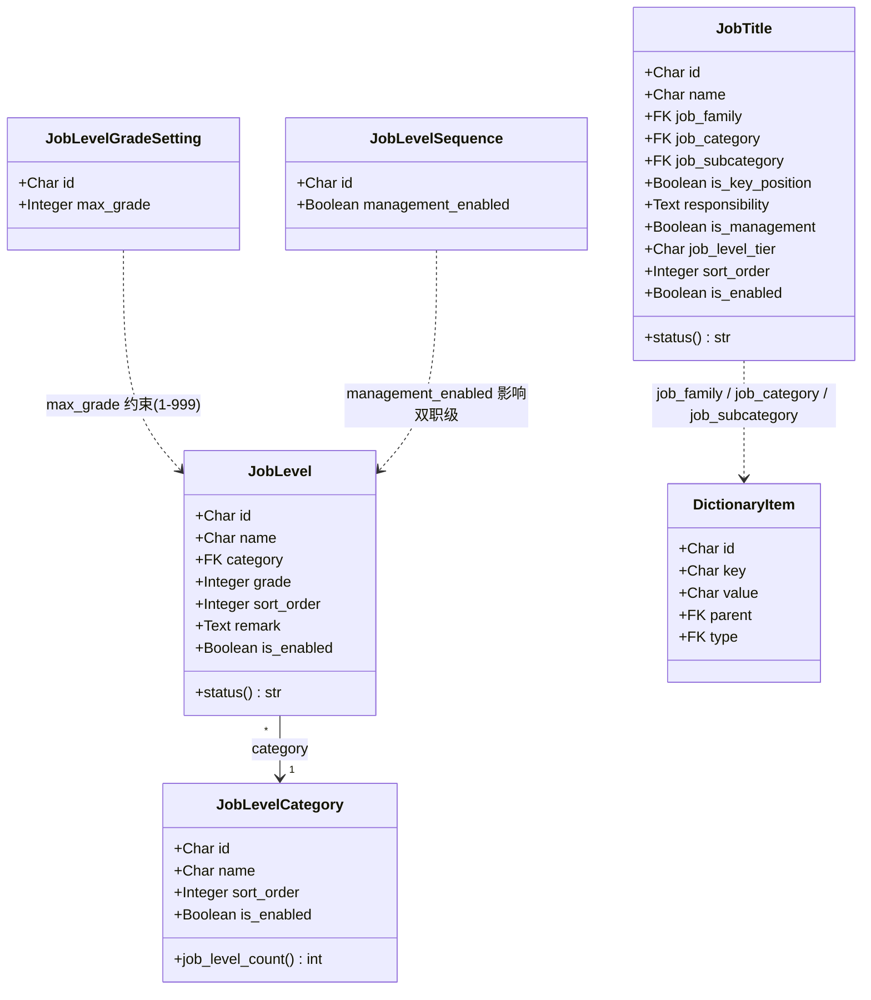
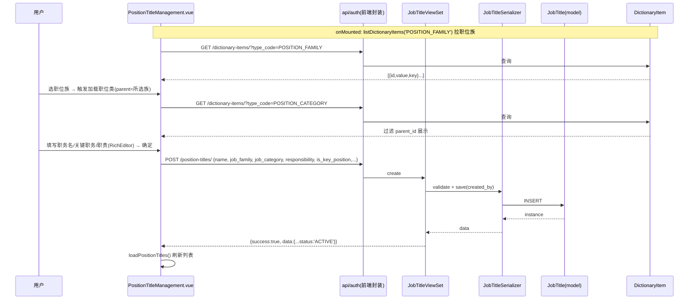
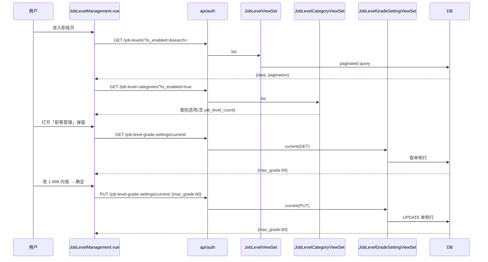
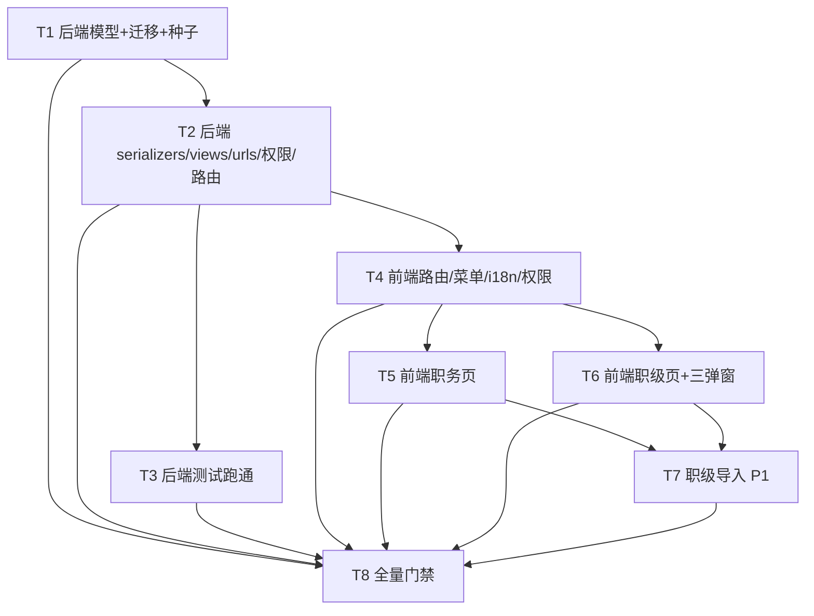

# 组织管理域扩展 · 技术方案与任务分解（部门 / 职务 / 职级）

- **文档版本**：v1.0
- **日期**：2026-10-14
- **架构师**：高见远（software-architect）
- **关联 PRD**：`docs/software-company/org-mgmt-prd-2026-10-14.md`
- **关联仓库**：`/Users/loki/WorkBuddy/招聘助手/ATS-NEW`（后端 `apps/django`，前端 `web/app`）

> 本文件**只描述设计与任务**，不写实现代码、不改动任何源码。所有结论已与现有代码（SettingsLayout.vue / router/index.ts / DepartmentManagement.vue / dictionary app / seed_v2_init.py / config/urls.py / i18n 域文件）逐一核对。

---

## 0. 设计目标与约束回顾（与 PRD 对齐）

| 目标 | 说明 |
|---|---|
| G1 结构归位 | 新建「组织管理」父分组 `g-org`，部门/职务/职级归拢到一个入口 |
| G2 补齐职务与职级 | 职务、职级完整 CRUD + 启停 + 导出 |
| G3 架构一致 | 复用 dictionary（枚举单一真源）/ V2Permission / 软删 / CSV BOM / 统一分页，不引入新工程债 |

**硬约束**：CSV 导出 BOM `utf-8-sig`；分页唯一真源 `useTablePagination`（`pageSizes=[10,20,50,100]`，默认 20）；zh/en i18n 键对称（`npm run locale:audit` 门禁）；禁止 stub 返 501 假成功；本期**在途禁区**（`demand/`、`field_acl/`、`data_permission/`、`candidate/`、`application/`、`add_candidate/`、`DemandList.vue`、`CandidateDetail.vue`）零触碰。

---

## 1. 实现方案（Implementation Approach）

### 1.1 后端 App 拆分裁决（二选一，已论证）

**结论：拆为两个新 Django app** —— `apps/position_title`（职务）与 `apps/job_level`（职级）。`job_level` 内部承载 4 个强关联实体（JobLevel / JobLevelCategory / JobLevelGradeSetting / JobLevelSequence）；职位族三级字典**不**进新 app，走既有 `apps/dictionary`（新增 3 个 DictionaryType + 种子）。

**理由（对齐仓库现状）**：
1. **权限命名空间天然是两个独立域**：PRD 已定 `recruit:settings:job_title:*` 与 `recruit:settings:job_level:*` 两套码，对应两个业务模块，拆 app 即权限域的 1:1 映射。
2. **与既有约定完全一致**：仓库中每个 settings 子模块独立成 app —— `dictionary`、`code_table`、`reason_library`、`brand`、`standard_resume`、`scraped_resume` 等逐个独立。合并成 `org_structure` 会违背这一粒度的项目惯例。
3. **两模块正交**：JobTitle（1 个模型）与 JobLevel 一族（4 个模型）彼此无外键依赖；合并只会把两个独立权限域与不同生命周期的实体混居，降低可读性。
4. **最小化触碰 core 的取舍**：无论拆/合，都不碰 `apps/core`（Department 模型仍在 core，本期只改**前端菜单** + **seed 标签改名 Q6** + **config/urls.py 增行**）。新 app 是纯增量，对 core 零侵入。
5. **代价极低**：两个 `LOCAL_APPS` 条目 + 两份迁移 + 两份 urls 注册，且全部复用 dictionary 范本，符合 DRY（不重复既有 pattern）。

> 备选（已否决）：合并为单 app `apps/org_structure`。理由见上 2/3 —— 会耦合两个独立权限域、与现有 app 粒度冲突。

### 1.2 技术栈与框架选型

| 维度 | 选型 | 依据 |
|---|---|---|
| 后端框架 | Django + DRF（沿用） | 全仓统一 |
| 模型基类 | `FullAuditModel` + `UUIDModel`（nanoid 21） | `apps/common/models.py`，与 dictionary 完全一致 |
| 软删 | `soft_delete()`（`deleted_at` 占位） | dictionary 范本 |
| 权限 | `V2Permission` + `permission_required` + `permission_required_map` | `apps/core/permissions_v2.py` |
| 分页 | `StandardResultsSetPagination`（`page_size`/`page`/`page_size` 查询参数） | `apps/common/pagination.py`，与前端 `useTablePagination` 对齐 |
| 响应信封 | `success_response`（`{success,data,message,code,pagination?}`） | `apps/common/response.py` |
| 前端框架 | Vue3 + Vite + Naive UI（沿用） | 全仓统一 |
| 表单/表格 | `n-form` / `n-data-table` / `useTablePagination` | DepartmentManagement.vue 范本 |
| 富文本 | 复用 `components/RichEditor.vue`（wangEditor5） | 职责说明控件，无需新依赖 |
| 枚举下拉 | 复用 `apps/dictionary`（`listDictionaryItems(typeCode)`） | `web/app/src/api/dictionary.ts` |

---

## 2. 文件清单（File List）

### 2.1 后端（全部新增，零触碰 in-transit 禁区）

```
apps/django/
├── apps/
│   ├── position_title/                 # 新 app
│   │   ├── __init__.py
│   │   ├── apps.py                     # AppConfig（可选，无 seed 需求）
│   │   ├── models.py                   # JobTitle
│   │   ├── serializers.py              # JobTitleSerializer
│   │   ├── views.py                    # JobTitleViewSet（list/create/retrieve/update/destroy）
│   │   ├── urls.py                     # DefaultRouter: position-titles/
│   │   ├── migrations/__init__.py
│   │   ├── migrations/0001_initial.py  # JobTitle 表
│   │   └── tests/test_crud.py          # 鉴权/CRUD/软删/导出 BOM 范式
│   └── job_level/                      # 新 app
│       ├── __init__.py
│       ├── apps.py
│       ├── models.py                   # JobLevel / JobLevelCategory / JobLevelGradeSetting / JobLevelSequence
│       ├── serializers.py              # 4 个 Serializer（含单例读写）
│       ├── views.py                    # 4 个 ViewSet（含 current 单例端点）
│       ├── urls.py                     # job-levels / job-level-categories / job-level-grade-settings / job-level-sequences
│       ├── migrations/__init__.py
│       ├── migrations/0001_initial.py  # 4 张表 + 单例初值
│       └── tests/test_crud.py
└── config/
    ├── settings/base.py                # LOCAL_APPS 增 2 行（apps.position_title / apps.job_level）
    └── urls.py                         # _NON_EMPTY 增 2 行路由挂载
```

### 2.2 既有文件改动（精确清单）

| 文件 | 改动性质 |
|---|---|
| `apps/django/apps/core/management/commands/seed_v2_init.py` | `RESOURCES` 增 job_title / job_level 全码（menu:view + create/edit/delete/export + 类别/职等/序列管理动作码）；`department` 标签「组织职责管理」→「部门」（Q6） |
| `apps/django/apps/dictionary/seeds.py` | 新增 `seed_position_family_type()` / `seed_position_category_type()` / `seed_position_subcategory_type()` |
| `apps/django/apps/dictionary/apps.py` | `ready()` 注册上述 3 个 seed 函数 |

### 2.3 前端（全部新增页面 + 2 个 locale 域文件增 key）

```
web/app/src/
├── pages/settings/
│   ├── PositionTitleManagement.vue     # 新：职务页（复制改造 DepartmentManagement 骨架）
│   ├── JobLevelManagement.vue          # 新：职级页（含三个弹窗入口）
│   └── components/                     # 建议拆分职级三类弹窗为子组件
│       ├── JobLevelCategoryModal.vue   # 新：类别管理弹窗
│       ├── JobLevelGradeModal.vue      # 新：职等上限弹窗
│       └── JobLevelSequenceModal.vue   # 新：职级序列弹窗
├── router/index.ts                     # settings children 增 /settings/job-title、/settings/job-level
├── utils/permissionMenu.ts             # MENU_PERMISSION_RULES 增 2 行（前缀→码）
├── pages/settings/SettingsLayout.vue   # 新增 g-org 分组；迁移 /settings/department 出 g-basic 并改名；增职务/职级叶子
└── locales/domains/
    ├── zh-CN.DATA_PERM_ZH.ts           # SettingsLayout.s14→「部门」；新增 s62「组织管理」/s63「职务」/s64「职级」
    ├── en-US.DATA_PERM_EN.ts           # 对称补译
    ├── zh-CN.APP_UI_ZH.ts              # DepartmentManagement.s1→「部门管理」；新增 PositionTitleManagement / JobLevelManagement 命名空间
    └── en-US.APP_UI_EN.ts              # 对称补译
```

---

## 3. 数据模型与接口（Data Structures & Interfaces）

### 3.1 模型字段表

#### JobTitle（`apps/position_title/models.py`）

| 字段 | 类型 | 必填/可空 | 默认 | 索引 | 关联 | verbose_name |
|---|---|---|---|---|---|---|
| `id` | CharField(32) PK | — | nanoid(21) | PK | — | 主键 |
| `name` | CharField(128) | 必填 | — | — | — | 职务 |
| `job_family` | FK→DictionaryItem | 必填（序列化层校验） | — | db_index | `apps.dictionary.DictionaryItem`（type=POSITION_FAMILY），`on_delete=PROTECT` | 职位族 |
| `job_category` | FK→DictionaryItem | 可空 | null | db_index | type=POSITION_CATEGORY，`on_delete=PROTECT` | 职位类 |
| `job_subcategory` | FK→DictionaryItem | 可空 | null | db_index | type=POSITION_SUBCATEGORY，`on_delete=PROTECT` | 职位子类 |
| `is_key_position` | BooleanField | 必填 | False | — | — | 关键职务 |
| `responsibility` | TextField | 可空 | '' | — | — | 职责说明（富文本 HTML） |
| `is_management` | BooleanField | 可空 | False | — | — | 是否为管理岗 |
| `job_level_tier` | CharField(64) | 可空 | null | — | 系统内置枚举（见 Q7，P1 字典化） | 岗位层级 |
| `sort_order` | IntegerField | 可空 | 0 | — | — | 顺序 |
| `is_enabled` | BooleanField | — | True | db_index | — | 是否启用（对齐 dictionary） |
| `created_by/updated_by` | FK→core.User | 可空 | null | — | `on_delete=SET_NULL` | 创建人/修改人 |
| `created_at/updated_at` | DateTimeField | — | auto | — | — | 时间戳 |
| `deleted_at` | DateTimeField | 可空 | null | db_index | — | 软删 |

#### JobLevel（`apps/job_level/models.py`）

| 字段 | 类型 | 必填/可空 | 默认 | 索引 | 关联 | verbose_name |
|---|---|---|---|---|---|---|
| `id` | CharField(32) PK | — | nanoid(21) | PK | — | 主键 |
| `name` | CharField(128) | 必填 | — | — | — | 职级名称 |
| `category` | FK→JobLevelCategory | 必填 | — | db_index | `on_delete=PROTECT` | 类别 |
| `grade` | IntegerField | 必填 | 1 | — | 受 JobLevelGradeSetting.max_grade 约束（1–999） | 职等 |
| `sort_order` | IntegerField | 可空 | 0 | — | — | 顺序 |
| `remark` | TextField | 可空 | '' | — | — | 备注 |
| `is_enabled` | BooleanField | — | True | db_index | — | 是否启用 |
| 审计字段 | 同 JobTitle | — | — | — | — | — |

#### JobLevelCategory

| 字段 | 类型 | 必填/可空 | 默认 | 索引 | 关联 | verbose_name |
|---|---|---|---|---|---|---|
| `id` | CharField(32) PK | — | nanoid(21) | PK | — | 主键 |
| `name` | CharField(128) | 必填 | — | — | — | 类别名称 |
| `sort_order` | IntegerField | 可空 | 0 | — | — | 顺序 |
| `is_enabled` | BooleanField | — | True | db_index | — | 是否启用 |
| 审计字段 | 同 | — | — | — | — | — |

#### JobLevelGradeSetting（全局单例）

| 字段 | 类型 | 必填/可空 | 默认 | 约束 | verbose_name |
|---|---|---|---|---|---|
| `id` | CharField(32) PK | — | 固定单例 id（如 `GLOBAL`） | PK | 主键 |
| `max_grade` | IntegerField | 必填 | 40 | 校验器 1–999 | 职等上限 |
| 审计字段 | 同 | — | — | — | — |

#### JobLevelSequence（全局单例）

| 字段 | 类型 | 必填/可空 | 默认 | verbose_name |
|---|---|---|---|---|
| `id` | CharField(32) PK | — | 固定单例 id（如 `GLOBAL`） | 主键 |
| `management_enabled` | BooleanField | — | False | 管理序列开关（专业序列系统内置固定、恒开，不入表） |
| 审计字段 | 同 | — | — | — |

> **单例实现**：两张单例表各以固定 id 播种一行（migration `RunPython` 或 post_migrate）。ViewSet 覆写 `get_object()` 恒返回该行；对外暴露 `@action(detail=False, methods=['get','put'], url_path='current')` —— 即 `GET/PUT /job-level-grade-settings/current/` 与 `/job-level-sequences/current/`，无需传 PK。
> **设计注**：JobLevelGradeSetting 与 JobLevelSequence 业务上都是「职级全局配置」，可考虑合并为单 `JobLevelConfig(max_grade, management_enabled)` 一张表一个端点（更省）。但因 PRD 明确拆四实体、且三个弹窗（职等/序列）由不同对话框维护，**保留两个单例**更贴合 PRD；若兵哥想减表，T2 阶段可合并——列为非阻塞设计注。

### 3.2 序列化层约定

- DB 字段 `is_enabled`；序列化额外暴露**只读派生** `status`（ACTIVE/INACTIVE），使前端直接复用 DepartmentManagement 的 `status` 列渲染与 `is_enabled` 筛选/切换逻辑（统一 UI 语义）。
- `job_family`/`job_category`/`job_subcategory` 输出 `{id, value, key, type_code}`（或仅 `id`+展示名），写入接收字典项 `id`。
- `JobLevelCategorySerializer` 加 `job_level_count`（SerializerMethodField，统计该类下 `is_enabled` 职级数，用于「包含 N 个职级」展示）。
- `responsibility` 存原始 HTML 字符串；`is_key_position`/`is_management` 写时校验。

### 3.3 API 端点设计

| App | 路由（basename） | HTTP | 说明 | 权限码映射 |
|---|---|---|---|---|
| position_title | `position-titles/` (`position-title`) | GET list | 列表（search=name，is_enabled 筛选，分页） | `permission_required='recruit:settings:job_title:list'` |
| | | POST | 新建 | map: create→`...:job_title:create` |
| | | GET `/{id}/` | 详情 | list |
| | | PUT/PATCH `/{id}/` | 更新 | map: update/partial_update→`...:job_title:edit` |
| | | DELETE `/{id}/` | 软删 | map: destroy→`...:job_title:delete` |
| job_level | `job-levels/` (`job-level`) | 同职务 | 职级 CRUD | `recruit:settings:job_level:list` + map create/edit/delete |
| | `job-level-categories/` (`job-level-category`) | CRUD | 类别 CRUD（含 job_level_count） | `recruit:settings:job_level:category:list` + create/edit/delete |
| | `job-level-grade-settings/` (`job-level-grade-setting`) | GET/PUT `/current/` | 职等上限单例读写 | list + map current(PUT)→`...:job_level:grade:edit` |
| | `job-level-sequences/` (`job-level-sequence`) | GET/PUT `/current/` | 管理序列开关单例读写 | list + map current(PUT)→`...:job_level:sequence:edit` |

> **导出说明**：职务/职级的 CSV 导出走**前端客户端**（复用 DepartmentManagement 的 `csvEscape`/`triggerDownload` + BOM `utf-8-sig`），**不设后端 `/export/` 端点**（与全仓既有范式一致）；`:export` 权限码仅用于前端「导出」按钮的可见性授权。

> 动作码清单（seed `RESOURCES`）：
> - job_title：`menu:view, create, edit, delete, export`
> - job_level：`menu:view, list, create, edit, delete, export`（职级本身）+ `category:list/create/edit/delete`（类别管理）+ `grade:edit`（职等管理）+ `sequence:edit`（职级序列管理）
> - 读码（list）与 menu:view 分离，遵循 dictionary 已采用的「读码 + 写码」双轨（seed 末尾 CONFIG_CODES 已给 settings 类模块授权，新码须同步纳入，见 T2）。

### 3.4 类图（Mermaid）



### 3.5 调用时序（Mermaid）

**(a) 职务新增（含职位族三级级联下拉加载）**



**(b) 职级列表 + 职等单例读写**



---

## 4. 前端页面 / 组件拆分

### 4.1 复用策略裁决（复制改造 vs 抽 composable）

**结论：复制改造（copy-and-adapt）DepartmentManagement.vue 骨架，不抽象公共 composable。**

理由：
1. DepartmentManagement 含**部门树形逻辑 + 用户下拉 + 父子禁用**等专属逻辑，无法干净泛化出通用 list composable；强行抽象会过度设计（over-engineering）。
2. 仓库现有范式即**每页独立**（每个 settings 页 ~30KB 自包含），无共享 list 基类；保持风格一致降低评审成本。
3. P0 时间盒内复制改造最快、最稳；若后续多页重复度上升，再抽 `useListPage` 也不迟（列为后续优化，非本期）。

### 4.2 PositionTitleManagement.vue（新）

- 复制 DepartmentManagement 的 `page-container / page-header / page-body` 三件套、`n-data-table` + `useTablePagination`、状态筛选（改为 `is_enabled` 参数）、搜索（name）、启停（`is_enabled` 软停，停用仅提示不硬阻止）、CSV 导出（`utf-8-sig` BOM，字段不含「在职员工数」）。
- **删除**：树形展开、用户下拉、父子禁用等部门专属逻辑。
- **新增**：编辑弹窗字段（职务*/职位族*下拉/职位类级联/职位子类级联/关键职务*/职责说明 RichEditor/是否为管理岗/岗位层级/顺序）；职位族三级下拉经 `listDictionaryItems(typeCode)` 加载并按 `parent_id` 客户端过滤（P1 后端校验一致）。
- 列表列：`职务 | 职位族 | 关键职务(是/否) | 操作(编辑/停用)`，隐藏「在职员工数」（Q3）。

### 4.3 JobLevelManagement.vue（新）+ 三个子组件

- 主表复用同一骨架：列表列 `职级名称 | 类别 | 职等 | 顺序 | 备注 | 操作(编辑/停用)`，隐藏「在职员工数」。
- 顶部按钮组：`添加职级 / 导入（入口，点击提示「即将上线」，兵哥 Q4 拍板不实现）/ 类别管理 / 职等管理 / 职级序列管理`。
- 编辑弹窗：`职级名称*/类别*(下拉)/职等*(数字，受 max_grade 约束)/顺序/备注`。
- **建议拆分**三个对话框为子组件（主文件会过长，违反可维护性）：
  - `JobLevelCategoryModal.vue`：类别列表（每行 名称输入 + 包含 N 个职级 + 停用链接）+ 添加类别 + 保存。
  - `JobLevelGradeModal.vue`：`max_grade` 数字输入（默认 40，提示 1–999，越界拦截）。
  - `JobLevelSequenceModal.vue`：专业序列（置灰必选说明）+ 管理序列开关（n-switch）。
- 单例读取：进页或开弹窗时 `GET /job-level-grade-settings/current/` 与 `/job-level-sequences/current/`。

### 4.4 菜单 / 路由 / i18n / 权限改动（精确）

**SettingsLayout.vue（约 95–147 行 rawSubMenuOptions）**
- 新增**一级菜单**（与 g-company/g-user/g-permission 平级的可展开父项，形态同「用户管理」），**位置保持在「基本信息」附近、不强置首位**（兵哥 Q1 拍板：做成一级菜单、位置不变）：
  ```ts
  { key: 'g-org', type: 'group', label: t('pages.settings.SettingsLayout.s62'), children: [
      { key: '/settings/department', label: t('pages.settings.SettingsLayout.s14') },  // s14 改为「部门」
      { key: '/settings/job-title',  label: t('pages.settings.SettingsLayout.s63') },  // 职务
      { key: '/settings/job-level',  label: t('pages.settings.SettingsLayout.s64') },  // 职级
  ]}
  ```
- 删除原 `g-basic` 内第 114 行 `/settings/department` 叶子（`s14` 标签不变、含义改为「部门」）。
- 排序：不强制置顶，放在「基本信息」分组附近即可（Q1 兵哥定：一级菜单、位置不变）。

**router/index.ts（settings children，约 131 行后）**
- 增两条：
  ```ts
  { path: 'job-title',  name: 'PositionTitleManagement', component: () => import('.../settings/PositionTitleManagement.vue') },
  { path: 'job-level',  name: 'JobLevelManagement',      component: () => import('.../settings/JobLevelManagement.vue') },
  ```

**permissionMenu.ts（MENU_PERMISSION_RULES）**
- 增两行（前缀必须以 `/` 开头才能被 `filterMenuByPermission` 裁剪）：
  ```ts
  { prefix: '/settings/job-title', code: 'recruit:settings:job_title:menu:view' },
  { prefix: '/settings/job-level', code: 'recruit:settings:job_level:menu:view' },
  ```

**i18n 域文件**
- `zh-CN.DATA_PERM_ZH.ts`：`SettingsLayout.s14` 值 `"组织管理"` → `"部门"`；新增 `s62`=`"组织管理"`、`s63`=`"职务"`、`s64`=`"职级"`。
- `en-US.DATA_PERM_EN.ts`：对称改/补 `s14`=`"Department"`、`s62`=`"Organization"`、`s63`=`"Job Title"`、`s64`=`"Job Level"`。
- `zh-CN.APP_UI_ZH.ts`：`DepartmentManagement.s1` 值 `"组织管理"` → `"部门管理"`；新增命名空间 `pages.settings.PositionTitleManagement.s1..`（页面 H1、搜索占位、状态、按钮、列名、弹窗字段等）与 `pages.settings.JobLevelManagement.s1..`。
- `en-US.APP_UI_EN.ts`：对称补译。
- 新增命名空间的 `sN` 从各文件当前最大值之后顺延（`npm run locale:audit` 门禁保证 zh/en 对称）。
- 现有 `SettingsLayout` 命名空间最大已用 `s61`（主题外观），故 `s62/63/64` 为安全新增位。

---

## 5. 依赖包（Dependencies）

**无需新增任何 npm 或 Django 依赖：**
- 富文本：`components/RichEditor.vue`（wangEditor5）已存在，直接复用。
- 枚举下拉：`api/dictionary.ts` 已存在。
- 分页：`useTablePagination` 已存在。
- 主键 nanoid：已在 `UUIDModel` 使用。
- 后端：DRF / drf-spectacular / django-filter 等已在 `THIRD_PARTY_APPS`。

---

## 6. 共享约定（Shared Knowledge，供工程师遵循）

| 约定 | 取值 / 规则 |
|---|---|
| i18n 命名空间 | 菜单 label → `pages.settings.SettingsLayout.sN`（DATA_PERM 域）；页内 key → `pages.settings.<PageName>.sN`（APP_UI 域）；zh/en 必须对称 |
| 权限码清单 | `recruit:settings:job_title:{menu:view,list,create,edit,delete,export}`；`recruit:settings:job_level:{menu:view,list,create,edit,delete,export}` + `category:{list,create,edit,delete}` + `grade:edit` + `sequence:edit`（其中 `export` 码仅授权前端「导出」按钮，CSV 客户端导出、无后端端点） |
| CSV BOM | 导出一律 `'\uFEFF' + content`，`Blob({type:'text/csv;charset=utf-8'})`，复用 DepartmentManagement `csvEscape`/`triggerDownload` |
| 分页 | 业务页禁用手写 pageSize；`useTablePagination()`（默认 20，选项 [10,20,50,100]） |
| 字典类型命名 | 新增 3 类型建议码 `POSITION_FAMILY` / `POSITION_CATEGORY` / `POSITION_SUBCATEGORY`（**避免与既有 `JOB_CATEGORY` 字面冲突**，见 Q2） |
| 启停字段 | DB `is_enabled`（对齐 dictionary）；API 派生只读 `status`(ACTIVE/INACTIVE) |
| 软删 | `perform_destroy` 调 `soft_delete()`，不做物理删除 |
| 单例配置 | 固定 id 播种一行；ViewSet 暴露 `/current/` 端点 |

---

## 7. 任务分解（Ordered Task List T1..Tn）

> 顺序可被工程师按序执行；P0 闭环 T1–T8，P1 项（级联校验/P1-2、在职员工数/P1-3、字典化/P1-4、导入/P1-1）列入末尾标注，不阻塞 P0 上线。

| ID | 目标 | 涉及文件 | 依赖 | 优先级 | 验收标准 |
|---|---|---|---|---|---|
| **T1** | 后端建 app + 模型 + 迁移 + 注册 | `position_title/*`（models/migrations/apps/__init__）、`job_level/*`（4 模型/migrations）、`config/settings/base.py`（LOCAL_APPS +2）、`dictionary/seeds.py`+`apps.py`（3 类型种子注册） | 无 | P0 | `python manage.py makemigrations && migrate` 成功；5 张表（含 2 单例初值）创建；种子字典类型经 migrate 落库 |
| **T2** | 后端 serializers + views + urls + 权限码 + 路由挂载 | 两 app 的 serializers/views/urls；`config/urls.py`（_NON_EMPTY +2）；`seed_v2_init.py`（RESOURCES 增 job_title/job_level 全码 + department 标签改名 Q6）；`seed_v2_init` 后须 `invalidate_known_codes`（命令已内置） | T1 | P0 | 所有端点 `drf-spectacular`/`curl` 可达；权限码在 seed 后齐全；`/position-titles/`、`/job-levels/`、`/job-level-categories/`、`/job-level-grade-settings/current/`、`/job-level-sequences/current/` 均 200 |
| **T3** | 后端测试跑通 | 两 app `tests/test_crud.py`（鉴权 401 / CRUD 200 / 软删 204 且列表排除 / 单例读写 / 唯一约束 400） | T2 | P0 | `pytest` 两 app 全绿；CSV BOM 属前端 T5/T6 验收，后端无导出端点 |
| **T4** | 前端路由/菜单/i18n/权限 | `router/index.ts`（2 路由）、`utils/permissionMenu.ts`（2 行）、`SettingsLayout.vue`（g-org 分组 + 部门迁移改名）、4 个 locale 域文件（增/改 key） | T2（权限码） | P0 | 侧边栏首位出现「组织管理」组，含部门/职务/职级三项；`npm run locale:audit` 通过（zh/en 对称）；s14→「部门」、s1→「部门管理」、s62→「组织管理」生效 |
| **T5** | 前端职务页 | `PositionTitleManagement.vue` | T2, T4 | P0 | 列表/搜索/状态筛选/分页/新增编辑弹窗（含三级级联下拉 + RichEditor 职责说明 + 必填校验）/启停/CSV BOM 导出 全部可用；不含在职员工数列 |
| **T6** | 前端职级页 + 三弹窗 | `JobLevelManagement.vue` + `JobLevelCategoryModal.vue` + `JobLevelGradeModal.vue` + `JobLevelSequenceModal.vue` | T2, T4 | P0 | 职级 CRUD + 启停 + 导出；类别管理（含职级数展示/停用软停）；职等上限单例读写（1–999 拦截）；序列弹窗（专业置灰 + 管理开关持久化） |
| **T7** | 职级导入（P1，兵哥 Q4 拍板：仅入口） | `JobLevelManagement.vue` 保留「导入」按钮，点击提示「即将上线」，不实现模板下载/解析/写入 | T5, T6 | P1 | 按钮可见、点击有「即将上线」提示，无导入逻辑 |
| **T8** | 全量门禁 | 全仓 | T1–T7 | P0 | `pytest`（后端）+ `locale:audit` + 前端 `build/typecheck` 全绿；手动走查三页 CRUD/导出/启停/弹窗 |

**P1 后续（不阻塞 P0，T8 之后择期）**：P1-2 三级级联后端一致性校验；P1-3 在职员工数统计落地；P1-4 `is_management`/`job_level_tier` 字典化。

---

## 8. 在途禁区重申（Zero-Touch Boundary）

本期**严格零触碰**以下目录/文件：`demand/`、`field_acl/`、`data_permission/`、`candidate/`、`application/`、`add_candidate/`、`DemandList.vue`、`CandidateDetail.vue`。

新模块做到零触碰的方式（仅增量）：
1. **纯新增文件**：两个新 app 全部文件、`PositionTitleManagement.vue`、`JobLevelManagement.vue` 及三个子组件。
2. **配置增行**：`config/urls.py`（`_NON_EMPTY` +2 行路由）、`config/settings/base.py`（`LOCAL_APPS` +2 行）。
3. **种子增行**：`seed_v2_init.py` 的 `RESOURCES` 增码 + `department` 标签改名；`dictionary/seeds.py`+`apps.py` 注册 3 类型（仍在 dictionary app 内，不碰禁区）。
4. **前端增改**：`SettingsLayout.vue` 菜单增改、`router/index.ts` 增路由、`permissionMenu.ts` 增 2 行、2 个 locale 域文件增/改 key（不改其他页）。
5. 停用被引用项**仅提示不硬阻止**（Q5 推荐），避免任何跨 candidate/demand/position 的引用校验代码。

---

## 9. 待明确事项（Q1–Q7，含推荐默认）

| 编号 | 问题 | 推荐默认（已采用） | 备选 | 需兵哥拍板？ |
|---|---|---|---|---|
| **Q1** | 组织管理菜单形态与位置 | 兵哥拍板：**做成一级菜单（与「用户管理」平级的可展开父项，部门/职务/职级为其二级子项），位置不变**（不强置首位，放「基本信息」附近） | 强制置首位 | 已定 |
| **Q2** | 职位族/类/子类数据来源 | 全部走 `apps/dictionary`，新增 3 类型，建议码 `POSITION_FAMILY/POSITION_CATEGORY/POSITION_SUBCATEGORY`（避开既有 `JOB_CATEGORY` 字面冲突） | 部分走系统内置枚举；或复用/重命名既有 `JOB_CATEGORY` | 是（码命名 + 是否复用 JOB_CATEGORY） |
| **Q3** | 「在职员工数」列 | 本期**直接隐藏**（系统无员工表） | 从「已入职」candidate 计数（跨禁区，高风险）→ 落 P1-3 | 否（默认已定，风险高不取备选） |
| **Q4** | 职级「导入」按钮 | 进 **P1 完整实现**，复用部门导入范式 | 仅保留入口提示「即将上线」 | 是（建议采纳默认） |
| **Q5** | 启停字段名 + 引用约束 | 字段用 `is_enabled`（对齐 dictionary）；停用**仅提示不硬阻止** | 用 `is_active`（对齐 Department 现状）；或硬阻止 | 否（默认已定；硬阻止留 P2-1） |
| **Q6** | 权限码 + department seed 标签改名 | 采用 `recruit:settings:job_title:*` / `job_level:*`；现存 `department` seed 标签「组织职责管理」**同步改名「部门」** | department 标签保留不改 | 是（建议采纳同步改名） |
| **Q7** | 岗位层级 / 管理岗枚举 | 本期内置（是/否 + 简单层级枚举，CharField 存储） | 一步到位字典化（落 P1-4） | 否（默认已定，P1 字典化） |

---

## 10. Anything UNCLEAR（需进一步确认 / 假设）

1. **Q2 字典类型码冲突**：既有 `JOB_CATEGORY`（职位类别，单级枚举）与 PRD 新增「职位类」语义不同但字面相近。已默认采用 `POSITION_*` 新码规避，需兵哥确认是否接受，或希望复用/重命名既有 `JOB_CATEGORY`。
2. **Q1 菜单排序**：默认置首位，兵哥可能想要其他顺序（影响 `SettingsLayout.s62` 插入点，不改变工作量）。
3. **Q4/Q6 拍板**：导入是否进 P1、department 标签是否改名，影响 T2 种子内容。
4. **单例建模**：JobLevelGradeSetting 与 JobLevelSequence 保留两单例（默认）或合并为单 `JobLevelConfig`（见 §3.1 设计注），非阻塞。
5. **管理序列「双职级」下游影响**：仅本期落开关存储，P2-2 才在 candidate/position 维护展示，本期不触碰禁区。
6. **字段 `job_level_tier`（岗位层级）内置枚举值**：P0 暂用简单层级文本（如 初级/中级/高级/专家），具体枚举值待兵哥在动 T5 前确认（不影响骨架）。

---

## 11. 任务依赖图（Mermaid）



---

*文档完。所有结论已对齐 `SettingsLayout.vue`、`router/index.ts`、`DepartmentManagement.vue`、`useTablePagination.ts`、`permissionMenu.ts`、`dictionary/*`、`seed_v2_init.py`、`config/urls.py`、`config/settings/base.py` 与 4 个 i18n 域文件的真实实现。*
