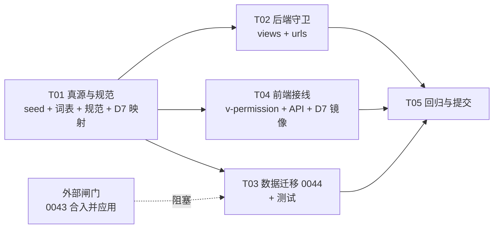
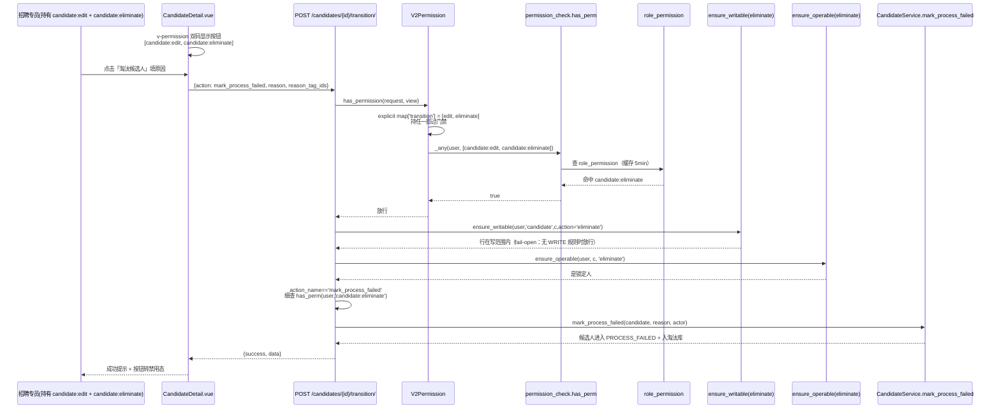
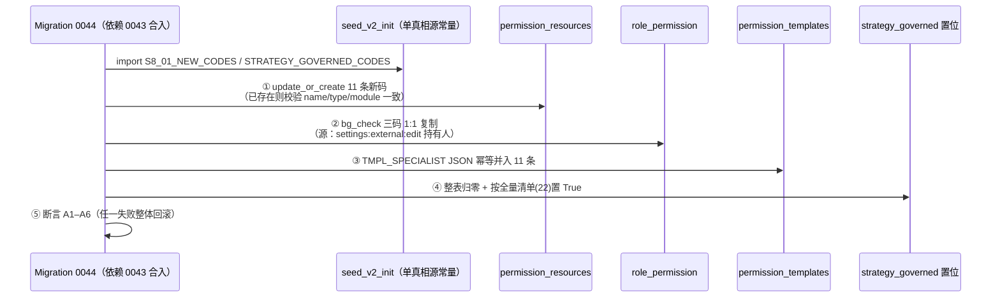
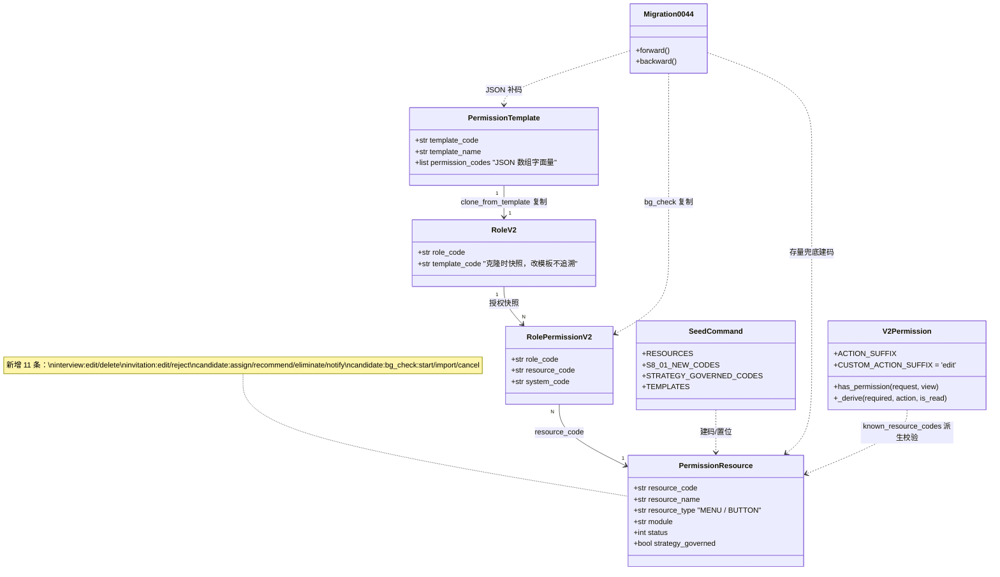

# 方案：S8-01 缺失资源码补建（23 条功能逐条落地）

> 架构师：高见远（Gao） · 2026-10-20 · 对应 TODO `S8-01 / S8-03`
> 输入：`TODO.md` §S8（兵哥 26 条清单，S8-02 已补 3 条，剩 23 条）、`docs/ARCH_校招资源码拆分与资源名对齐.md`、`docs/DESIGN_资源编码规范.md`
> 参考实现：S8-02 commit `3a2ccd7e`（删除需求 / 开启抢单 / 批量变更人员）
> 纪律：本文档只做设计与任务分解，**不改任何代码文件、不做任何 git 写操作**。
>
> **状态：决策已闭环（2026-10-20 兵哥拍板）；实施中——T01/T02 已派 engineer，T03 等 0043 合入后开工。**
> 本文档为「决策已闭环」修订版：§10 的八项决策已全部落表（含裁决日期）；迁移编号按 D1 裁决固定为 **0044**；新增 §5.6「派生副作用清单」（T01 建码后 4 个 view 的 action 级守卫码变化，供 engineer 逐个核对）。

---

## 0. 一页结论（TL;DR）

1. **23 条不是同一类问题**。逐条调研后只有 **11 条值得本轮补码**；7 条功能前后端都不存在（建码即僵尸资源，违反 R3 精神）；5 条已被现有码覆盖（编辑画像 / 发送 offer / 重发 offer / 重发 offer 审批）。
2. **补码的 11 条里藏着一个 P0 越权面和一个错域守卫**：
   - 面试模块 `interview:edit` / `interview:delete` **seed 未定义** → `InterviewViewSet` 的 update/destroy 按 action 派生不到码，**回退 `recruit:interview:list`**（持列表码即可改/删面试）——与 S8-02 修复的「回退 list 即可删需求」同款。
   - 邀约模块 `invitation:edit` **seed 未定义** → `InvitationViewSet.transition`（入池/已联系/成功/失败/干预/终止全部走它）**回退 `recruit:invitation:list`**。
   - 背调 5 项全部挂在**外部集成配置域** `recruit:settings:external:edit` 下（发起/补充/取消/上传都是它）——语义错域：能配生态对接的人才能做背调，该做背调的 HR 反而要做配置授权。
3. **新增 11 条资源码**（§2），动作词表 R3 扩 4 个词（`recommend/eliminate/notify/cancel`，D2 已裁；备选压缩方案见 §10-D2）。
4. **迁移编号是 0044**（D1 裁决）：`0042_rename_mgmt_unit_resources_to_settings.py`（管理单元码族迁 settings 家族）**已由他人提交合入**（commit `ac42507d`，dev 库已应用）；`0043_rename_role_resources_to_settings_permissions.py`（身份管理角色码归位，兵哥 2026-10-20 拍板）是**今晚 23:47 出现的在途迁移、尚未提交、dev 库待应用**。S8-01 数据迁移因此固定为 **`0044_s8_01_missing_resource_codes.py`**，`dependencies` 依赖 `('core','0043_rename_role_resources_to_settings_permissions')`，docstring 必须写明「必须待 0043 合入并在目标库应用后，本迁移才可运行」。TODO.md 里「0042 起」的表述已过时，以本版为准。
5. **提交切分按 D1 拆开**（§8.4）：C2 拆为 C2a（T02 守卫独立先行提交）与 C2b（T03 迁移 0044，等 0043 落地后单独提交）——不能把守卫和迁移捆成一个 commit 干等 0043。
6. **「同步五处」里有一处本轮零改动**：前端 `permissionMenu.ts` —— 本轮不新增任何 MENU 码（不开新页面），背调入口复用 `/settings/external` 与候选人详情页。真正要补的是**按钮级 `v-permission`**（全仓现仅 10 处，候选人详情操作卡 8 个按钮、邀约中心整页、面试列表行操作、简历筛选页**零覆盖**）。
7. **发现三个新缺陷（调研副产品，两个需同批修、一个已报错可见）**：
   - `POST /background-check/orders/upload-report/` 与 `GET /background-check/orders/bg-suggestions/` **路由未登记**（`config/urls.py` 的 `_DIRECT_VIEWS` 只有 suppliers/products/create-order/list/detail/query/report）→ 「已有报告」上传分支与背调建议聚合**现在就是 404**。补 `bg_check:import` 码不同批补路由 = 白建。
   - 候选人详情「发送通知」与列表「批量发送通知」都是**前端假成功 stub**（`message.success` 后无任何请求）；备注保存同样是 stub。后端 notification app 只有模板/日志，**无发送端点**。
   - 邀约中心「处理超时」按钮打的是 `POST /invitations/process-expired/`，而后端该 action 是 `methods=['get']`（invitation/views.py:98）→ **405**。错误有 catch 提示（不静默），但功能实际不可用；属 S8-03 功能待办，本轮不修（见 §9-R10）。

---

## 1. 现状调研：23 条逐条落点

> 调研方法：功能名 → 前端 locale 键反查定位页面 → 读页面 handler 找真实 API → 读后端 view 的 `permission_required` / `permission_required_map` → 按 `permissions_v2.V2Permission._derive()` 推演**实际生效的守卫码**。凡前后端都无落点的如实标注，不猜。

### 1.1 判定口径

| 判定 | 含义 | 处置 |
|---|---|---|
| **A** | 有真实端点，守卫**缺**（派生码不存在→回退 list）或**错域**（守了别的域的码） | **本轮补码 + 精确挂守卫** |
| **B** 端点在、守卫是粗粒度 `:edit`（能跑，但粒度不符兵哥清单） | 前端 stub（假成功）或按钮未接线 | **本轮补码 + 前端接线** |
| **C** | 前后端均无落点（无 UI、无端点） | **本轮不建码**（否则 R3 僵尸资源），记待办 |
| **D** | 已有码覆盖，无需新码 | **不建码**，在清单里登记闭环 |

### 1.2 23 条逐条表

#### 招聘需求（1 条）

| # | 功能 | 前端落点 | 后端端点 | 当前生效守卫 | 行级动作键 | 判定 |
|---|---|---|---|---|---|---|
| 1 | 编辑画像 | `settings/DemandConfig.vue:109`「画像设置」分区（`profileFieldRules` 等），随整页保存 | `POST/PUT /api/v1/system/config/demand`（`DemandConfigView`，demand/views.py:285） | map：`get→demand_config:list`，`post/put→[demand_config:edit, open_grab]`（S8-02 已拆） | — | **D** |

- 画像设置是**同一个表单的一个分区**，与「功能设置 / 抢单设置」共用页级保存按钮与页级码。拆独立码会出现「一个表单三个码、保存时互相打架」的割裂（S8-02 的 open_grab 拆法之所以成立，是因为抢单卡是**可独立勾选的开关**，画像不是）。
- `pages.demand.DemandList.s25/s26`「职位画像」locale 键是**死键**（全仓无引用）——需求列表页的画像入口尚未接线。
- **结论：不补码，清单登记闭环**（若兵哥坚持要独立码，唯一合理形态是 `recruit:settings:demand_config:profile:edit`，需 R3 加 `profile` 词且要先有独立保存端点，成本大于收益，不建议）。

#### 候选人基础（4 条）

| # | 功能 | 前端落点 | 后端端点 | 当前生效守卫 | 行级动作键 | 判定 |
|---|---|---|---|---|---|---|
| 2 | 分配职位 | `CandidateList.vue:167` 按钮 = **stub**（`message.info('批量分配职位功能开发中')`） | `POST /candidates/batch/assign/`（`CandidateBatchAssignView`，candidate/views.py:1090）**端点已在** | `{'post': 'recruit:candidate:edit'}` | — | **B** |
| 3 | 转推其他职位 | `CandidateDetail.vue:259`「推荐其他职位」→ `recommendCandidateToPosition` | `POST /candidates/batch/recommend/`（`CandidateBatchRecommendView`，candidate/views.py:979） | `{'post': 'recruit:candidate:edit'}` | `recommend`（ensure_writable + operable_q 双守卫已接，views.py:639/1025） | **B** |
| 4 | 淘汰 | `CandidateDetail.vue:265`「淘汰候选人」→ `transitionCandidate(id,'mark_process_failed')` | `POST /candidates/{id}/transition/`（`CandidateViewSet.transition`，views.py:237，无 map） | 派生 `recruit:candidate:edit`（该码已注册→守它） | `eliminate`（FSM_ACTION_TO_WRITE_ACTION 映射 + ensure_operable，views.py:59-62/254-258） | **B** |
| 5 | 发送通知 | 详情 `CandidateDetail.vue:237`（s3）+ 列表 `CandidateList.vue:418`（s23）均为**假成功 stub**（`handleSendNotification` 直接 `message.success`） | **无端点**（notification app 仅模板/日志 ViewSet） | — | `notify`（ACTION_REGISTRY 已登记，无调用方） | **B+C**（D3 已裁：本期做端点 + 落库 + 校验，§10-D3） |

- 候选人详情「操作」卡 8 个按钮（发送通知/发起背调/补充背调/关注/转发/推荐其他职位/放入人才库/淘汰）**零 v-permission**；它们目前全靠后端 `candidate:edit` 一道闸。
- 「转发候选人」（s294）与「关注」（s291）兵哥清单未列，维持 `candidate:edit` 不动。

#### 简历筛选（3 条）

| # | 功能 | 前端落点 | 后端端点 | 当前生效守卫 | 判定 |
|---|---|---|---|---|---|
| 6 | 邀请筛选简历 | 无。`pages.settings.ProcessDetailModal.s95`「邀请筛选」是**招聘流程阶段动作类型**的配置枚举（ProcessStageEditor.vue:233 同族），不是运行时功能 | 无 | — | **C** |
| 7 | 撤回筛选邀请 | 无（locale 全库零命中） | 无 | — | **C** |
| 8 | 催促筛选 | 无（locale 全库零命中） | 无 | — | **C** |

- 简历筛选模块（`ScreeningList.vue`，路由 `/screenings`）本身是个**薄壳**：列表复用 `listCandidates`（`candidate:list`），批量筛选走 `POST /candidates/batch/screen/`（守卫 `candidate:edit`），导出走 `candidate:export`。整个模块**没有自己的资源码族**，菜单守卫借的是 `recruit:candidate:menu:view`。
- S8-03 说的「简历筛选整体无资源码」指的就是这个。**本轮不建议**为薄壳页面造码；真正的缺口是 6/7/8 三个功能本身不存在（见 §10-D4：先做功能还是先做码）。

#### 面试邀约（2 条）

| # | 功能 | 前端落点 | 后端端点 | 当前生效守卫 | 行级动作键 | 判定 |
|---|---|---|---|---|---|---|
| 9 | 标记邀约失败 | `InvitationCenter.vue:227`「失败」按钮 → `markResult(id,false)` | `POST /invitations/{id}/transition/`（`InvitationViewSet.transition`，invitation/views.py:57，无 map） | 派生 `recruit:invitation:edit` → **seed 无此码 → 回退 `recruit:invitation:list`**（越权面） | `transition`（ensure_writable 已接，views.py:60） | **A** |
| 10 | 填写邀约标记 | `InvitationCenter.vue:224`「已联系」→ `markContacted(id)` | 同上（`action='contact'`） | 同上（回退 list） | `transition` | **A** |

- 邀约中心整页**零 v-permission**；行内 7 个按钮（入池/抢单/已联系/成功/失败/干预/终止）全部只靠后端一道闸，而这道闸现在是坏的（回退 list）。
- `grab`（抢单）是独立 @action，同样派生 edit→回退 list；但它有 `ensure_writable(action='claim')` 行级守卫兜底，且兵哥清单未列，维持现状（码补上后自动收紧）。
- 邀约模块 seed 只有 `menu:view / list / create` 三条，**无 edit/delete**。

#### 面试管理（5 条）

| # | 功能 | 前端落点 | 后端端点 | 当前生效守卫 | 判定 |
|---|---|---|---|---|---|
| 11 | 取消面试 | `InterviewList.vue:238`「取消面试」→ `cancelInterview` = `DELETE /interviews/{id}/` | `InterviewViewSet.destroy`（interview/views.py:53，无 map） | 派生 `recruit:interview:delete` → **seed 无此码 → 回退 `recruit:interview:list`**（越权面：持列表码即可删面试） | **A** |
| 12 | 修改面试 | 前端**无编辑 UI**（InterviewList 只有评价/取消） | `InterviewViewSet.update/partial_update`（无 map） | 派生 `recruit:interview:edit` → **seed 无此码 → 回退 list**（越权面） | **A**（守卫先修，UI 后置） |
| 13 | 催促面评 | 无（locale 全库零命中） | 无 | — | **C** |
| 14 | 面试邀请 | 无。`INVITE_INTERVIEW:'邀请面试'` 是 `ProcessStageEditor.vue:233` 的**阶段类型枚举** | 无（interview app 无 invite action） | — | **C** |
| 15 | 打印面试反馈 | 无 | 无 | — | **C**（打印本质是客户端导出，若要码应归 `export` 词，后置） |

- 面试模块 seed 有 `menu:view/list/schedule/feedback/export`，**无 edit/delete**。
- `InterviewEvaluationViewSet` 已正确挂 map（create/update/partial_update/destroy → `interview:feedback`），是正面样板。
- 另注：`api/interview.ts` 的 `submitFeedback`（`POST interviews/{id}/feedback/`）是**死函数**—— InterviewViewSet 没有 `feedback` action，路由不存在，调用即 404。当前无调用方，建议顺手删或同批清理（§9-R8）。

#### offer信息（8 条，兵哥把背调 5 项归在这组）

| # | 功能 | 前端落点 | 后端端点 | 当前生效守卫 | 判定 |
|---|---|---|---|---|---|
| 16 | 发起背调 | `CandidateDetail.vue:240` → `InitiateBackgroundCheckModal` → `createBackgroundCheckOrder` | `POST /background-check/orders/create-order/`（`BackgroundCheckOrderViewSet.create_order`，integration/views.py:358，无 map） | 派生 `recruit:settings:external:edit`（该码已注册→守它）——**错域**：外部集成配置编辑权 | **A** |
| 17 | 重发背调 | 无 UI | 无（重发=对同候选人再建一单，将来仍走 create-order） | — | **C**（将来复用 `bg_check:start`，不建独立码） |
| 18 | 取消背调 | `settings/ExternalSettings.vue:1123`「取消」→ `cancelBackgroundCheckOrder` | `POST /background-check/orders/{id}/cancel/`（views.py:526，无 map） | 派生 `recruit:settings:external:edit`——**错域** | **A** |
| 19 | 补充背调 | `CandidateDetail.vue:243` → 同一弹窗 `parent_order_id` 分支 | 同 create-order（`parent_order_id` 入参） | 同 16 | **A**（与发起共用 `bg_check:start`，不拆码） |
| 20 | 添加背调 | 语义不明。最接近的是弹窗「是否已有背调报告→已有报告」分支的 `uploadBackgroundCheckReport`（**路由 404，见 §0 第 6 条**） | `POST /background-check/orders/upload-report/`（views.py:431，**路由未登记**） | 若路由补上，派生 `settings:external:edit` | **A**（D5 已裁：按「上传已有报告」建 `bg_check:import` + 同批补路由，§10-D5） |
| 21 | 重发 offer 审批 | `CandidateOfferPanel.vue` → `transitionOffer(action='submit_approval')` | `POST /offers/{id}/transition/`（offer/views.py:77） | map：`transition→[offer:approve, offer:edit]` + `TRANSITION_ACTION_PERM` 细查（submit_approval 未登记→落 `offer:edit`） | **D** |
| 22 | 发送 offer | 同上（`action='send'`） | 同上 | 落 `recruit:candidate:offer:edit` | **D** |
| 23 | 重发 offer | 同上（`send` 再走一次） | 同上 | 落 `offer:edit` | **D** |

- offer 族是**已治理完毕的正面样板**：`list/create/edit/approve` 四条码 + `TRANSITION_ACTION_PERM` 细粒度（approve/reject→approve 码，其余→edit 码）。兵哥清单里的 3 条 offer 项都在它覆盖范围内，**无需新码**；若兵哥要求「发送/重发」独立成码，唯一合理形态是加 `recruit:candidate:offer:send`（R3 加 `send` 词）——不推荐（发送是 FSM 的一条边，与 accept/negotiate 同级，单独拆一边会破坏 FSM 权限的对称性）。

### 1.3 汇总

| 判定 | 条数 | 功能 |
|---|---|---|
| A（守卫缺/错域，补码） | 7 | 标记邀约失败、填写邀约标记、取消面试、修改面试、发起背调、取消背调、补充背调 |
| B（端点在/粗码或 stub，补码+接线） | 4 | 分配职位、转推其他职位、淘汰、发送通知 |
| C（功能不存在，不建码） | 7 | 邀请筛选简历、撤回筛选邀请、催促筛选、催促面评、面试邀请、打印面试反馈、重发背调 |
| D（已有码覆盖，不建码） | 5 | 编辑画像、重发 offer 审批、发送 offer、重发 offer + 添加背调(归入 A 的 import 码) |

> 添加背调按「上传已有报告」语义归入 `bg_check:import`（A 类），故 A+B=11 条功能、11 个新码（补充背调与发起背调共码）。

---

## 2. 建议补建的资源码清单（11 条）

### 2.1 清单表

| # | 资源码 | 中文名 | 类型 | module | 守卫挂载点（view + action） | 覆盖功能 |
|---|---|---|---|---|---|---|
| 1 | `recruit:interview:edit` | 编辑面试 | BUTTON | interview | `InterviewViewSet` map `update/partial_update` | 修改面试 |
| 2 | `recruit:interview:delete` | 删除面试 | BUTTON | interview | `InterviewViewSet` map `destroy` | 取消面试 |
| 3 | `recruit:invitation:edit` | 编辑邀约 | BUTTON | invitation | `InvitationViewSet` map `update/partial_update/destroy` + `transition` 门禁列表 | 填写邀约标记、入池/成功/干预/终止 |
| 4 | `recruit:invitation:reject` | 标记邀约失败 | BUTTON | invitation | `InvitationViewSet.transition` 内 `action='fail'` 细查 | 标记邀约失败 |
| 5 | `recruit:candidate:assign` | 分配职位 | BUTTON | candidate | `CandidateBatchAssignView` map `post` | 分配职位 |
| 6 | `recruit:candidate:recommend` | 转推其他职位 | BUTTON | candidate | `CandidateBatchRecommendView` map `post` | 转推其他职位 |
| 7 | `recruit:candidate:eliminate` | 淘汰候选人 | BUTTON | candidate | `CandidateViewSet.transition` 门禁 + `mark_process_failed` 细查 | 淘汰 |
| 8 | `recruit:candidate:notify` | 发送通知 | BUTTON | candidate | 新建 `CandidateBatchNotifyView` map `post`（§5.5） | 发送通知 |
| 9 | `recruit:candidate:bg_check:start` | 发起背调 | BUTTON | candidate | `BackgroundCheckOrderViewSet` map `create-order` | 发起背调、补充背调 |
| 10 | `recruit:candidate:bg_check:import` | 上传背调报告 | BUTTON | candidate | 同上 map `upload-report`（**需同批补路由**） | 添加背调（D5 已裁） |
| 11 | `recruit:candidate:bg_check:cancel` | 取消背调 | BUTTON | candidate | 同上 map `cancel` | 取消背调 |

### 2.2 规范符合性自检（R1–R7）

| 规则 | 自检结论 |
|---|---|
| R1（MENU ⟺ 倒数第 2 段 == menu） | 11 条全为 BUTTON，倒数第 2 段是 `interview`/`invitation`/`candidate`/`bg_check`，无 menu 段 ✓ |
| R2（第 2 段 == module） | `interview:*`→interview、`invitation:*`→invitation、`candidate:*`/`candidate:bg_check:*`→candidate ✓ |
| R3（末段 ∈ 动作受控词表） | `edit/delete/reject/assign/start/import` 已在词表；**`recommend/eliminate/notify/cancel` 需扩词表**（§2.3） |
| R4（段数 ≥3 且第 1 段 == recruit） | 最少 3 段（`recruit:interview:edit`），`bg_check` 族 4 段 ✓ |
| R5（同前缀至多一条 MENU） | 无新增 MENU ✓ |
| R6（模板码必须能在资源表找到） | seed 同事务先建 RESOURCES 再写 TEMPLATES ✓；护栏测试已覆盖 |
| R7（分段 snake_case） | `bg_check` 下划线 ✓，无连字符/大写 ✓ |

### 2.3 R3 动作词表扩充（`test_resource_code_convention.ACTION_WHITELIST` + 规范 §3.2）

需新增 4 词，每个都有真实按钮（R3 的立法本意就是「码必须有按钮」）：

| 新词 | 语义 | 对应按钮 |
|---|---|---|
| `recommend` | 转推其他职位 | 候选人详情「推荐其他职位」 |
| `eliminate` | 淘汰 | 候选人详情「淘汰候选人」 |
| `notify` | 发送通知 | 候选人详情/列表「发送通知」 |
| `cancel` | 取消（进行中的单子） | 背调订单「取消」 |

> 备选（D2 已裁为扩词，以下仅作将来词表治理备案）：`eliminate→reject`（拒绝候选人，词表已有）、`cancel→close`（关闭，词表已有）——代价是中文名与按钮文案漂移（「关闭背调订单」vs 按钮「取消」）。**D2 裁决 = 扩词**：词表是受控资产而非封闭资产，`confirm/evaluate` 已有先例（校招工作流），且资源码与动作键（`ACTION_REGISTRY.eliminate/recommend/notify`）**同词**是 §3 口径的核心。

---

## 3. 资源码 vs 动作键口径建议（D2 已裁：扩 4 词，双轨制命名对齐）

TODO 已提示：「转推其他职位/淘汰/发送通知在 `DataPermissionAction` 动作字典里已有同名 key，补建资源码前先确认口径，避免双真相源打架」。我的结论：**两套词表是刻意的双轨制，不合并、不同步消亡，但命名必须对齐**。

### 3.1 两套词表到底各管什么

| | 资源码（`PermissionResource`） | 动作键（`ACTION_REGISTRY`） |
|---|---|---|
| 回答的问题 | 「这个用户**能不能调这个端点/按这个按钮**」 | 「这条**行记录**在不在他的写范围内 / 他是不是锁定人」 |
| 存储 | `permission_resources` / `role_permission` / `permission_templates.permission_codes` | `DataPermissionAction` 字典 + 角色的行级规则配置 |
| 生效点 | `V2Permission.has_permission`（DRF 入口，**功能级**） | `ensure_writable(user, entity, instance, action)` / `ensure_operable`（**行级**） |
| 粒度 | 端点/按钮 | 实体实例 × 动作 |
| 超管 | bypass | bypass |

实例：淘汰候选人今天有**两层**——功能层 `candidate:edit`（端点闸）+ 行层 `eliminate`（写范围 + 锁定人）。持 `candidate:edit` 但不在写范围的人，点「淘汰」会在 `ensure_writable` 被拒（`FORBIDDEN_SCOPE`，前端 `translateApiError` 已能渲染）。这就是**纵深防御，不是重复**。

### 3.2 口径建议（三条）

1. **不合并**。把动作键并进资源码会让「行级范围配置」失去承载；把资源码并进动作键会让功能授权依赖行级规则是否存在（无规则时 fail-open，功能权限会静默失效）。
2. **命名对齐（同词）**。新增资源码的动作段与 `ACTION_REGISTRY` 的 key 用同一个词：`candidate:recommend`↔`recommend`、`candidate:eliminate`↔`eliminate`、`candidate:notify`↔`notify`、`invitation:reject`↔（邀约的失败标记，动作键 `transition` 的子状态，不强求 1:1）。对齐的好处：权限配置页两处词汇一致，管理员不需要两张心理表；测试可以断言「新资源码的动作段如果在 ACTION_REGISTRY 有同名 key，则必须同词」。
3. **防漂移护栏（建议加，P2）**：在 `test_resource_code_convention.py` 加一条软断言——seed BUTTON 码的动作段若与某动作键同名，中文名不得与动作键 label 相矛盾（如码叫「淘汰」而动作键 label 叫「转入待定」）。本轮可不做，但要把这条写进规范文档的「双轨制」章节，免得后人再次提出同一问题。

### 3.3 前端消费侧

`v-permission` 指令 / `usePermission.hasPermission` 只认资源码；行级动作键不进前端。按钮显隐 = 资源码；点下去被拒 = 动作键。**两层都要有用户可读反馈**（现在 `FORBIDDEN_SCOPE` 已有专门文案，新增码的 403 走统一 `translateApiError`，不需要新前端机制）。

---

## 4. 五处存储点同步改法（+2 处易漏）

TODO 写的「同步五处」：资源表 / role_permission / permission_templates / 前端 permissionMenu.ts / 各 views.py。逐处给改法与**本轮是否改动**：

| # | 存储点 | 真源/改法 | 本轮是否改 |
|---|---|---|---|
| 1 | `permission_resources`（资源表） | 真源 = `seed_v2_init.RESOURCES` 四元组；存量库由迁移 0044 按 seed 常量兜底建行（**单真相源模式**，同 STRATEGY_GOVERNED_CODES） | **改**（+11 行） |
| 2 | `role_permission`（真实授权） | 迁移 0044 按 §6.3 语义矩阵复制（bg_check 三码从 `settings:external:edit` 持有人 1:1 复制；其余不复制，走模板 + 管理员显式授） | **改**（仅 bg_check 三码） |
| 3 | `permission_templates.permission_codes`（JSON 数组字面量） | 真源 = `seed_v2_init.TEMPLATES`；存量库由迁移 0044 幂等补码进 TMPL_SPECIALIST（§6.2）。**漏改 = 按模板新建的身份静默丢权** | **改** |
| 4 | 前端 `permissionMenu.ts` | **本轮零改动**——11 条全是 BUTTON，不开新页面、不加 MENU 码；背调入口沿用 `/settings/external`（`settings:external:menu:view`）与候选人详情页。`test_menu_code_registration.py` 不受影响 | **不改**（需在交付说明里显式声明，避免 reviewer 以为漏了） |
| 5 | 各 `views.py` 的 `permission_required` / `permission_required_map` | §5 逐个给 map 设计 | **改**（4 个 view 文件 + candidate/urls.py） |
| 6 | （易漏①）`STRATEGY_GOVERNED_CODES` | 兵哥要求新码全部 `strategy_governed=True`：11 条并入 seed 常量；迁移 0044 按「整表归零 + 全量清单置位」落地存量库（0040/0041 同款） | **改** |
| 7 | （易漏②）R3 词表 + 规范文档 | `ACTION_WHITELIST` +4 词；`docs/DESIGN_资源编码规范.md` §3.2 同步 | **改** |

**顺序铁律（从校调批次学来的教训，本轮同样适用）**：

> **先让码在 seed 真源里存在（T01），再跑迁移让存量库有码（T03），然后挂守卫（T02）与按钮（T04）。**
> 反过来（先挂守卫后建码）在升级窗口期内会让新守卫因派生码不存在而**告警回退原码**（不锁死人，但日志刷屏、行为不可预期）；先挂按钮后挂守卫则出现「按钮可见、后端 403」的静默不一致。

---

## 5. 守卫挂载方案（含 APIView 陷阱与 FSM 细粒度）

### 5.0 两条必须先记住的机制

1. **派生规则**（`permissions_v2.py:136-152`）：单码 + 无 map 时，create→`:create`、update/partial_update/自定义 POST→`:edit`、destroy→`:delete`、GET→原码；**派生码不在 `known_resource_codes()` 就告警并回退原码**。本方案所有 A 类问题的根因都是「派生码不在集合里 → 回退 list」。
2. **APIView 陷阱**（`permissions_v2.py:101-106` + S8-02 注释）：纯 APIView 无 DRF action（`action` 恒 None），`permission_required_map` 按 **HTTP method 小写**匹配。若给 APIView 写单码 `permission_required`，POST 会按 `CUSTOM_ACTION_SUFFIX` 派生 `:edit`，**edit 码已注册时就守 edit 而不是你想守的码**（S8-02 的 `DemandBatchUpdatePeopleView` 注释原文）。所有 APIView 一律 `permission_required_map = {'post': '精确码'}`。

### 5.1 `InterviewViewSet`（interview/views.py:26）

```python
permission_required = 'recruit:interview:list'
permission_required_map = {
    'update': 'recruit:interview:edit',
    'partial_update': 'recruit:interview:edit',
    'destroy': 'recruit:interview:delete',   # 取消面试 = 软删（perform_destroy 置 deleted_at）
}
```

效果：修掉「持 `interview:list` 即可改/删面试」。`InterviewEvaluationViewSet` 的 map 已正确，不动。

### 5.2 `InvitationViewSet`（invitation/views.py:22）

```python
permission_required = 'recruit:invitation:list'
permission_required_map = {
    'update': 'recruit:invitation:edit',
    'partial_update': 'recruit:invitation:edit',
    'destroy': 'recruit:invitation:edit',
    # 门禁放行：持 edit 或 reject 任一即可进入 action，进入后按 FSM action 细查（G1 模式）
    'transition': ['recruit:invitation:edit', 'recruit:invitation:reject'],
}
```

`transition` 方法内在 `action_name` 解析后加细查（与 `OfferViewSet.TRANSITION_ACTION_PERM` 同款）：

```python
if action_name == 'fail' and not has_perm(request.user, 'recruit:invitation:reject'):
    raise PermissionDenied('无权执行该操作，缺少权限码 recruit:invitation:reject')
```

说明：邀约的 FSM 边（enter_pool/contact/success/fail/intervene/terminate）共用一个端点，无法用静态 map 逐边分配码——这是 `permission_required_map` 的能力边界（键是 DRF action 名，不是 body 里的 FSM 动作名）。门禁 + 细查是 codebase 已验证的模式（offer G1），不要发明第三种。

### 5.3 `CandidateViewSet` + batch APIViews（candidate/views.py）

```python
# CandidateViewSet
permission_required_map = {
    'transition': ['recruit:candidate:edit', 'recruit:candidate:eliminate'],
}
# transition 内：mark_process_failed 细查 eliminate（其余流转维持 edit 不动）
if action_name == 'mark_process_failed' and not has_perm(request.user, 'recruit:candidate:eliminate'):
    raise PermissionDenied('无权执行该操作，缺少权限码 recruit:candidate:eliminate')

# CandidateBatchAssignView（APIView）
permission_required_map = {'post': 'recruit:candidate:assign'}      # 原 {'post': 'recruit:candidate:edit'}
# CandidateBatchRecommendView（APIView）
permission_required_map = {'post': 'recruit:candidate:recommend'}   # 原 {'post': 'recruit:candidate:edit'}
```

- `batch/archive`、`batch/screen` 维持 `candidate:edit`（兵哥清单未列归档/初筛独立码；初筛页是薄壳，见 §1.2-简历筛选）。
- 放入人才库（`move_to_talent_pool`）维持 `candidate:edit` 门禁 + `talent_pool_add` 行级键——它已有专属资源码 `recruit:talent_pool:create`（0041 已置位受管控），但那是**人才库模块**的码；候选人详情页的入库入口归候选人模块，两者不互相冒名（在 §3.2 口径文档里写清，避免后人「合并」）。

### 5.4 `BackgroundCheckOrderViewSet`（integration/views.py:207）

```python
permission_required = 'recruit:settings:external:list'   # 读（list/retrieve/query/report/suppliers/products/bg-suggestions）保持不动
permission_required_map = {
    'create': 'recruit:settings:external:create',
    'update': 'recruit:settings:external:edit',
    'partial_update': 'recruit:settings:external:edit',
    'destroy': 'recruit:settings:external:delete',
    # 背调业务动作从「外部集成配置域」摘出来，归候选人模块 bg_check 子族
    'create-order': 'recruit:candidate:bg_check:start',
    'upload-report': 'recruit:candidate:bg_check:import',
    'cancel': 'recruit:candidate:bg_check:cancel',
}
```

配套必修：`config/urls.py` 的 `_DIRECT_VIEWS` 补两条路由（`upload-report`、`bg-suggestions` 现在 404）：

```python
('background-check/orders/upload-report/', BackgroundCheckOrderViewSet.as_view({'post': 'upload_report'}), 'bg-orders-upload'),
('background-check/orders/bg-suggestions/', BackgroundCheckOrderViewSet.as_view({'get': 'bg_suggestions'}), 'bg-suggestions'),
```

注意 `_DIRECT_VIEWS` 的注释声明「由声明表构建、非空前缀按长度降序，消灭手工顺序敏感」——追加两条不会破坏既有匹配，但 `orders/upload-report/` 必须**先于** `orders/<str:pk>/` 的观念已被构建器保证（按长度降序），放心加。

读侧为什么不一起换码：兵哥清单没有「查看背调订单」；且订单列表页在设置里（`/settings/external`），读码留 `settings:external:list` 与页面归属一致。候选人详情页「补充背调」的父单查询（`listBackgroundCheckOrders`）失败已有 catch 容错（`openSupplementBg` 失败时 `bgParentOrderId=''` 仍开弹窗），功能不碎。**遗留小瑕**：无 `external:list` 的 HR 打开补充背调弹窗时父单关联丢失——记入 §9 风险 R6，后置可加 `recruit:candidate:bg_check:list`。

### 5.5 新建 `CandidateBatchNotifyView`（发送通知，D3 已裁：端点 + 落库 + 校验）

```python
class CandidateBatchNotifyView(APIView):
    """批量/单个发送通知（候选人维度）。POST /api/v1/candidates/batch/notify/"""
    permission_classes = [V2Permission]
    # APIView 必须用方法级 map：单码会让 POST 派生 recruit:candidate:edit（已注册→守错码）
    permission_required_map = {'post': 'recruit:candidate:notify'}
```

- 入参对齐现有前端弹窗：`{candidateIds, channels: {email?, sms?, wechat?}, emailSubject?, emailContent?, smsContent?}`；服务端校验至少一种渠道 + 主题/内容非空（把前端 stub 里已有的校验搬到服务端）。
- 落库：写 `NotificationLog`（recipient=候选人对应用户或外部渠道地址，按现有模型语义）；**渠道实际投递（邮件/短信/微信）本期 best-effort 后置**——先让「按钮不骗人、记录可追溯」，再接渠道（D3 已裁：本期只做端点 + 落库 + 校验，投递不阻塞本批次）。
- 行级守卫：`ensure_writable(user,'candidate',c,action='notify')` + `assert_candidates_visible`，与 batch/recommend 同款（越权 id 显式报 `FORBIDDEN_SCOPE`，不静默跳过）。

### 5.6 🔴 派生副作用清单（T01 建码后 4 个 view 的 action 级守卫码全量核对）

> **为什么必须有这一节**：T01 把 11 条码写进 seed 后，`known_resource_codes()` 集合变大，`V2Permission._derive()` 的「派生码不存在→回退原码」分支会对**所有未显式 map 的 action** 静默改判。这不是理论风险——本轮 4 个 view 里有 7 个 action 的最终守卫码会因此翻转。engineer 在 T02 挂守卫后必须按本表逐个断言（测试写法见 §8.2-T02），**不允许只测自己关心的那个 action**。

派生规则速查（`permissions_v2.py:136-152`）：无 map 项时，GET/HEAD/OPTIONS → 声明的原码；create → `:create`；update/partial_update → `:edit`；destroy → `:delete`；自定义 POST action → `:edit`。派生码在 seed 里不存在 → 告警 + 回退原码。

#### （1）`InterviewViewSet`（interview/views.py:26，`permission_required='recruit:interview:list'`，无自定义 action）

| action | 方法 | 改前守卫 | 改后守卫 | 变化 |
|---|---|---|---|---|
| list / retrieve | GET | `interview:list` | `interview:list` | 不变 |
| create | POST | 派生 `:create` 不存在 → **回退 `interview:list`** | 同左（`interview:create` 仍不在 seed） | 不变（遗留：无前端调用方，见下） |
| update / partial_update | PUT/PATCH | 派生 `:edit` 不存在 → **回退 `interview:list`**（越权） | **`interview:edit`**（map 显式） | 🔴 越权面关闭 |
| destroy | DELETE | 派生 `:delete` 不存在 → **回退 `interview:list`**（越权） | **`interview:delete`**（map 显式） | 🔴 越权面关闭 |

- **遗留项**：`interview:create` 未建码，create 继续回退 list。前端 `api/interview.ts` 无创建调用方（只有 list/cancel/evaluations），故本轮不补；若将来接「安排面试」落库端点，必须同批补 `recruit:interview:create` 并在 map 显式挂 `create`（`recruit:interview:schedule` 是另一个语义——它守的是安排动作而非落库动作，两者别混）。
- `InterviewEvaluationViewSet`（59 行起）已有完整 map（create/update/partial_update/destroy → `interview:feedback`），**不在副作用范围**，不动。

#### （2）`InvitationViewSet`（invitation/views.py:22，`permission_required='recruit:invitation:list'`）

| action | 方法 | 改前守卫 | 改后守卫 | 变化 |
|---|---|---|---|---|
| list / retrieve | GET | `invitation:list` | `invitation:list` | 不变 |
| create | POST | 派生 `invitation:create`（seed 已有）→ 守它 | 同左 | 不变 |
| update / partial_update | PUT/PATCH | 派生 `:edit` 不存在 → **回退 list** | **`invitation:edit`**（map 显式） | 🔴 关闭 |
| destroy | DELETE | 派生 `:delete` 不存在 → **回退 list** | **`invitation:edit`**（map 显式，不建 delete 码） | 🔴 关闭 |
| transition | POST | 派生 `:edit` 不存在 → **回退 list**（7 个行内按钮全走它） | **`[invitation:edit, invitation:reject]`** 门禁 + `action='fail'` 细查 reject | 🔴 关闭 |
| grab-pool / claimable | GET | `invitation:list` | `invitation:list` | 不变 |
| process-expired | GET（前端 POST → 405，§0-7） | 派生 `:edit` 不存在 → 回退 list | 派生 `:edit` **现在存在** → **`invitation:edit`** | ⚠️ 隐式翻转（路由修好后持 list 者将 403） |
| grab | POST | 派生 `:edit` 不存在 → **回退 list**（「可见即可抢」，注释自认的问题） | 派生 `:edit` → **`invitation:edit`** | ⚠️ 隐式翻转：抢单功能级收紧到 edit（行级 `ensure_writable(claim)` 兜底不变） |

- ⚠️ 两个「隐式翻转」不在 map 里，是派生集合变大的自然结果——**必须在测试里钉住**（`process-expired`/`grab` 各一条断言），否则将来有人删 `invitation:edit` 码时它们会静默回退 list，越权面复活。
- `process-expired` 的 405 缺陷（FE POST vs 路由 GET）归 S8-03 功能待办；修路由时同步决定它的守卫码（建议显式 map 到 `invitation:edit`，与 grab 对齐）。

#### （3）`CandidateViewSet`（candidate/views.py:109，`permission_required='recruit:candidate:list'`）

| action | 方法 | 改前守卫 | 改后守卫 | 变化 |
|---|---|---|---|---|
| list / retrieve | GET | `candidate:list` | `candidate:list` | 不变 |
| create / update / partial_update / destroy | — | `:create` / `:edit` / `:edit` / `:delete`（seed 全有） | 同左 | 不变 |
| **transition** | POST | 派生 `:edit` 存在 → `candidate:edit` | **`[candidate:edit, candidate:eliminate]`** 门禁 + `mark_process_failed` 细查 eliminate | ⚠️ 持 edit 者**失去淘汰能力**（收紧）；持 eliminate 者获得进门资格（其余流转仍会被 edit 细查拒） |
| blacklist / unblacklist | POST | 派生 `:edit` → `candidate:edit` | 同左 | 不变 |
| follow | GET/POST/DELETE | GET→list；POST/DELETE 派生 `:edit` | 同左 | 不变 |
| forward | GET/POST | 同 follow | 同左 | 不变 |
| merge | POST | 派生 `:edit` → `candidate:edit` | 同左 | 不变（合并是 destructive 却只守 edit，**存量粗粒度**，兵哥清单未列，记 §9-R11 后置） |
| import / moka-sync / search | POST | 派生 `:edit` → `candidate:edit` | 同左 | 不变（search 是 POST 查询却按 edit 守，存量 quirck，无前端调用方，不动） |
| status-details | PUT/PATCH | 派生 `:edit` | 同左 | 不变 |
| histories / histories/verify / applications / soft-reject-stats / soft-reject-list / status-details/schema | GET | `candidate:list` | 同左 | 不变 |

- CandidateViewSet **没有回退 list 的越权面**（`candidate:edit` 一直在 seed 里），副作用只有 transition 一处收紧——这是四个 view 里最干净的一个。
- batch 系 APIView（recommend/archive/assign/screen/export）不经过 action 派生（APIView 的 map 按 method 匹配），各自守卫见 §5.3，不在本表范围。

#### （4）`BackgroundCheckOrderViewSet`（integration/views.py:207，`permission_required='recruit:settings:external:list'`）

| action | 方法 | 改前守卫 | 改后守卫 | 变化 |
|---|---|---|---|---|
| list / retrieve | GET | `settings:external:list` | `settings:external:list` | 不变（读留给设置页订单列表） |
| create / update / partial_update / destroy | — | `settings:external:{create,edit,delete}`（map 已有） | 同左 | 不变（集成配置 CRUD，归配置域） |
| suppliers / products / query / report | GET | `settings:external:list` | 同左 | 不变 |
| bg-suggestions | GET | `settings:external:list` | 同左 | 不变（但**路由未登记**，现在 404，需同批补） |
| **create-order** | POST | 派生 `settings:external:edit`（存在）→ 守它 | **`candidate:bg_check:start`**（map 显式） | 🔴 错域修复：external:edit 持有人失去发起权；bg_check:start 持有人获得 |
| **upload-report** | POST | 派生 `settings:external:edit` | **`candidate:bg_check:import`**（map 显式） | 🔴 同上 + **路由需同批补** |
| **cancel** | POST | 派生 `settings:external:edit` | **`candidate:bg_check:cancel`**（map 显式） | 🔴 同上 |

- 本 view 同样没有「回退 list」问题（`settings:external:edit` 一直在），副作用是三个 POST 动作**换域**：从配置域 `external:edit` 改到业务域 `bg_check:*`。行为保持靠迁移 0044 的 1:1 复制（§6.3），不是靠派生。

#### 副作用清单的验收用法（给 engineer）

T02 完成后，`test_s8_01_guards.py` 至少覆盖以下**翻转/收紧点**各一条（每条都要「改前行为 → 改后行为」的对照断言，只断言改后不够——那是把越权面写进测试）：

1. `PUT /interviews/{id}/`：持 `interview:list` → 403（改前 200）。
2. `DELETE /interviews/{id}/`：持 `interview:list` → 403（改前 200）。
3. `POST /invitations/{id}/transition/`（action=fail）：持 `invitation:list` → 403（改前 200）。
4. `POST /invitations/{id}/transition/`（action=fail）：持 `invitation:edit` → 403（必须持 reject）；action=success 持 edit → 200。
5. `POST /invitations/{id}/grab/`：持 `invitation:list` → 403（隐式翻转，防呆）。
6. `POST /candidates/{id}/transition/`（mark_process_failed）：持 `candidate:edit` → 403（收紧）；持 `candidate:eliminate` → 200；enter_process 持 edit → 200（不误伤）。
7. `POST /background-check/orders/create-order/`：持 `settings:external:edit` → 403（错域修复的反向证明）；持 `bg_check:start` → 200。
8. 两条新路由（upload-report / bg-suggestions）GET/POST 通 + 守卫码正确。

---

## 6. 角色模板影响

### 6.1 机制前提（决定迁移必须显式写授权）

`views_permission_v2.clone_from_template`（views_permission_v2.py:207-257）在**克隆那一刻**把 `template.permission_codes` 快照进 `role_permission`。**改 seed 里的 TEMPLATES 不会追溯更新已有角色**——这是「模板改了但老角色不涨权」的根因，也是迁移必须同批改存量 `role_permission` 的原因。

### 6.2 模板分配建议

| 新码 | TMPL_DIRECTOR（招聘总经理） | TMPL_SPECIALIST（招聘专员） | TMPL_INTERVIEWER（面试官） |
|---|---|---|---|
| interview:edit / interview:delete | — | ✓ | — |
| invitation:edit / invitation:reject | — | ✓ | — |
| candidate:assign / recommend / eliminate / notify | — | ✓ | — |
| candidate:bg_check:start / import / cancel | — | ✓ | — |

- 专员是这些功能的**真实操作者**（他已持 `interview:schedule`、`invitation:list/create`、`candidate:*`），不给新码 = 迁移后专员集体丢功能（见 6.3）。
- 总经理是「看 + 审批」定位（现有模板无 schedule、无 invitation 任何码），不加法不违和。
- `bg_check` 三码对 DIRECTOR/SPECIALIST 还会经 §6.3 的复制路径拿到一份（因为他们持 `settings:external:edit`），复制与模板赋值**取并集**，不冲突。

### 6.3 存量角色授权语义矩阵（迁移 0044 的复制规则）

| 新码 | 当前生效守卫 | 复制策略 | 理由 |
|---|---|---|---|
| `interview:edit/delete` | `interview:list`（回退 bug） | **不复制**；仅进 TMPL_SPECIALIST | 复制 = 把越权面原样保留（持 list 的人照样能删），与 S8-02 `demand:delete` 的先例相反；安全收紧优先。**代价：现存只有 list 的角色失去改/删面试能力**（本就是他不该有的），需在发布说明里点名 |
| `invitation:edit/reject` | `invitation:list`（回退 bug） | **不复制**；仅进 TMPL_SPECIALIST | 同上。额外注意：transition 是邀约全部工作流的入口，收紧后**现存专员克隆角色会失去标记结果能力**——这正是模板同批加码 + 发布说明引导「用模板重克隆/手动补码」的原因 |
| `candidate:assign/recommend/eliminate/notify` | `candidate:edit`（粗码，能跑） | **不复制**；仅进 TMPL_SPECIALIST | 行为收紧（持 edit 的人不再自动获得四个细分能力），粒度高开低走；管理员按需补 |
| `bg_check:start/import/cancel` | `settings:external:edit`（错域但**是真在用**的能力） | **1:1 复制**：持有 `settings:external:edit` 的角色 → 三条都给 | 这是**行为保持**优先的场景：当前守卫是有意配置的码（不是回退 bug），不复制 = 现存 HR 突然不能发起/取消背调（功能断裂）。复制的副作用（纯配置编辑角色也拿到背调操作权）由管理员事后回收，好过功能静默消失 |

> 一句话记法：**回退 bug 收紧（不复制），错域实权保持（复制）**。

---

## 7. 数据迁移设计（`core/migrations/0044_s8_01_missing_resource_codes.py`）

### 7.1 编号与依赖（D1 裁决，2026-10-20）

- **0044**。号段现状（team-lead 2026-10-20 实测）：
  - `0042_rename_mgmt_unit_resources_to_settings.py`（管理单元码族迁 settings 家族）**已由他人提交合入**（commit `ac42507d`），dev 库已应用 —— 撞号风险解除。
  - `0043_rename_role_resources_to_settings_permissions.py`（身份管理角色码归位）是**今晚 23:47 出现的在途迁移、尚未提交、dev 库待应用** —— 这是当前唯一的撞号窗口。
- 裁决：**S8-01 数据迁移固定 0044**，`dependencies = [('core', '0043_rename_role_resources_to_settings_permissions')]`。
- docstring 必须写明：**「本迁移必须待 0043 合入并在目标库应用后才可运行；对未应用 0043 的库执行会因依赖缺失直接报错，这是故意的——禁止为绕开依赖而改依赖到 0042 或更早。」**
- T01/T02/T04 **不等 0043，立即推进**（seed 建码、守卫挂载、前端接线都不依赖迁移）；**T03 等 0043 合入后开工**（见 §8.4 的 C2a/C2b 切分）。

### 7.2 单真相源常量（seed 侧新增）

在 `seed_v2_init.py` 新增：

```python
# S8-01 补建的 11 条资源码（四元组与 RESOURCES 同构）。
# 🔴 迁移 0044 import 本常量建存量库的行，不复制一份字面量（同 STRATEGY_GOVERNED_CODES 模式）。
S8_01_NEW_CODES = [
    ('recruit:interview:edit', '编辑面试', 'BUTTON', 'interview'),
    ('recruit:interview:delete', '删除面试', 'BUTTON', 'interview'),
    ('recruit:invitation:edit', '编辑邀约', 'BUTTON', 'invitation'),
    ('recruit:invitation:reject', '标记邀约失败', 'BUTTON', 'invitation'),
    ('recruit:candidate:assign', '分配职位', 'BUTTON', 'candidate'),
    ('recruit:candidate:recommend', '转推其他职位', 'BUTTON', 'candidate'),
    ('recruit:candidate:eliminate', '淘汰候选人', 'BUTTON', 'candidate'),
    ('recruit:candidate:notify', '发送通知', 'BUTTON', 'candidate'),
    ('recruit:candidate:bg_check:start', '发起背调', 'BUTTON', 'candidate'),
    ('recruit:candidate:bg_check:import', '上传背调报告', 'BUTTON', 'candidate'),
    ('recruit:candidate:bg_check:cancel', '取消背调', 'BUTTON', 'candidate'),
]
RESOURCES = RESOURCES + S8_01_NEW_CODES   # 或直接内联进 RESOURCES（推荐内联，少一个跳转）
STRATEGY_GOVERNED_CODES = STRATEGY_GOVERNED_CODES + [c for c, *_ in S8_01_NEW_CODES]
```

> 关于「迁移该不该建码」：0040/0041 选择「迁移只置位、码由 seed 建」，因为新库 migrate 时资源表为空、随后 seed 才建。S8-01 的码是**功能码**（不是标记位），存量库升级后若不重跑 seed，码不存在 → 守卫告警回退。两条路：(a) 升级流程强制重跑 seed（运维步骤，易漏）；(b) 迁移 import seed 常量兜底建行（幂等、顺序无关，0042 同款思想）。**选 (b)**，并把「seed 仍是唯一真源、迁移只是存量兜底」写进 docstring。

### 7.3 forward 步骤（同一 `transaction.atomic`）

1. **建码**：对 `S8_01_NEW_CODES` 逐条 `update_or_create(resource_code=code, defaults={name,type,module,system_code:'recruit',status:1})`。已存在则校验 name/type/module 一致，不一致 → **RuntimeError**（防有人手改过资源台）。
2. **bg_check 授权复制**：`RolePermissionV2.objects.filter(resource_code='recruit:settings:external:edit')` 的每个 (role_code) → 补三条 bg_check 码（`uk_role_resource` 唯一约束兜底幂等，用 `get_or_create` 或先查后插）。
3. **模板改写**：`PermissionTemplate.objects.get(template_code='TMPL_SPECIALIST')` 的 `permission_codes` JSON 里幂等并入 11 条（DIRECTOR 不加——它经步骤 2 的复制拿 bg_check 三码即可，不叠加模板赋值，保持「模板表达意图、复制表达既成事实」的分离）。
4. **受管控置位**：整表归零 + 按 `STRATEGY_GOVERNED_CODES`（含新增 11 条）置 True（0041 同款；新库资源表为空时打告警不报错）。
5. **断言**（任一失败整体回滚）：
   - A1：11 条新码全部存在于 `permission_resources` 且 `status=1`。
   - A2：`role_permission` 中不存在引用不存在资源码的行（悬空授权，R6 的 DB 侧镜像）。
   - A3：`permission_templates` 各 `permission_codes` 中无悬空码。
   - A4：bg_check 复制行数 == 复制前持有 `external:edit` 的 role 数 × 3（去重后逐 role 校验三条都在）。
   - A5：`strategy_governed=True` 的行数 == `len(STRATEGY_GOVERNED_CODES)` 与库内存在码的交集（存量库应为 22；新库为 0 + 告警）。
   - A6（幂等）：重跑 forward，A1–A5 结论不变、role_permission 不产生重复行。

### 7.4 backward

删 11 条资源行（先断言无 `role_permission`/模板引用，有则拒删并提示人工处理）→ 从 TMPL_SPECIALIST JSON 移除 11 条 → 删除步骤 2 复制的行 → 受管控整表归零。**注意 backward 会还原「回退 list」越权面**——docstring 用红字标明「回滚本迁移 = 重新打开两个 P0 越权面，仅在紧急止血时使用」。

---

## 8. 任务分解与提交切分

### 8.1 任务列表（5 个，依赖见 §8.3）

| ID | 名称 | 源文件 | 依赖 | 优先级 |
|---|---|---|---|---|
| T01 | 真源与规范：seed 建码 + 词表扩充 + 规范文档 + D7 策略模块映射 | `apps/django/apps/core/management/commands/seed_v2_init.py`；`docs/DESIGN_资源编码规范.md`；`apps/django/apps/core/tests/test_resource_code_convention.py`；`apps/django/apps/data_permission/views_dynamic_strategy.py`（D7：`STRATEGY_MODULE_RESOURCE_MODULES['candidate']` 并入 `'invitation'`）；`apps/django/apps/core/tests/test_dynamic_strategy_governed_resources.py`（防重复归属断言同批更新） | — | P0 |
| T02 | 后端守卫挂载 + 发送通知端点 + 背调补路由 | `apps/django/apps/interview/views.py`；`apps/django/apps/invitation/views.py`；`apps/django/apps/candidate/views.py`；`apps/django/apps/candidate/urls.py`；`apps/django/apps/integration/views.py`；`apps/django/config/urls.py` | T01 | P0 |
| T03 | 数据迁移 0044 + 迁移/守卫测试（**等 0043 合入后开工**） | `apps/django/apps/core/migrations/0044_s8_01_missing_resource_codes.py`（新建）；`apps/django/apps/core/tests/test_s8_01_migration.py`（新建）；`apps/django/apps/interview/tests/`、`apps/django/apps/invitation/tests/`、`apps/django/apps/candidate/tests/` 各补守卫断言（S8-02 的 `test_s8_02_guards.py` 为样板） | T01 + 0043 合入 | P0 |
| T04 | 前端按钮接线（v-permission + 批量分配职位真接线 + 发送通知表单提交 + D7 前端镜像） | `web/app/src/pages/candidate/CandidateDetail.vue`；`web/app/src/pages/candidate/CandidateList.vue`；`web/app/src/pages/invitation/InvitationCenter.vue`；`web/app/src/pages/interview/InterviewList.vue`；`web/app/src/api/candidate.ts`；`web/app/src/pages/settings/DynamicStrategy.vue`（D7 前端镜像 `STRATEGY_MODULE_RESOURCE_MODULES`，与后端常量互为镜像）；`web/app/src/locales/domains/zh-CN.DATA_PERM_ZH.ts` + `en-US.DATA_PERM_EN.ts` | T01 | P1 |
| T05 | 回归、TODO/文档状态更新与提交 | `TODO.md`（S8-01/S8-03 状态 + 备注证据）；`docs/方案_S8-01_缺失资源码补建.md`（本文档状态头）；回归报告（测试数、lint、migrate --check clean） | T02,T03,T04 | P0 |

### 8.2 每任务验收标准

- **T01**：`pytest apps/core/tests/test_resource_code_convention.py` 全绿（R1–R7 对新码通过，词表 +4 后无 R3 违规）；`python manage.py seed_v2_init` 在空库跑出 `22 条 strategy_governed`（11 旧 + 11 新）；`makemigrations --check` clean；D7 两条断言——后端 `STRATEGY_MODULE_RESOURCE_MODULES['candidate']` 含 `'invitation'`，且 `test_dynamic_strategy_governed_resources.py` 的「防重复归属」断言同步更新（`invitation` 只归 candidate、不归 talent）。
- **T02**：按 §5.6「副作用清单的验收用法」逐条断言（8 组对照，含「改前行为 → 改后行为」）；`CandidateBatchAssignView` 持 `assign` 过、持 `edit` 被拒；upload-report/bg-suggestions 两条新路由 200。
- **T03**：迁移在「已 seed 的库」「未 seed 的空库」两种起点都不炸；A1–A6 全过；重跑幂等；backward 可逆。**开工前置：0043 已合入且 dev 库已应用**（否则 `migrate` 直接报依赖缺失，这是设计行为不是故障）。
- **T04**：候选人详情 8 按钮、邀约中心行内按钮、面试列表取消/评价按钮各有 `v-permission`；无权限时按钮隐藏（fail-open 语义不变：`/me.permissions` 为空时不误杀）；批量分配职位从 stub 变为真实调用 `batchAssign`；`npm run lint:ci` + `vue-tsc` 通过；新增 locale 键中英齐全。
- **T05**：全量 pytest 无新增红；`docs/` 与 `TODO.md` 状态一致；提交信息按 §8.4 切分。

### 8.3 依赖图



### 8.4 提交切分（4 个 commit，均不 push，待授权）

| Commit | 内容 | 理由 |
|---|---|---|
| C1 | T01（seed 11 码 + 词表 +4 + 规范文档 + D7 后端常量与断言） | 真源先行，可独立 review；此时库无码，无行为变更 |
| C2a | T02（守卫 + 补路由 + 发送通知端点 + 守卫测试） | **不等 0043，先行提交**（D1 裁决）。部署前置条件见下方「部署顺序」注 |
| C2b | T03（迁移 0044 + 迁移测试） | **等 0043 合入并在 dev 库应用后单独提交**（D1 裁决）；与 C2a 拆开，避免「守卫和迁移捆成一个 commit 干等 0043」把 C2a 也堵死 |
| C3 | T04（前端） | 前后端分离，前端可在 C2a 之后独立验证 |
| C4 | T05（TODO/文档/回归记录） | 收尾 |

> **部署顺序注（C2a 的前置条件，硬性）**：`has_perm` 对「库内不存在的码」不拒授（`permission_check.has_perm` 只拒 `status=0` 的停用码，未知码按授权行判定），但**资源目录里没有的码，管理员在资源台根本授不出去**。因此 C2a 上线时目标库必须已存在 11 条新码——路径有两条，任选其一：① C1 合入后在目标库重跑一次 `python manage.py seed_v2_init`（幂等，seed 是真源）；② 等 0044 应用。若两条都没做就上 C2a，**除超管外全员 403 且无法补救**（授权入口缺码）。C2a 与 C2b 之间允许「先 seed 兜底、后迁移补齐」的窗口，窗口期内 bg_check 授权复制与受管控置位未生效（表现为：持 `external:edit` 的 HR 暂不能发起背调，需管理员手工补三条码或等 0044）。

---

## 9. 风险登记与回滚

| # | 风险 | 概率 | 影响 | 缓解 |
|---|---|---|---|---|
| R1 | **0043 在途窗口**：`0043_rename_role_resources_to_settings_permissions.py`（身份管理角色码归位）今晚 23:47 出现、尚未提交；0044 依赖它，若它改号/改内容，0044 的 dependencies 要跟着改 | 中 | 0044 migrate 报依赖缺失 | D1 已裁决固定 0044 + 依赖 0043；0042（mgmt_unit，commit `ac42507d`）已合入，撞号风险只剩这一个在途窗口。T03 开工前先确认 0043 已合入且 dev 库已应用 |
| R2 | 现存只有 `interview:list`/`invitation:list` 的角色被收紧后**功能断裂**（改不了面试、标记不了邀约结果） | 高 | 用户报障 | 发布说明点名；TMPL_SPECIALIST 同批加码；引导存量角色「重克隆自模板」或管理员补码；必要时提供一次性补权脚本（按 `interview:list` 持有人补 `interview:edit`，**默认不执行**，需兵哥点头） |
| R3 | bg_check 复制把背调操作权给了「只想配生态对接」的角色 | 中 | 轻微过度授权 | 管理员可在资源台回收；发布说明列明受影响角色清单 |
| R4 | `upload-report`/`bg-suggestions` 补路由后首次真实调用才暴露的服务层 bug（这两条路径自上线起就没通过） | 中 | 补充背调「已有报告」分支 500 | T02 验收标准要求两条路由 200 + 一条 happy-path 测试；服务层 `upload_background_check_report` 已有实现但**从未被路由命中过**，按未测试代码对待 |
| R5 | 前端 8 按钮 + 邀约页一次性挂 v-permission，fail-open 语义下「未配置权限的用户」仍看到全部按钮，被误报「没生效」 | 中 | 信任成本 | 提交说明写清 fail-open 设计（与现状一致，非本次引入）；测试用「已配置角色」断言隐藏 |
| R6 | 无 `external:list` 的 HR 用「补充背调」时父单查询 403 → 父单关联静默丢失 | 中 | 数据质量（补充单挂不上父单） | 前端已有 catch 容错（不炸）；后置加 `recruit:candidate:bg_check:list` 并把详情页父单查询切到它 |
| R7 | 词表 +4 后与存量 285 条码的 R3 校验相互作用 | 低 | CI 红 | 词表只增不减；`KNOWN_ACTION_OUT_OF_WHITELIST` 保持空 |
| R8 | `api/interview.ts` 的 `submitFeedback` 死函数（路由不存在）继续留存 | 低 | 后人误调 404 | 顺手删（T04 附带），或在注释里标 DEAD |
| R9 | 迁移 A2/A3 断言在「历史脏数据」（模板引用停用码）的库上炸 | 中 | 升级失败 | A2/A3 先跑「仅告警不阻断」一轮，把脏数据清单打进日志，人工确认后再改硬断言（或直接修脏数据） |
| R10 | 邀约中心「处理超时」按钮 405（FE POST vs 路由 GET，§0-7）在本轮后仍未修 | 中（已存在） | 用户可见报错 | 归 S8-03 功能待办（D4 已把 C 类 7 条移入）；修路由时同步显式 map 其守卫码到 `invitation:edit`（§5.6-②） |
| R11 | `CandidateViewSet.merge`（合并，destructive）只守 `candidate:edit` 粗码 | 中（已存在） | 持 edit 者即可合并候选人 | 兵哥清单未列；本轮不动（避免与 23 条清单范围混淆），记 S8-03 后续治理候选 |

**回滚**：C2a 可独立 `git revert`（守卫回到派生回退态——注意这会**重新打开 §5.6 表里两个越权面**，回滚后应立刻用热修守卫补救，不要长时间停留）；C2b 的迁移 backward 会删码 + 还原复制行（同样重新打开越权面，仅在紧急止血时用）。C1/C3/C4 各自独立回滚，互不阻塞。

---

## 10. 决策记录（兵哥 2026-10-20 拍板，全部闭环）

> 原「待兵哥决策清单」8 项已全部裁决。下表为**决策记录**（含裁决日期与对方案的改写点），后续变更须在此追加新行而非涂改旧行。

| # | 决策点 | 裁决（2026-10-20 兵哥） | 对方案的改写 |
|---|---|---|---|
| D1 | 迁移编号 | **S8-01 数据迁移固定 0044**；T01/T02/T04 不等 0043 立即推进；T03 等 0043 合入后开工。0042（mgmt_unit，commit `ac42507d`）**已由他人提交合入**、dev 库已应用——撞号风险只剩 0043 的在途窗口（`0043_rename_role_resources_to_settings_permissions.py`，今晚 23:47 出现、尚未提交、dev 库待应用） | §0-4、§7.1、§8.1-T03、§8.3、§8.4（C2→C2a/C2b）、§9-R1 全部按 0044 重写 |
| D2 | R3 词表 | **扩 4 词**（recommend/eliminate/notify/cancel），按架构师原建议 | §2.3 维持；T01 含词表 + 规范文档 + 护栏测试 |
| D3 | 发送通知范围 | **本期做端点 + 落库 + 校验，渠道投递后置**（按架构师原建议） | §5.5 维持（NotificationLog 落库 + 服务端校验；邮件/短信/微信投递记后续） |
| D4 | C 类 7 条处置 | **全部移入 S8-03 功能待办，本轮不建码**（按架构师原建议）。台账搬迁由 team-lead 完成，T05 收尾归 engineer | §1.2 判定表维持；§10 本行即闭环依据 |
| D5 | 添加背调所指 | **按「上传已有报告」建 `bg_check:import` + 同批补路由**（按架构师原建议） | §1.2-#20、§2.1-#10、§5.4 维持 |
| D6 | 补充背调共码 | **与发起背调共 `bg_check:start`**（按架构师原建议） | §1.2-#19、§2.1-#9 维持 |
| D7 | 邀约码进策略候选区 | **邀约 2 码进候选人管理策略候选区**：后端 `STRATEGY_MODULE_RESOURCE_MODULES['candidate']` 并入 `'invitation'`，前端 `DynamicStrategy.vue` 镜像同批改，防重复归属断言同批更新 | T01 文件列表 +2（views_dynamic_strategy.py、test_dynamic_strategy_governed_resources.py）；T04 文件列表已含 DynamicStrategy.vue；T01 验收标准 +D7 两条断言 |
| D8 | 存量角色补权 | **不批跑补权**（按架构师原建议）：安全收紧即目的，业务痛按角色逐个手工加 | §6.3 语义矩阵维持；§9-R2 维持 |

**实施状态**（2026-10-20）：T01/T02 已派 engineer（不等 0043）；T03 等 0043 合入后开工；T05 收尾（TODO/文档）归 engineer。

---

## 附：Mermaid

### A. 一次「淘汰候选人」的完整鉴权链（补码后）



> 三条防线各司其职：**门禁**（资源码，功能级）→ **写范围**（动作键，行级）→ **锁定人**（动态操作权，关系级）。缺任一都是半截权限——这是 §3 双轨制的运行时全貌。

### B. 迁移 0044 的三处存储点同步



### C. 权限数据模型与新码族关系



---

## 附：本轮明确**不**做的事（防止范围蔓延）

1. 不新建任何 MENU 码、不开新页面（`permissionMenu.ts` 零改动）。
2. 不给简历筛选薄壳页造码族（S8-03 的功能缺口归功能待办，D4 已裁）。
3. 不动 offer 族（已有 `list/create/edit/approve` + FSM 细查，治理完毕）。
4. 不动 `mou` / `mgmt_unit`（0042 的scope，已由他人合入 `ac42507d`）。
5. 不合并资源码与动作键两套词表（§3）。
6. 不做通知渠道投递基建（D3 已裁：本期只做端点 + 落库 + 校验）。
7. 不修 `process-expired` 的 405（归 S8-03，§9-R10）；不批跑存量补权（D8 已裁）。
